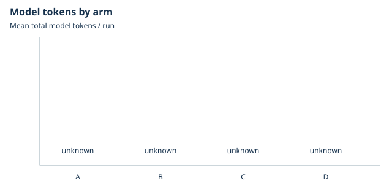
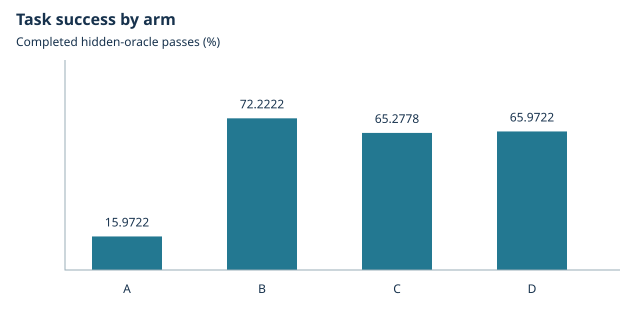
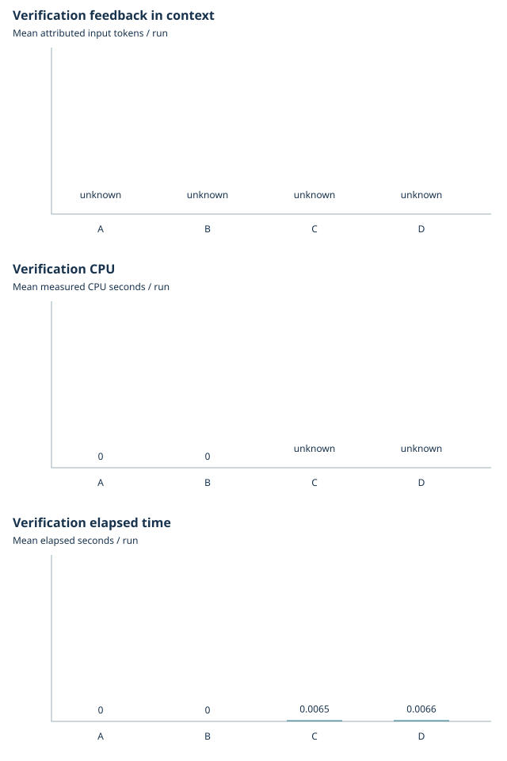
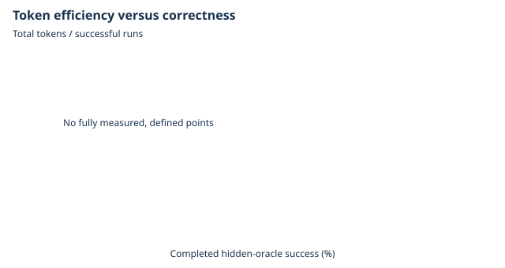
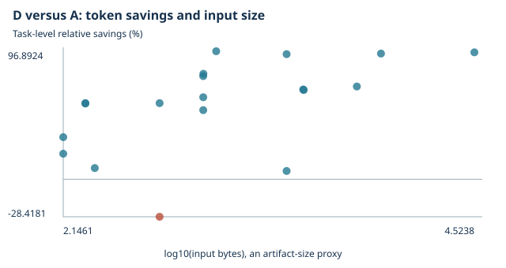
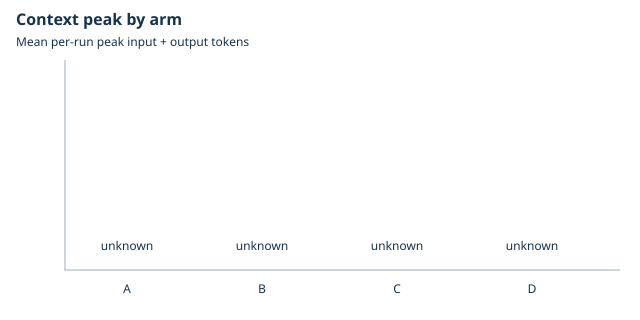
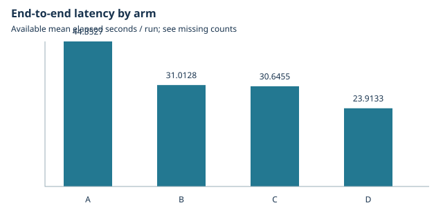

# Verified CLI Delegation Benchmark

**EXPLORATORY OBSERVATIONAL REPORT — NOT CONFIRMATORY**

## 1. Research question and hypotheses

When does CLI delegation with compact verification feedback reduce model tokens without reducing correctness? H1 tests efficiency and correctness separately. H2 tests size dependence and in-range crossover. H3 isolates raw verification and compression effects. H4 examines invocation-complexity limitations independently. No treatment advantage is assumed.

## 2. Experimental methodology

All supplied runs, including failures and incomplete runs, remain in arm summaries. Paired effects weight each task instance equally, retaining paired repetitions within task clusters. Main and pilot experiments are not inferred from the presence of data. The protocol and margin remain unfrozen.

```json
{
  "analysis_config": {
    "allow_synthetic": false,
    "bootstrap_samples": 2000,
    "bootstrap_seed": 2026,
    "expected_repetitions": 3,
    "expected_tasks": 48,
    "margin_justification": "At most one additional failure per 20 runs (5 percentage points) in a non-safety-critical transformation workflow. Frozen before the main run.",
    "minimum_clusters": 48,
    "non_inferiority_margin": 0.05
  },
  "decoding": {
    "max_output_tokens": 8192,
    "reasoning_effort": "none"
  },
  "expected_records": 576,
  "matrix_complete": true,
  "missing_cells": [],
  "model": "gpt-6-luna",
  "protocol_violation_runs": 0,
  "records": 576,
  "unidentified_missing_tasks": 0
}
```

## 3. Dataset description

Inputs and requirements are validated against run manifests. Input byte count is an artifact-size proxy, not final-output size. Expected error tasks are retained; the boundary model controls for expected failure when identifiable. Detailed family, size, complexity and outcome strata are in summary.json.

| Family / arm | Runs | Successes | Exact model tokens |
|---|---:|---:|---:|
| aggregation / A | 36 | 9 | n/a |
| aggregation / B | 36 | 22 | n/a |
| aggregation / C | 36 | 19 | n/a |
| aggregation / D | 36 | 21 | n/a |
| filesystem / A | 36 | 4 | n/a |
| filesystem / B | 36 | 26 | n/a |
| filesystem / C | 36 | 24 | n/a |
| filesystem / D | 36 | 24 | n/a |
| sorting / A | 36 | 6 | n/a |
| sorting / B | 36 | 24 | n/a |
| sorting / C | 36 | 21 | n/a |
| sorting / D | 36 | 17 | n/a |
| text / A | 36 | 4 | n/a |
| text / B | 36 | 32 | n/a |
| text / C | 36 | 30 | n/a |
| text / D | 36 | 33 | 90309 |

## 4. Implementation architecture

Rust dataset generators, immutable originals, fresh Linux bubblewrap workspaces, single-process tool execution, independent feedback verification, bounded certificates, model adapters, host-only JSONL telemetry and a separate hidden oracle. Provider/tokenizer validation and protocol freeze remain prerequisites to a real study.

## 5. Token consumption by arm

Unknown usage is not zero; known totals are lower bounds whenever usage is incomplete.

| Arm | Runs | Exact tokens | Known tokens | Unknown-usage runs |
|---|---:|---:|---:|---:|
| A | 144 | n/a | 5034745 | 44 |
| B | 144 | n/a | 3052082 | 14 |
| C | 144 | n/a | 2532189 | 20 |
| D | 144 | n/a | 1357952 | 19 |



## 6. Success rates by arm

Success requires completion and a hidden-oracle pass. Unknown oracle outcomes and resource-limited incomplete runs do not count as successes. Raw oracle pass and completeness remain distinct in raw records.

| Arm | Successes / runs | Success rate | Incomplete runs | Unknown oracle |
|---|---:|---:|---:|---:|
| A | 23 / 144 | 0.1597 | 52 | 7 |
| B | 104 / 144 | 0.7222 | 21 | 3 |
| C | 94 / 144 | 0.6528 | 26 | 4 |
| D | 95 / 144 | 0.6597 | 21 | 9 |



## 7. Token efficiency and verification overhead

Efficiency is aggregate tokens across all runs divided by successful runs, never an average of per-run ratios. Zero successes or missing usage makes it undefined. Verification input tokens, CPU, wall time, memory and observed retries are separate costs; CPU is never converted to LLM tokens. See arm metrics in summary.json for measured/missing counts and attributed-input coverage.

| Arm | Tokens / success | Verifier input tokens | Verifier CPU seconds | Verifier elapsed seconds | Estimated monetary cost |
|---|---:|---:|---:|---:|---:|
| A | n/a | n/a | 0 | 0 | n/a |
| B | n/a | n/a | 0 | 0 | n/a |
| C | n/a | n/a | n/a | 0.9333 | n/a |
| D | n/a | n/a | n/a | 0.9529 | n/a |

Recorded pricing assumptions (null means unavailable):

```json
null
```





## 8. Token savings against artifact size

Paired relative savings are 1 − treatment/reference; positive values mean fewer treatment tokens. The chart uses ratios of task-level mean tokens, whereas the paired relative-effect estimate averages paired ratios within each task. Zero reference tokens produce an undefined ratio. Negative savings are retained. The exploratory SVD fit uses log token ratio with size × family, complexity and expected-failure interactions when identifiable. No crossover is extrapolated beyond its measured stratum.



```json
{
  "status": "not_estimable_incomplete_usage"
}
```

## 9. Context-usage comparison

Peak context is the largest reported input-plus-output call for each run. Complete artifacts are not injected into later model calls; arm A retains only chunk metadata. Input reads and raw feedback remain part of actual context. Missing usage prevents exact context-peak conclusions. Tool I/O volume, calls, attempts and retries are reported separately in summary.json.



## 10. Failure taxonomy and representative traces

Terminations count runs. Taxonomy counts encountered events, not mutually exclusive final failures; retries may recover. Verifier-reported semantic/format errors are marked as such, not treated as oracle truth. Unknown classifications remain unknown, including unclassified execution failures. Trace collection enriches summary-only data; absent trace coverage is not evidence that no errors occurred.

```json
{
  "failed_run_examples": {
    "adapter_error": [
      {
        "arm": "D",
        "oracle_error": null,
        "oracle_pass": false,
        "run_id": "1794872384099033243-809448",
        "task_id": "aggregation-v3-s1",
        "termination": "adapter_error"
      },
      {
        "arm": "A",
        "oracle_error": null,
        "oracle_pass": false,
        "run_id": "1794872484362192892-809448",
        "task_id": "sorting-v0-s2",
        "termination": "adapter_error"
      },
      {
        "arm": "A",
        "oracle_error": null,
        "oracle_pass": false,
        "run_id": "1794872703206591048-809448",
        "task_id": "text-v2-s2",
        "termination": "adapter_error"
      }
    ],
    "call_limit": [
      {
        "arm": "B",
        "oracle_error": null,
        "oracle_pass": false,
        "run_id": "1794874559996969588-867084",
        "task_id": "sorting-v2-s1",
        "termination": "call_limit"
      },
      {
        "arm": "A",
        "oracle_error": null,
        "oracle_pass": false,
        "run_id": "1794874799593944902-867084",
        "task_id": "filesystem-v2-s0",
        "termination": "call_limit"
      },
      {
        "arm": "C",
        "oracle_error": null,
        "oracle_pass": false,
        "run_id": "1794877654826593336-867084",
        "task_id": "sorting-v3-s1",
        "termination": "call_limit"
      }
    ],
    "finished": [
      {
        "arm": "B",
        "oracle_error": null,
        "oracle_pass": false,
        "run_id": "1794872475052449515-809448",
        "task_id": "filesystem-v3-s0",
        "termination": "finished"
      },
      {
        "arm": "A",
        "oracle_error": null,
        "oracle_pass": false,
        "run_id": "1794872572159323850-809448",
        "task_id": "text-v2-s0",
        "termination": "finished"
      },
      {
        "arm": "C",
        "oracle_error": null,
        "oracle_pass": false,
        "run_id": "1794872599686890975-809448",
        "task_id": "sorting-v1-s0",
        "termination": "finished"
      }
    ],
    "resource_limit": [
      {
        "arm": "C",
        "oracle_error": null,
        "oracle_pass": false,
        "run_id": "1794873926297359863-867085",
        "task_id": "aggregation-v1-s2",
        "termination": "resource_limit"
      },
      {
        "arm": "B",
        "oracle_error": null,
        "oracle_pass": false,
        "run_id": "1794874246797958102-867085",
        "task_id": "aggregation-v2-s1",
        "termination": "resource_limit"
      },
      {
        "arm": "A",
        "oracle_error": null,
        "oracle_pass": false,
        "run_id": "1794874554128406730-867085",
        "task_id": "sorting-v0-s1",
        "termination": "resource_limit"
      }
    ]
  },
  "failure_taxonomy": {
    "adapter_transport_failure": {
      "events": 81,
      "examples": [
        {
          "arm": "D",
          "event": {
            "category": "adapter_transport_failure",
            "detail": "{\"error\":\"adapter failed, timed out, or exceeded response budget; usage unknown\",\"raw_adapter_response_bounded\":\"{\\\"error\\\":\\\"curl failed: exit status: 28 curl: (3) URL rejected: Malformed input to a URL function\\\\ncurl: (28) Operation timed out after 85002 milliseconds with 1159912 bytes received\\\"}\\n\",\"stdout_bytes\":184,\"truncated\":false}",
            "line": 7
          },
          "run_id": "1794872384099033243-809448",
          "task_id": "aggregation-v3-s1",
          "trace": "main/runs/0000-aggregation-v3-s1-D-r0/trace.jsonl"
        },
        {
          "arm": "A",
          "event": {
            "category": "adapter_transport_failure",
            "detail": "{\"error\":\"adapter failed, timed out, or exceeded response budget; usage unknown\",\"raw_adapter_response_bounded\":\"{\\\"error\\\":\\\"curl failed: exit status: 28 curl: (3) URL rejected: Malformed input to a URL function\\\\ncurl: (28) Operation timed out after 85000 milliseconds with 1234758 bytes received\\\"}\\n\",\"stdout_bytes\":184,\"truncated\":false}",
            "line": 6
          },
          "run_id": "1794872484362192892-809448",
          "task_id": "sorting-v0-s2",
          "trace": "main/runs/0002-sorting-v0-s2-A-r1/trace.jsonl"
        },
        {
          "arm": "A",
          "event": {
            "category": "adapter_transport_failure",
            "detail": "{\"error\":\"adapter failed, timed out, or exceeded response budget; usage unknown\",\"raw_adapter_response_bounded\":\"{\\\"error\\\":\\\"curl failed: exit status: 28 curl: (3) URL rejected: Malformed input to a URL function\\\\ncurl: (28) Operation timed out after 85000 milliseconds with 1231244 bytes received\\\"}\\n\",\"stdout_bytes\":184,\"truncated\":false}",
            "line": 30
          },
          "run_id": "1794872703206591048-809448",
          "task_id": "text-v2-s2",
          "trace": "main/runs/0011-text-v2-s2-A-r1/trace.jsonl"
        }
      ],
      "known_events": 81,
      "unit": "encountered_events_not_mutually_exclusive_final_run_failures"
    },
    "argument_construction_failure": {
      "events": 5,
      "examples": [
        {
          "arm": "B",
          "event": {
            "category": "argument_construction_failure",
            "detail": "invalid command batch",
            "line": 64
          },
          "run_id": "1794873938855186228-867084",
          "task_id": "sorting-v3-s2",
          "trace": "main-1/runs/0006-sorting-v3-s2-B-r1/trace.jsonl"
        },
        {
          "arm": "B",
          "event": {
            "category": "argument_construction_failure",
            "detail": "invalid command batch",
            "line": 218
          },
          "run_id": "1794874559996969588-867084",
          "task_id": "sorting-v2-s1",
          "trace": "main-1/runs/0025-sorting-v2-s1-B-r2/trace.jsonl"
        },
        {
          "arm": "B",
          "event": {
            "category": "argument_construction_failure",
            "detail": "invalid command batch",
            "line": 111
          },
          "run_id": "1794875301964250541-867084",
          "task_id": "aggregation-v0-s1",
          "trace": "main-1/runs/0049-aggregation-v0-s1-B-r2/trace.jsonl"
        }
      ],
      "known_events": 5,
      "unit": "encountered_events_not_mutually_exclusive_final_run_failures"
    },
    "incorrect_transformation_semantics": {
      "events": 8,
      "examples": [
        {
          "arm": "C",
          "event": {
            "category": "incorrect_transformation_semantics",
            "detail": "PRESERVATION_ERROR",
            "line": 21,
            "reported_by_verifier_not_oracle": true
          },
          "run_id": "1794873801051030633-867084",
          "task_id": "filesystem-v1-s0",
          "trace": "main-1/runs/0002-filesystem-v1-s0-C-r0/trace.jsonl"
        },
        {
          "arm": "C",
          "event": {
            "category": "incorrect_transformation_semantics",
            "detail": "CONTENT_ERROR",
            "line": 16,
            "reported_by_verifier_not_oracle": true
          },
          "run_id": "1794875430275013970-867085",
          "task_id": "aggregation-v1-s1",
          "trace": "main-2/runs/0040-aggregation-v1-s1-C-r0/trace.jsonl"
        },
        {
          "arm": "C",
          "event": {
            "category": "incorrect_transformation_semantics",
            "detail": "CONTENT_ERROR",
            "line": 69,
            "reported_by_verifier_not_oracle": true
          },
          "run_id": "1794875430275013970-867085",
          "task_id": "aggregation-v1-s1",
          "trace": "main-2/runs/0040-aggregation-v1-s1-C-r0/trace.jsonl"
        }
      ],
      "known_events": 8,
      "unit": "encountered_events_not_mutually_exclusive_final_run_failures"
    },
    "model_context_or_output_limit_failure": {
      "events": 8,
      "examples": [
        {
          "arm": "B",
          "event": {
            "category": "model_context_or_output_limit_failure",
            "detail": "call_limit"
          },
          "run_id": "1794874559996969588-867084",
          "task_id": "sorting-v2-s1",
          "trace": "main-1/runs/0025-sorting-v2-s1-B-r2/trace.jsonl"
        },
        {
          "arm": "A",
          "event": {
            "category": "model_context_or_output_limit_failure",
            "detail": "call_limit"
          },
          "run_id": "1794874799593944902-867084",
          "task_id": "filesystem-v2-s0",
          "trace": "main-1/runs/0029-filesystem-v2-s0-A-r1/trace.jsonl"
        },
        {
          "arm": "C",
          "event": {
            "category": "model_context_or_output_limit_failure",
            "detail": "call_limit"
          },
          "run_id": "1794877654826593336-867084",
          "task_id": "sorting-v3-s1",
          "trace": "main-1/runs/0110-sorting-v3-s1-C-r1/trace.jsonl"
        }
      ],
      "known_events": 8,
      "unit": "encountered_events_not_mutually_exclusive_final_run_failures"
    },
    "permission_or_safety_rejection": {
      "events": 0,
      "examples": [],
      "known_events": 0,
      "unit": "encountered_events_not_mutually_exclusive_final_run_failures"
    },
    "provider_content_rejection": {
      "events": 16,
      "examples": [
        {
          "arm": "A",
          "event": {
            "category": "provider_content_rejection",
            "detail": "{\"error\":\"adapter failed, timed out, or exceeded response budget; usage unknown\",\"raw_adapter_response_bounded\":\"{\\\"error\\\":\\\"provider reported failure: {\\\\\\\"code\\\\\\\":\\\\\\\"invalid_prompt\\\\\\\",\\\\\\\"message\\\\\\\":\\\\\\\"Invalid prompt: your prompt was flagged as potentially violating our usage policy. Please try again with a different prompt: https://platform.openai.com/docs/guides/reasoning#advice-on-prompting\\\\\\\",\\\\\\\"param\\\\\\\":null,\\\\\\\"type\\\\\\\":\\\\\\\"invalid_request_error\\\\\\\"}\\\"}\\n\",\"stdout_bytes\":330,\"tr",
            "line": 10
          },
          "run_id": "1794873733624155816-809448",
          "task_id": "sorting-v1-s1",
          "trace": "main/runs/0051-sorting-v1-s1-A-r2/trace.jsonl"
        },
        {
          "arm": "A",
          "event": {
            "category": "provider_content_rejection",
            "detail": "{\"error\":\"adapter failed, timed out, or exceeded response budget; usage unknown\",\"raw_adapter_response_bounded\":\"{\\\"error\\\":\\\"provider reported failure: {\\\\\\\"code\\\\\\\":\\\\\\\"invalid_prompt\\\\\\\",\\\\\\\"message\\\\\\\":\\\\\\\"Invalid prompt: your prompt was flagged as potentially violating our usage policy. Please try again with a different prompt: https://platform.openai.com/docs/guides/reasoning#advice-on-prompting\\\\\\\",\\\\\\\"param\\\\\\\":null,\\\\\\\"type\\\\\\\":\\\\\\\"invalid_request_error\\\\\\\"}\\\"}\\n\",\"stdout_bytes\":330,\"tr",
            "line": 10
          },
          "run_id": "1794876134025133801-867084",
          "task_id": "filesystem-v2-s2",
          "trace": "main-1/runs/0068-filesystem-v2-s2-A-r0/trace.jsonl"
        },
        {
          "arm": "D",
          "event": {
            "category": "provider_content_rejection",
            "detail": "{\"error\":\"adapter failed, timed out, or exceeded response budget; usage unknown\",\"raw_adapter_response_bounded\":\"{\\\"error\\\":\\\"provider reported failure: {\\\\\\\"code\\\\\\\":\\\\\\\"invalid_prompt\\\\\\\",\\\\\\\"message\\\\\\\":\\\\\\\"Invalid prompt: your prompt was flagged as potentially violating our usage policy. Please try again with a different prompt: https://platform.openai.com/docs/guides/reasoning#advice-on-prompting\\\\\\\",\\\\\\\"param\\\\\\\":null,\\\\\\\"type\\\\\\\":\\\\\\\"invalid_request_error\\\\\\\"}\\\"}\\n\",\"stdout_bytes\":330,\"tr",
            "line": 3
          },
          "run_id": "1794876387590629858-867084",
          "task_id": "sorting-v1-s1",
          "trace": "main-1/runs/0075-sorting-v1-s1-D-r2/trace.jsonl"
        }
      ],
      "known_events": 16,
      "unit": "encountered_events_not_mutually_exclusive_final_run_failures"
    },
    "resource_limit_failure": {
      "events": 28,
      "examples": [
        {
          "arm": "D",
          "event": {
            "category": "resource_limit_failure",
            "detail": "retry budget exhausted",
            "line": 18
          },
          "run_id": "1794872942366952414-809448",
          "task_id": "filesystem-v3-s0",
          "trace": "main/runs/0022-filesystem-v3-s0-D-r1/trace.jsonl"
        },
        {
          "arm": "D",
          "event": {
            "category": "resource_limit_failure",
            "detail": "retry budget exhausted",
            "line": 18
          },
          "run_id": "1794874683183741612-867084",
          "task_id": "filesystem-v3-s2",
          "trace": "main-1/runs/0026-filesystem-v3-s2-D-r1/trace.jsonl"
        },
        {
          "arm": "B",
          "event": {
            "category": "resource_limit_failure",
            "detail": "retry budget exhausted",
            "line": 181
          },
          "run_id": "1794875301964250541-867084",
          "task_id": "aggregation-v0-s1",
          "trace": "main-1/runs/0049-aggregation-v0-s1-B-r2/trace.jsonl"
        }
      ],
      "known_events": 28,
      "unit": "encountered_events_not_mutually_exclusive_final_run_failures"
    },
    "syntax_or_parsing_failure": {
      "events": 1930,
      "examples": [
        {
          "arm": "D",
          "event": {
            "category": "syntax_or_parsing_failure",
            "detail": "trailing characters at line 1 column 60",
            "line": 4
          },
          "run_id": "1794872384099033243-809448",
          "task_id": "aggregation-v3-s1",
          "trace": "main/runs/0000-aggregation-v3-s1-D-r0/trace.jsonl"
        },
        {
          "arm": "B",
          "event": {
            "category": "syntax_or_parsing_failure",
            "detail": "trailing characters at line 2 column 1",
            "line": 4
          },
          "run_id": "1794872475052449515-809448",
          "task_id": "filesystem-v3-s0",
          "trace": "main/runs/0001-filesystem-v3-s0-B-r1/trace.jsonl"
        },
        {
          "arm": "A",
          "event": {
            "category": "syntax_or_parsing_failure",
            "detail": "trailing characters at line 1 column 62",
            "line": 4
          },
          "run_id": "1794872572159323850-809448",
          "task_id": "text-v2-s0",
          "trace": "main/runs/0003-text-v2-s0-A-r0/trace.jsonl"
        }
      ],
      "known_events": 1930,
      "unit": "encountered_events_not_mutually_exclusive_final_run_failures"
    },
    "tool_selection_failure": {
      "events": 0,
      "examples": [],
      "known_events": 0,
      "unit": "encountered_events_not_mutually_exclusive_final_run_failures"
    },
    "unclassified_action_failure": {
      "events": 15,
      "examples": [
        {
          "arm": "D",
          "event": {
            "category": "unclassified_action_failure",
            "detail": "Is a directory (os error 21)",
            "line": 8
          },
          "run_id": "1794874550071554712-867084",
          "task_id": "text-v3-s2",
          "trace": "main-1/runs/0024-text-v3-s2-D-r0/trace.jsonl"
        },
        {
          "arm": "A",
          "event": {
            "category": "unclassified_action_failure",
            "detail": "No such file or directory (os error 2)",
            "line": 143
          },
          "run_id": "1794874799593944902-867084",
          "task_id": "filesystem-v2-s0",
          "trace": "main-1/runs/0029-filesystem-v2-s0-A-r1/trace.jsonl"
        },
        {
          "arm": "A",
          "event": {
            "category": "unclassified_action_failure",
            "detail": "No such file or directory (os error 2)",
            "line": 156
          },
          "run_id": "1794874799593944902-867084",
          "task_id": "filesystem-v2-s0",
          "trace": "main-1/runs/0029-filesystem-v2-s0-A-r1/trace.jsonl"
        }
      ],
      "known_events": 15,
      "unit": "encountered_events_not_mutually_exclusive_final_run_failures"
    },
    "unclassified_execution_failure": {
      "events": 37,
      "examples": [
        {
          "arm": "B",
          "event": {
            "category": "unclassified_execution_failure",
            "detail": "Traceback (most recent call last):\n  File \"<string>\", line 1, in <module>\n    import csv,json; f=open('input.csv',newline='',encoding='utf-8'); rows=csv.DictReader(f); n=sum(1 for r in rows if r['group']=='A' and r['active']=='true' and int(r['value'])>50); open('output.json','w',encoding='utf-8').write(json.dumps({'count':n}))\n                                                                                                ~~~^^^^^^^^^^^^^^^^^^^^^^^^^^^^^^^^^^^^^^^^^^^^^^^^^^^^^^^^^^^^^^^^^^^^^^^",
            "tool_log": "tool-1.json"
          },
          "run_id": "1794872834369865555-809448",
          "task_id": "aggregation-v0-s0",
          "trace": "main/runs/0014-aggregation-v0-s0-B-r1/trace.jsonl"
        },
        {
          "arm": "D",
          "event": {
            "category": "unclassified_execution_failure",
            "detail": "Traceback (most recent call last):\n  File \"<string>\", line 1, in <module>\n    import os,pathlib; p=pathlib.Path('work'); assert os.path.lexists(p/'occupied.txt'); assert not os.path.lexists(p/'result.json'); (p/'result.json').write_bytes(b'{\"error\":\"COLLISION\"}')\n                                                                                                ^^^^^^^^^^^^^^^^^^^^^^^^^^^^^^^^^^^^\nAssertionError\n",
            "tool_log": "tool-2.json"
          },
          "run_id": "1794872942366952414-809448",
          "task_id": "filesystem-v3-s0",
          "trace": "main/runs/0022-filesystem-v3-s0-D-r1/trace.jsonl"
        },
        {
          "arm": "D",
          "event": {
            "category": "unclassified_execution_failure",
            "detail": "Traceback (most recent call last):\n  File \"<string>\", line 12, in <module>\n    sorted_rows=sorted(rows[1:],key=key)\n  File \"<string>\", line 10, in key\n    secondary=int(row[1])\nValueError: invalid literal for int() with base 10: ''\n",
            "tool_log": "tool-1.json"
          },
          "run_id": "1794873481434310115-809448",
          "task_id": "sorting-v2-s0",
          "trace": "main/runs/0037-sorting-v2-s0-D-r0/trace.jsonl"
        }
      ],
      "known_events": 37,
      "unit": "encountered_events_not_mutually_exclusive_final_run_failures"
    },
    "unclassified_verifier_failure": {
      "events": 18,
      "examples": [
        {
          "arm": "C",
          "event": {
            "category": "unclassified_verifier_failure",
            "detail": "VERIFIER_ERROR",
            "line": 52,
            "reported_by_verifier_not_oracle": true
          },
          "run_id": "1794873224837605660-809448",
          "task_id": "sorting-v3-s0",
          "trace": "main/runs/0031-sorting-v3-s0-C-r0/trace.jsonl"
        },
        {
          "arm": "C",
          "event": {
            "category": "unclassified_verifier_failure",
            "detail": "VERIFIER_ERROR",
            "line": 77,
            "reported_by_verifier_not_oracle": true
          },
          "run_id": "1794873224837605660-809448",
          "task_id": "sorting-v3-s0",
          "trace": "main/runs/0031-sorting-v3-s0-C-r0/trace.jsonl"
        },
        {
          "arm": "C",
          "event": {
            "category": "unclassified_verifier_failure",
            "detail": "VERIFIER_ERROR",
            "line": 12,
            "reported_by_verifier_not_oracle": true
          },
          "run_id": "1794873353516192380-809448",
          "task_id": "sorting-v0-s0",
          "trace": "main/runs/0032-sorting-v0-s0-C-r1/trace.jsonl"
        }
      ],
      "known_events": 18,
      "unit": "encountered_events_not_mutually_exclusive_final_run_failures"
    },
    "verifier_false_negative": {
      "evaluated_runs": 231,
      "events": 0,
      "unit": "evaluable_final_verifier_oracle_runs"
    },
    "verifier_false_positive": {
      "evaluated_runs": 231,
      "events": 0,
      "unit": "evaluable_final_verifier_oracle_runs"
    }
  },
  "terminations": {
    "adapter_error": 97,
    "call_limit": 8,
    "finished": 456,
    "resource_limit": 15
  },
  "trace_classified_runs": 576,
  "verifier_disagreement": {
    "evaluated_runs": 231,
    "false_negative": 0,
    "false_negative_rate": 0.0,
    "false_positive": 0,
    "false_positive_rate": 0.0,
    "oracle_negative_runs": 42,
    "oracle_positive_runs": 189,
    "tool_arm_runs_without_evaluable_final_pair": 57
  }
}
```

## 11. Statistical uncertainty

All intervals are exploratory. Percentile bootstrap resamples task instances with replacement and preserves all matched repetitions in each selected cluster; repeated runs are not independent samples. Paired differences are treatment minus reference. Non-inferiority uses a one-sided 95% lower bound and is separate from a two-sided 95% token interval. Too few clusters, missing matrix cells, protocol violations or unknown usage prevent the corresponding support claim. Secondary comparisons are not multiplicity-adjusted and are not confirmatory.

A degenerate bootstrap is not proof of zero failure risk. For all-nonnegative or constant observed task success differences, the success lower bound is also capped by m·0.05^(1/n) − (1−0.05^(1/n)), where m is the minimum observed cluster difference and n is the task count. This conservative unseen-task risk guard shares the task-sampling assumptions; it is not a guarantee outside this dataset. In particular, 48 perfect ties do not establish a five-point margin under this guard.

| Treatment − reference | Task clusters | Mean token difference | Token CI95 | Mean success difference | NI lower bound |
|---|---:|---:|---|---:|---:|
| D − A | 48 | n/a | null | 0.5000 | 0.3889 |
| B − A | 48 | n/a | null | 0.5625 | 0.4514 |
| C − B | 48 | n/a | null | -0.0694 | -0.1389 |
| D − C | 48 | n/a | null | 0.0069 | -0.0764 |
| D − B | 48 | n/a | null | -0.0625 | -0.1319 |

## 12. Threats to validity

- Protocol and margin are not frozen: all inference is exploratory.
- Bootstrap resamples task instances, retaining all paired repetitions within each cluster; repeated runs are not independent dataset instances.
- Equal task weighting is used for paired effects; arm summaries include every supplied run, including failures and incomplete runs.
- Missing usage suppresses exact token comparisons and efficiency. Reported known totals are lower bounds, not imputed zeros.
- Non-inferiority is separate from token reduction; no-worse-observed clusters use a conservative zero-event risk guard.
- Related semantic variants at multiple sizes may remain correlated across task clusters; interpret task-instance bootstrap uncertainty conditionally.
- Input bytes are an artifact-size proxy, not measured final-output bytes.
- Summary-only data cannot distinguish every tool-selection, argument, parsing or permission error. Consult host traces; do not infer absent errors from unclassified counts.
- Synthetic cohorts are fixture validation only and cannot support scientific conclusions.
- The size model includes failed and incomplete paired runs. It estimates token cost, not correctness-adjusted efficiency; per-task success rates accompany its points.

## 13. Boundary conditions and negative findings

These observations do not discard negative results. Point estimates are not declarations of statistical significance. Synthetic observations validate report logic only.

- C versus B: success decreased at the point estimate. Token savings do not compensate for correctness loss.
- D versus B: success decreased at the point estimate. Token savings do not compensate for correctness loss.
- Incomplete usage prevents exact token-efficiency and paired-token conclusions for affected comparisons.



## 14. Conclusions and reproducibility

Token reduction alone is insufficient to establish an overall improvement. Hypotheses are evaluated independently; the report can show no advantage or no established non-inferiority. Synthetic fixtures support none of the scientific hypotheses.

```json
{
  "H1": "token_reduction_not_established",
  "H2": {
    "boundary_status": "not_estimable_incomplete_usage",
    "status": "exploratory_size_interactions_only",
    "warning": "Size trends and crossovers are stratum-specific; no universal advantage or out-of-range crossover is asserted."
  },
  "H3": {
    "compression_delta": {
      "ci95": null,
      "estimate": null,
      "reason": "incomplete_usage; known lower bounds not substituted for totals"
    },
    "compression_reduces_tokens": false,
    "raw_verification_delta": {
      "ci95": null,
      "estimate": null,
      "reason": "incomplete_usage; known lower bounds not substituted for totals"
    },
    "raw_verification_increases_tokens": false,
    "status": "exploratory_only",
    "verification_input_attribution_complete": false,
    "warning": "Execution CPU and latency are not LLM tokens. Attribution, runtime, resources and observed retries are separate quantities; compression is not assumed beneficial."
  },
  "H4": {
    "invocation_measured_runs": 432,
    "invocation_relationships": {
      "log_argument_bytes_vs_D_A_token_savings": {
        "ci95": [
          -0.5835230662895432,
          0.27872984433995074
        ],
        "estimate": -0.23241340424528908,
        "inference_eligible": false,
        "status": "observational_correlation_not_causation",
        "task_clusters": 19,
        "valid_bootstraps": 2000
      },
      "log_argument_bytes_vs_interface_errors": {
        "ci95": [
          0.13069313665494137,
          0.38720071410176476
        ],
        "estimate": 0.22836704667780852,
        "inference_eligible": true,
        "status": "observational_correlation_not_causation",
        "task_clusters": 48,
        "valid_bootstraps": 2000
      },
      "log_argument_bytes_vs_success": {
        "ci95": [
          -0.030623201067622865,
          0.43656477377126285
        ],
        "estimate": 0.24439485566716396,
        "inference_eligible": true,
        "status": "observational_correlation_not_causation",
        "task_clusters": 48,
        "valid_bootstraps": 2000
      },
      "observed_tool_task_arm_groups": 144,
      "paired_D_A_points": [
        {
          "arm": "D",
          "family": "aggregation",
          "mean_argument_bytes": 390.0,
          "mean_interface_errors": 1.0,
          "mean_tool_requests": 1.3333333333333333,
          "relative_token_savings_D_A": 0.31845487035206455,
          "semantic_complexity": "simple",
          "success_rate": 0.6666666666666666,
          "task_id": "aggregation-v0-s0"
        },
        {
          "arm": "D",
          "family": "aggregation",
          "mean_argument_bytes": 383.6666666666667,
          "mean_interface_errors": 0.0,
          "mean_tool_requests": 1.0,
          "relative_token_savings_D_A": 0.19309181578175416,
          "semantic_complexity": "multi-step",
          "success_rate": 1.0,
          "task_id": "aggregation-v1-s0"
        },
        {
          "arm": "D",
          "family": "aggregation",
          "mean_argument_bytes": 566.0,
          "mean_interface_errors": 0.3333333333333333,
          "mean_tool_requests": 1.3333333333333333,
          "relative_token_savings_D_A": 0.9469038840846585,
          "semantic_complexity": "multi-step",
          "success_rate": 0.6666666666666666,
          "task_id": "aggregation-v1-s1"
        },
        {
          "arm": "D",
          "family": "aggregation",
          "mean_argument_bytes": 472.0,
          "mean_interface_errors": 0.0,
          "mean_tool_requests": 1.0,
          "relative_token_savings_D_A": 0.0624335005319957,
          "semantic_complexity": "multi-step",
          "success_rate": 1.0,
          "task_id": "aggregation-v2-s1"
        },
        {
          "arm": "D",
          "family": "aggregation",
          "mean_argument_bytes": 376.3333333333333,
          "mean_interface_errors": 0.0,
          "mean_tool_requests": 1.0,
          "relative_token_savings_D_A": 0.7020411059341075,
          "semantic_complexity": "multi-step",
          "success_rate": 1.0,
          "task_id": "aggregation-v3-s2"
        },
        {
          "arm": "D",
          "family": "filesystem",
          "mean_argument_bytes": 189.33333333333334,
          "mean_interface_errors": 0.0,
          "mean_tool_requests": 1.0,
          "relative_token_savings_D_A": 0.5760848846813648,
          "semantic_complexity": "simple",
          "success_rate": 1.0,
          "task_id": "filesystem-v0-s0"
        },
        {
          "arm": "D",
          "family": "filesystem",
          "mean_argument_bytes": 229.33333333333334,
          "mean_interface_errors": 0.0,
          "mean_tool_requests": 1.0,
          "relative_token_savings_D_A": 0.6794422106253744,
          "semantic_complexity": "simple",
          "success_rate": 1.0,
          "task_id": "filesystem-v0-s1"
        },
        {
          "arm": "D",
          "family": "filesystem",
          "mean_argument_bytes": 403.3333333333333,
          "mean_interface_errors": 0.0,
          "mean_tool_requests": 1.0,
          "relative_token_savings_D_A": 0.572988068037573,
          "semantic_complexity": "multi-step",
          "success_rate": 1.0,
          "task_id": "filesystem-v1-s0"
        },
        {
          "arm": "D",
          "family": "filesystem",
          "mean_argument_bytes": 401.0,
          "mean_interface_errors": 0.0,
          "mean_tool_requests": 1.3333333333333333,
          "relative_token_savings_D_A": 0.9689241519691196,
          "semantic_complexity": "multi-step",
          "success_rate": 0.3333333333333333,
          "task_id": "filesystem-v2-s0"
        },
        {
          "arm": "D",
          "family": "filesystem",
          "mean_argument_bytes": 523.0,
          "mean_interface_errors": 1.0,
          "mean_tool_requests": 2.0,
          "relative_token_savings_D_A": 0.08449396471680592,
          "semantic_complexity": "simple",
          "success_rate": 0.0,
          "task_id": "filesystem-v3-s0"
        },
        {
          "arm": "D",
          "family": "filesystem",
          "mean_argument_bytes": 590.6666666666666,
          "mean_interface_errors": 0.6666666666666666,
          "mean_tool_requests": 2.0,
          "relative_token_savings_D_A": 0.6754455074094916,
          "semantic_complexity": "simple",
          "success_rate": 0.0,
          "task_id": "filesystem-v3-s1"
        },
        {
          "arm": "D",
          "family": "sorting",
          "mean_argument_bytes": 383.3333333333333,
          "mean_interface_errors": 0.0,
          "mean_tool_requests": 1.0,
          "relative_token_savings_D_A": 0.9512586811297044,
          "semantic_complexity": "simple",
          "success_rate": 1.0,
          "task_id": "sorting-v0-s1"
        },
        {
          "arm": "D",
          "family": "sorting",
          "mean_argument_bytes": 376.3333333333333,
          "mean_interface_errors": 0.0,
          "mean_tool_requests": 1.0,
          "relative_token_savings_D_A": 0.5759004337167641,
          "semantic_complexity": "simple",
          "success_rate": 1.0,
          "task_id": "sorting-v1-s0"
        },
        {
          "arm": "D",
          "family": "sorting",
          "mean_argument_bytes": 745.3333333333334,
          "mean_interface_errors": 1.3333333333333333,
          "mean_tool_requests": 2.0,
          "relative_token_savings_D_A": -0.2841812075038912,
          "semantic_complexity": "multi-step",
          "success_rate": 0.0,
          "task_id": "sorting-v2-s0"
        },
        {
          "arm": "D",
          "family": "sorting",
          "mean_argument_bytes": 520.3333333333334,
          "mean_interface_errors": 0.0,
          "mean_tool_requests": 1.0,
          "relative_token_savings_D_A": 0.9606037758274247,
          "semantic_complexity": "multi-step",
          "success_rate": 0.6666666666666666,
          "task_id": "sorting-v3-s2"
        },
        {
          "arm": "D",
          "family": "text",
          "mean_argument_bytes": 137.33333333333334,
          "mean_interface_errors": 0.0,
          "mean_tool_requests": 1.0,
          "relative_token_savings_D_A": 0.6207028509471267,
          "semantic_complexity": "simple",
          "success_rate": 1.0,
          "task_id": "text-v0-s0"
        },
        {
          "arm": "D",
          "family": "text",
          "mean_argument_bytes": 211.66666666666666,
          "mean_interface_errors": 0.0,
          "mean_tool_requests": 1.0,
          "relative_token_savings_D_A": 0.5229830803863191,
          "semantic_complexity": "simple",
          "success_rate": 0.6666666666666666,
          "task_id": "text-v1-s0"
        },
        {
          "arm": "D",
          "family": "text",
          "mean_argument_bytes": 212.33333333333334,
          "mean_interface_errors": 0.0,
          "mean_tool_requests": 1.0,
          "relative_token_savings_D_A": 0.7805788356240921,
          "semantic_complexity": "multi-step",
          "success_rate": 1.0,
          "task_id": "text-v2-s0"
        },
        {
          "arm": "D",
          "family": "text",
          "mean_argument_bytes": 514.6666666666666,
          "mean_interface_errors": 0.0,
          "mean_tool_requests": 1.0,
          "relative_token_savings_D_A": 0.7983559566958046,
          "semantic_complexity": "multi-step",
          "success_rate": 1.0,
          "task_id": "text-v3-s0"
        }
      ],
      "status": "secondary_observational_only",
      "task_arm_points": [
        {
          "arm": "B",
          "family": "aggregation",
          "mean_argument_bytes": 467.0,
          "mean_interface_errors": 0.6666666666666666,
          "mean_tool_requests": 1.6666666666666667,
          "semantic_complexity": "simple",
          "success_rate": 1.0,
          "task_id": "aggregation-v0-s0"
        },
        {
          "arm": "C",
          "family": "aggregation",
          "mean_argument_bytes": 415.0,
          "mean_interface_errors": 0.6666666666666666,
          "mean_tool_requests": 1.6666666666666667,
          "semantic_complexity": "simple",
          "success_rate": 0.6666666666666666,
          "task_id": "aggregation-v0-s0"
        },
        {
          "arm": "D",
          "family": "aggregation",
          "mean_argument_bytes": 390.0,
          "mean_interface_errors": 1.0,
          "mean_tool_requests": 1.3333333333333333,
          "semantic_complexity": "simple",
          "success_rate": 0.6666666666666666,
          "task_id": "aggregation-v0-s0"
        },
        {
          "arm": "B",
          "family": "aggregation",
          "mean_argument_bytes": 142.66666666666666,
          "mean_interface_errors": 0.6666666666666666,
          "mean_tool_requests": 1.0,
          "semantic_complexity": "simple",
          "success_rate": 0.3333333333333333,
          "task_id": "aggregation-v0-s1"
        },
        {
          "arm": "C",
          "family": "aggregation",
          "mean_argument_bytes": 215.66666666666666,
          "mean_interface_errors": 0.3333333333333333,
          "mean_tool_requests": 0.6666666666666666,
          "semantic_complexity": "simple",
          "success_rate": 0.3333333333333333,
          "task_id": "aggregation-v0-s1"
        },
        {
          "arm": "D",
          "family": "aggregation",
          "mean_argument_bytes": 461.0,
          "mean_interface_errors": 1.3333333333333333,
          "mean_tool_requests": 1.6666666666666667,
          "semantic_complexity": "simple",
          "success_rate": 0.0,
          "task_id": "aggregation-v0-s1"
        },
        {
          "arm": "B",
          "family": "aggregation",
          "mean_argument_bytes": 270.6666666666667,
          "mean_interface_errors": 0.3333333333333333,
          "mean_tool_requests": 1.0,
          "semantic_complexity": "simple",
          "success_rate": 0.6666666666666666,
          "task_id": "aggregation-v0-s2"
        },
        {
          "arm": "C",
          "family": "aggregation",
          "mean_argument_bytes": 294.0,
          "mean_interface_errors": 1.0,
          "mean_tool_requests": 1.3333333333333333,
          "semantic_complexity": "simple",
          "success_rate": 0.0,
          "task_id": "aggregation-v0-s2"
        },
        {
          "arm": "D",
          "family": "aggregation",
          "mean_argument_bytes": 488.0,
          "mean_interface_errors": 2.0,
          "mean_tool_requests": 1.6666666666666667,
          "semantic_complexity": "simple",
          "success_rate": 0.3333333333333333,
          "task_id": "aggregation-v0-s2"
        },
        {
          "arm": "B",
          "family": "aggregation",
          "mean_argument_bytes": 369.0,
          "mean_interface_errors": 0.0,
          "mean_tool_requests": 1.0,
          "semantic_complexity": "multi-step",
          "success_rate": 1.0,
          "task_id": "aggregation-v1-s0"
        },
        {
          "arm": "C",
          "family": "aggregation",
          "mean_argument_bytes": 260.3333333333333,
          "mean_interface_errors": 0.0,
          "mean_tool_requests": 0.6666666666666666,
          "semantic_complexity": "multi-step",
          "success_rate": 0.6666666666666666,
          "task_id": "aggregation-v1-s0"
        },
        {
          "arm": "D",
          "family": "aggregation",
          "mean_argument_bytes": 383.6666666666667,
          "mean_interface_errors": 0.0,
          "mean_tool_requests": 1.0,
          "semantic_complexity": "multi-step",
          "success_rate": 1.0,
          "task_id": "aggregation-v1-s0"
        },
        {
          "arm": "B",
          "family": "aggregation",
          "mean_argument_bytes": 260.0,
          "mean_interface_errors": 0.0,
          "mean_tool_requests": 0.6666666666666666,
          "semantic_complexity": "multi-step",
          "success_rate": 0.3333333333333333,
          "task_id": "aggregation-v1-s1"
        },
        {
          "arm": "C",
          "family": "aggregation",
          "mean_argument_bytes": 513.6666666666666,
          "mean_interface_errors": 0.0,
          "mean_tool_requests": 1.6666666666666667,
          "semantic_complexity": "multi-step",
          "success_rate": 0.6666666666666666,
          "task_id": "aggregation-v1-s1"
        },
        {
          "arm": "D",
          "family": "aggregation",
          "mean_argument_bytes": 566.0,
          "mean_interface_errors": 0.3333333333333333,
          "mean_tool_requests": 1.3333333333333333,
          "semantic_complexity": "multi-step",
          "success_rate": 0.6666666666666666,
          "task_id": "aggregation-v1-s1"
        },
        {
          "arm": "B",
          "family": "aggregation",
          "mean_argument_bytes": 292.6666666666667,
          "mean_interface_errors": 0.0,
          "mean_tool_requests": 0.6666666666666666,
          "semantic_complexity": "multi-step",
          "success_rate": 0.3333333333333333,
          "task_id": "aggregation-v1-s2"
        },
        {
          "arm": "C",
          "family": "aggregation",
          "mean_argument_bytes": 141.33333333333334,
          "mean_interface_errors": 0.0,
          "mean_tool_requests": 0.3333333333333333,
          "semantic_complexity": "multi-step",
          "success_rate": 0.3333333333333333,
          "task_id": "aggregation-v1-s2"
        },
        {
          "arm": "D",
          "family": "aggregation",
          "mean_argument_bytes": 254.33333333333334,
          "mean_interface_errors": 0.0,
          "mean_tool_requests": 1.3333333333333333,
          "semantic_complexity": "multi-step",
          "success_rate": 0.3333333333333333,
          "task_id": "aggregation-v1-s2"
        },
        {
          "arm": "B",
          "family": "aggregation",
          "mean_argument_bytes": 136.33333333333334,
          "mean_interface_errors": 0.0,
          "mean_tool_requests": 0.6666666666666666,
          "semantic_complexity": "multi-step",
          "success_rate": 0.3333333333333333,
          "task_id": "aggregation-v2-s0"
        },
        {
          "arm": "C",
          "family": "aggregation",
          "mean_argument_bytes": 198.66666666666666,
          "mean_interface_errors": 0.0,
          "mean_tool_requests": 0.6666666666666666,
          "semantic_complexity": "multi-step",
          "success_rate": 0.3333333333333333,
          "task_id": "aggregation-v2-s0"
        },
        {
          "arm": "D",
          "family": "aggregation",
          "mean_argument_bytes": 150.33333333333334,
          "mean_interface_errors": 0.0,
          "mean_tool_requests": 0.3333333333333333,
          "semantic_complexity": "multi-step",
          "success_rate": 0.3333333333333333,
          "task_id": "aggregation-v2-s0"
        },
        {
          "arm": "B",
          "family": "aggregation",
          "mean_argument_bytes": 336.0,
          "mean_interface_errors": 0.0,
          "mean_tool_requests": 0.6666666666666666,
          "semantic_complexity": "multi-step",
          "success_rate": 0.6666666666666666,
          "task_id": "aggregation-v2-s1"
        },
        {
          "arm": "C",
          "family": "aggregation",
          "mean_argument_bytes": 139.66666666666666,
          "mean_interface_errors": 0.0,
          "mean_tool_requests": 0.3333333333333333,
          "semantic_complexity": "multi-step",
          "success_rate": 0.3333333333333333,
          "task_id": "aggregation-v2-s1"
        },
        {
          "arm": "D",
          "family": "aggregation",
          "mean_argument_bytes": 472.0,
          "mean_interface_errors": 0.0,
          "mean_tool_requests": 1.0,
          "semantic_complexity": "multi-step",
          "success_rate": 1.0,
          "task_id": "aggregation-v2-s1"
        },
        {
          "arm": "B",
          "family": "aggregation",
          "mean_argument_bytes": 291.0,
          "mean_interface_errors": 0.0,
          "mean_tool_requests": 0.6666666666666666,
          "semantic_complexity": "multi-step",
          "success_rate": 0.6666666666666666,
          "task_id": "aggregation-v2-s2"
        },
        {
          "arm": "C",
          "family": "aggregation",
          "mean_argument_bytes": 355.3333333333333,
          "mean_interface_errors": 0.0,
          "mean_tool_requests": 0.6666666666666666,
          "semantic_complexity": "multi-step",
          "success_rate": 0.6666666666666666,
          "task_id": "aggregation-v2-s2"
        },
        {
          "arm": "D",
          "family": "aggregation",
          "mean_argument_bytes": 172.33333333333334,
          "mean_interface_errors": 0.0,
          "mean_tool_requests": 0.3333333333333333,
          "semantic_complexity": "multi-step",
          "success_rate": 0.3333333333333333,
          "task_id": "aggregation-v2-s2"
        },
        {
          "arm": "B",
          "family": "aggregation",
          "mean_argument_bytes": 58.0,
          "mean_interface_errors": 0.0,
          "mean_tool_requests": 0.6666666666666666,
          "semantic_complexity": "multi-step",
          "success_rate": 0.6666666666666666,
          "task_id": "aggregation-v3-s0"
        },
        {
          "arm": "C",
          "family": "aggregation",
          "mean_argument_bytes": 337.0,
          "mean_interface_errors": 0.0,
          "mean_tool_requests": 0.6666666666666666,
          "semantic_complexity": "multi-step",
          "success_rate": 0.6666666666666666,
          "task_id": "aggregation-v3-s0"
        },
        {
          "arm": "D",
          "family": "aggregation",
          "mean_argument_bytes": 643.0,
          "mean_interface_errors": 0.0,
          "mean_tool_requests": 0.6666666666666666,
          "semantic_complexity": "multi-step",
          "success_rate": 0.6666666666666666,
          "task_id": "aggregation-v3-s0"
        },
        {
          "arm": "B",
          "family": "aggregation",
          "mean_argument_bytes": 370.6666666666667,
          "mean_interface_errors": 0.0,
          "mean_tool_requests": 1.0,
          "semantic_complexity": "multi-step",
          "success_rate": 1.0,
          "task_id": "aggregation-v3-s1"
        },
        {
          "arm": "C",
          "family": "aggregation",
          "mean_argument_bytes": 369.6666666666667,
          "mean_interface_errors": 0.0,
          "mean_tool_requests": 1.0,
          "semantic_complexity": "multi-step",
          "success_rate": 1.0,
          "task_id": "aggregation-v3-s1"
        },
        {
          "arm": "D",
          "family": "aggregation",
          "mean_argument_bytes": 244.66666666666666,
          "mean_interface_errors": 0.0,
          "mean_tool_requests": 0.6666666666666666,
          "semantic_complexity": "multi-step",
          "success_rate": 0.6666666666666666,
          "task_id": "aggregation-v3-s1"
        },
        {
          "arm": "B",
          "family": "aggregation",
          "mean_argument_bytes": 397.0,
          "mean_interface_errors": 0.3333333333333333,
          "mean_tool_requests": 1.0,
          "semantic_complexity": "multi-step",
          "success_rate": 0.3333333333333333,
          "task_id": "aggregation-v3-s2"
        },
        {
          "arm": "C",
          "family": "aggregation",
          "mean_argument_bytes": 502.0,
          "mean_interface_errors": 0.0,
          "mean_tool_requests": 1.3333333333333333,
          "semantic_complexity": "multi-step",
          "success_rate": 0.6666666666666666,
          "task_id": "aggregation-v3-s2"
        },
        {
          "arm": "D",
          "family": "aggregation",
          "mean_argument_bytes": 376.3333333333333,
          "mean_interface_errors": 0.0,
          "mean_tool_requests": 1.0,
          "semantic_complexity": "multi-step",
          "success_rate": 1.0,
          "task_id": "aggregation-v3-s2"
        },
        {
          "arm": "B",
          "family": "filesystem",
          "mean_argument_bytes": 229.0,
          "mean_interface_errors": 0.0,
          "mean_tool_requests": 1.0,
          "semantic_complexity": "simple",
          "success_rate": 1.0,
          "task_id": "filesystem-v0-s0"
        },
        {
          "arm": "C",
          "family": "filesystem",
          "mean_argument_bytes": 220.66666666666666,
          "mean_interface_errors": 0.0,
          "mean_tool_requests": 1.0,
          "semantic_complexity": "simple",
          "success_rate": 1.0,
          "task_id": "filesystem-v0-s0"
        },
        {
          "arm": "D",
          "family": "filesystem",
          "mean_argument_bytes": 189.33333333333334,
          "mean_interface_errors": 0.0,
          "mean_tool_requests": 1.0,
          "semantic_complexity": "simple",
          "success_rate": 1.0,
          "task_id": "filesystem-v0-s0"
        },
        {
          "arm": "B",
          "family": "filesystem",
          "mean_argument_bytes": 263.6666666666667,
          "mean_interface_errors": 0.0,
          "mean_tool_requests": 1.0,
          "semantic_complexity": "simple",
          "success_rate": 1.0,
          "task_id": "filesystem-v0-s1"
        },
        {
          "arm": "C",
          "family": "filesystem",
          "mean_argument_bytes": 219.0,
          "mean_interface_errors": 0.0,
          "mean_tool_requests": 1.0,
          "semantic_complexity": "simple",
          "success_rate": 0.6666666666666666,
          "task_id": "filesystem-v0-s1"
        },
        {
          "arm": "D",
          "family": "filesystem",
          "mean_argument_bytes": 229.33333333333334,
          "mean_interface_errors": 0.0,
          "mean_tool_requests": 1.0,
          "semantic_complexity": "simple",
          "success_rate": 1.0,
          "task_id": "filesystem-v0-s1"
        },
        {
          "arm": "B",
          "family": "filesystem",
          "mean_argument_bytes": 208.0,
          "mean_interface_errors": 0.0,
          "mean_tool_requests": 1.0,
          "semantic_complexity": "simple",
          "success_rate": 1.0,
          "task_id": "filesystem-v0-s2"
        },
        {
          "arm": "C",
          "family": "filesystem",
          "mean_argument_bytes": 110.0,
          "mean_interface_errors": 0.0,
          "mean_tool_requests": 0.3333333333333333,
          "semantic_complexity": "simple",
          "success_rate": 0.3333333333333333,
          "task_id": "filesystem-v0-s2"
        },
        {
          "arm": "D",
          "family": "filesystem",
          "mean_argument_bytes": 139.33333333333334,
          "mean_interface_errors": 0.0,
          "mean_tool_requests": 1.0,
          "semantic_complexity": "simple",
          "success_rate": 1.0,
          "task_id": "filesystem-v0-s2"
        },
        {
          "arm": "B",
          "family": "filesystem",
          "mean_argument_bytes": 198.0,
          "mean_interface_errors": 0.0,
          "mean_tool_requests": 0.6666666666666666,
          "semantic_complexity": "multi-step",
          "success_rate": 0.6666666666666666,
          "task_id": "filesystem-v1-s0"
        },
        {
          "arm": "C",
          "family": "filesystem",
          "mean_argument_bytes": 335.0,
          "mean_interface_errors": 0.0,
          "mean_tool_requests": 1.6666666666666667,
          "semantic_complexity": "multi-step",
          "success_rate": 1.0,
          "task_id": "filesystem-v1-s0"
        },
        {
          "arm": "D",
          "family": "filesystem",
          "mean_argument_bytes": 403.3333333333333,
          "mean_interface_errors": 0.0,
          "mean_tool_requests": 1.0,
          "semantic_complexity": "multi-step",
          "success_rate": 1.0,
          "task_id": "filesystem-v1-s0"
        },
        {
          "arm": "B",
          "family": "filesystem",
          "mean_argument_bytes": 356.0,
          "mean_interface_errors": 0.0,
          "mean_tool_requests": 1.0,
          "semantic_complexity": "multi-step",
          "success_rate": 1.0,
          "task_id": "filesystem-v1-s1"
        },
        {
          "arm": "C",
          "family": "filesystem",
          "mean_argument_bytes": 296.3333333333333,
          "mean_interface_errors": 0.3333333333333333,
          "mean_tool_requests": 1.6666666666666667,
          "semantic_complexity": "multi-step",
          "success_rate": 1.0,
          "task_id": "filesystem-v1-s1"
        },
        {
          "arm": "D",
          "family": "filesystem",
          "mean_argument_bytes": 440.3333333333333,
          "mean_interface_errors": 0.0,
          "mean_tool_requests": 1.0,
          "semantic_complexity": "multi-step",
          "success_rate": 1.0,
          "task_id": "filesystem-v1-s1"
        },
        {
          "arm": "B",
          "family": "filesystem",
          "mean_argument_bytes": 334.3333333333333,
          "mean_interface_errors": 0.0,
          "mean_tool_requests": 1.0,
          "semantic_complexity": "multi-step",
          "success_rate": 1.0,
          "task_id": "filesystem-v1-s2"
        },
        {
          "arm": "C",
          "family": "filesystem",
          "mean_argument_bytes": 299.6666666666667,
          "mean_interface_errors": 0.0,
          "mean_tool_requests": 1.0,
          "semantic_complexity": "multi-step",
          "success_rate": 1.0,
          "task_id": "filesystem-v1-s2"
        },
        {
          "arm": "D",
          "family": "filesystem",
          "mean_argument_bytes": 325.6666666666667,
          "mean_interface_errors": 0.0,
          "mean_tool_requests": 1.0,
          "semantic_complexity": "multi-step",
          "success_rate": 1.0,
          "task_id": "filesystem-v1-s2"
        },
        {
          "arm": "B",
          "family": "filesystem",
          "mean_argument_bytes": 292.0,
          "mean_interface_errors": 0.0,
          "mean_tool_requests": 1.0,
          "semantic_complexity": "multi-step",
          "success_rate": 1.0,
          "task_id": "filesystem-v2-s0"
        },
        {
          "arm": "C",
          "family": "filesystem",
          "mean_argument_bytes": 382.6666666666667,
          "mean_interface_errors": 0.0,
          "mean_tool_requests": 1.0,
          "semantic_complexity": "multi-step",
          "success_rate": 1.0,
          "task_id": "filesystem-v2-s0"
        },
        {
          "arm": "D",
          "family": "filesystem",
          "mean_argument_bytes": 401.0,
          "mean_interface_errors": 0.0,
          "mean_tool_requests": 1.3333333333333333,
          "semantic_complexity": "multi-step",
          "success_rate": 0.3333333333333333,
          "task_id": "filesystem-v2-s0"
        },
        {
          "arm": "B",
          "family": "filesystem",
          "mean_argument_bytes": 293.0,
          "mean_interface_errors": 0.0,
          "mean_tool_requests": 1.0,
          "semantic_complexity": "multi-step",
          "success_rate": 1.0,
          "task_id": "filesystem-v2-s1"
        },
        {
          "arm": "C",
          "family": "filesystem",
          "mean_argument_bytes": 377.0,
          "mean_interface_errors": 0.0,
          "mean_tool_requests": 1.0,
          "semantic_complexity": "multi-step",
          "success_rate": 1.0,
          "task_id": "filesystem-v2-s1"
        },
        {
          "arm": "D",
          "family": "filesystem",
          "mean_argument_bytes": 269.6666666666667,
          "mean_interface_errors": 0.0,
          "mean_tool_requests": 1.0,
          "semantic_complexity": "multi-step",
          "success_rate": 1.0,
          "task_id": "filesystem-v2-s1"
        },
        {
          "arm": "B",
          "family": "filesystem",
          "mean_argument_bytes": 339.0,
          "mean_interface_errors": 0.0,
          "mean_tool_requests": 2.6666666666666665,
          "semantic_complexity": "multi-step",
          "success_rate": 1.0,
          "task_id": "filesystem-v2-s2"
        },
        {
          "arm": "C",
          "family": "filesystem",
          "mean_argument_bytes": 296.3333333333333,
          "mean_interface_errors": 0.0,
          "mean_tool_requests": 1.0,
          "semantic_complexity": "multi-step",
          "success_rate": 1.0,
          "task_id": "filesystem-v2-s2"
        },
        {
          "arm": "D",
          "family": "filesystem",
          "mean_argument_bytes": 299.6666666666667,
          "mean_interface_errors": 0.0,
          "mean_tool_requests": 1.0,
          "semantic_complexity": "multi-step",
          "success_rate": 0.6666666666666666,
          "task_id": "filesystem-v2-s2"
        },
        {
          "arm": "B",
          "family": "filesystem",
          "mean_argument_bytes": 295.6666666666667,
          "mean_interface_errors": 0.0,
          "mean_tool_requests": 1.0,
          "semantic_complexity": "simple",
          "success_rate": 0.0,
          "task_id": "filesystem-v3-s0"
        },
        {
          "arm": "C",
          "family": "filesystem",
          "mean_argument_bytes": 343.3333333333333,
          "mean_interface_errors": 0.0,
          "mean_tool_requests": 1.0,
          "semantic_complexity": "simple",
          "success_rate": 0.0,
          "task_id": "filesystem-v3-s0"
        },
        {
          "arm": "D",
          "family": "filesystem",
          "mean_argument_bytes": 523.0,
          "mean_interface_errors": 1.0,
          "mean_tool_requests": 2.0,
          "semantic_complexity": "simple",
          "success_rate": 0.0,
          "task_id": "filesystem-v3-s0"
        },
        {
          "arm": "B",
          "family": "filesystem",
          "mean_argument_bytes": 178.66666666666666,
          "mean_interface_errors": 0.0,
          "mean_tool_requests": 0.6666666666666666,
          "semantic_complexity": "simple",
          "success_rate": 0.0,
          "task_id": "filesystem-v3-s1"
        },
        {
          "arm": "C",
          "family": "filesystem",
          "mean_argument_bytes": 386.0,
          "mean_interface_errors": 0.6666666666666666,
          "mean_tool_requests": 1.6666666666666667,
          "semantic_complexity": "simple",
          "success_rate": 0.0,
          "task_id": "filesystem-v3-s1"
        },
        {
          "arm": "D",
          "family": "filesystem",
          "mean_argument_bytes": 590.6666666666666,
          "mean_interface_errors": 0.6666666666666666,
          "mean_tool_requests": 2.0,
          "semantic_complexity": "simple",
          "success_rate": 0.0,
          "task_id": "filesystem-v3-s1"
        },
        {
          "arm": "B",
          "family": "filesystem",
          "mean_argument_bytes": 292.6666666666667,
          "mean_interface_errors": 0.0,
          "mean_tool_requests": 1.0,
          "semantic_complexity": "simple",
          "success_rate": 0.0,
          "task_id": "filesystem-v3-s2"
        },
        {
          "arm": "C",
          "family": "filesystem",
          "mean_argument_bytes": 551.3333333333334,
          "mean_interface_errors": 1.0,
          "mean_tool_requests": 1.6666666666666667,
          "semantic_complexity": "simple",
          "success_rate": 0.0,
          "task_id": "filesystem-v3-s2"
        },
        {
          "arm": "D",
          "family": "filesystem",
          "mean_argument_bytes": 340.3333333333333,
          "mean_interface_errors": 0.3333333333333333,
          "mean_tool_requests": 1.3333333333333333,
          "semantic_complexity": "simple",
          "success_rate": 0.0,
          "task_id": "filesystem-v3-s2"
        },
        {
          "arm": "B",
          "family": "sorting",
          "mean_argument_bytes": 376.6666666666667,
          "mean_interface_errors": 0.0,
          "mean_tool_requests": 1.0,
          "semantic_complexity": "simple",
          "success_rate": 1.0,
          "task_id": "sorting-v0-s0"
        },
        {
          "arm": "C",
          "family": "sorting",
          "mean_argument_bytes": 493.6666666666667,
          "mean_interface_errors": 0.0,
          "mean_tool_requests": 1.3333333333333333,
          "semantic_complexity": "simple",
          "success_rate": 0.6666666666666666,
          "task_id": "sorting-v0-s0"
        },
        {
          "arm": "D",
          "family": "sorting",
          "mean_argument_bytes": 346.0,
          "mean_interface_errors": 0.0,
          "mean_tool_requests": 0.6666666666666666,
          "semantic_complexity": "simple",
          "success_rate": 0.3333333333333333,
          "task_id": "sorting-v0-s0"
        },
        {
          "arm": "B",
          "family": "sorting",
          "mean_argument_bytes": 382.3333333333333,
          "mean_interface_errors": 0.0,
          "mean_tool_requests": 1.0,
          "semantic_complexity": "simple",
          "success_rate": 1.0,
          "task_id": "sorting-v0-s1"
        },
        {
          "arm": "C",
          "family": "sorting",
          "mean_argument_bytes": 418.6666666666667,
          "mean_interface_errors": 0.0,
          "mean_tool_requests": 1.0,
          "semantic_complexity": "simple",
          "success_rate": 1.0,
          "task_id": "sorting-v0-s1"
        },
        {
          "arm": "D",
          "family": "sorting",
          "mean_argument_bytes": 383.3333333333333,
          "mean_interface_errors": 0.0,
          "mean_tool_requests": 1.0,
          "semantic_complexity": "simple",
          "success_rate": 1.0,
          "task_id": "sorting-v0-s1"
        },
        {
          "arm": "B",
          "family": "sorting",
          "mean_argument_bytes": 259.3333333333333,
          "mean_interface_errors": 0.0,
          "mean_tool_requests": 0.6666666666666666,
          "semantic_complexity": "simple",
          "success_rate": 0.6666666666666666,
          "task_id": "sorting-v0-s2"
        },
        {
          "arm": "C",
          "family": "sorting",
          "mean_argument_bytes": 0.0,
          "mean_interface_errors": 0.0,
          "mean_tool_requests": 0.0,
          "semantic_complexity": "simple",
          "success_rate": 0.0,
          "task_id": "sorting-v0-s2"
        },
        {
          "arm": "D",
          "family": "sorting",
          "mean_argument_bytes": 148.66666666666666,
          "mean_interface_errors": 0.0,
          "mean_tool_requests": 0.3333333333333333,
          "semantic_complexity": "simple",
          "success_rate": 0.3333333333333333,
          "task_id": "sorting-v0-s2"
        },
        {
          "arm": "B",
          "family": "sorting",
          "mean_argument_bytes": 468.0,
          "mean_interface_errors": 0.0,
          "mean_tool_requests": 1.0,
          "semantic_complexity": "simple",
          "success_rate": 1.0,
          "task_id": "sorting-v1-s0"
        },
        {
          "arm": "C",
          "family": "sorting",
          "mean_argument_bytes": 169.33333333333334,
          "mean_interface_errors": 0.0,
          "mean_tool_requests": 0.6666666666666666,
          "semantic_complexity": "simple",
          "success_rate": 0.3333333333333333,
          "task_id": "sorting-v1-s0"
        },
        {
          "arm": "D",
          "family": "sorting",
          "mean_argument_bytes": 376.3333333333333,
          "mean_interface_errors": 0.0,
          "mean_tool_requests": 1.0,
          "semantic_complexity": "simple",
          "success_rate": 1.0,
          "task_id": "sorting-v1-s0"
        },
        {
          "arm": "B",
          "family": "sorting",
          "mean_argument_bytes": 393.3333333333333,
          "mean_interface_errors": 0.0,
          "mean_tool_requests": 1.0,
          "semantic_complexity": "simple",
          "success_rate": 1.0,
          "task_id": "sorting-v1-s1"
        },
        {
          "arm": "C",
          "family": "sorting",
          "mean_argument_bytes": 349.3333333333333,
          "mean_interface_errors": 0.0,
          "mean_tool_requests": 1.0,
          "semantic_complexity": "simple",
          "success_rate": 1.0,
          "task_id": "sorting-v1-s1"
        },
        {
          "arm": "D",
          "family": "sorting",
          "mean_argument_bytes": 267.6666666666667,
          "mean_interface_errors": 0.0,
          "mean_tool_requests": 0.6666666666666666,
          "semantic_complexity": "simple",
          "success_rate": 0.6666666666666666,
          "task_id": "sorting-v1-s1"
        },
        {
          "arm": "B",
          "family": "sorting",
          "mean_argument_bytes": 380.3333333333333,
          "mean_interface_errors": 0.0,
          "mean_tool_requests": 1.0,
          "semantic_complexity": "simple",
          "success_rate": 1.0,
          "task_id": "sorting-v1-s2"
        },
        {
          "arm": "C",
          "family": "sorting",
          "mean_argument_bytes": 418.3333333333333,
          "mean_interface_errors": 0.0,
          "mean_tool_requests": 1.0,
          "semantic_complexity": "simple",
          "success_rate": 1.0,
          "task_id": "sorting-v1-s2"
        },
        {
          "arm": "D",
          "family": "sorting",
          "mean_argument_bytes": 392.6666666666667,
          "mean_interface_errors": 0.0,
          "mean_tool_requests": 1.0,
          "semantic_complexity": "simple",
          "success_rate": 1.0,
          "task_id": "sorting-v1-s2"
        },
        {
          "arm": "B",
          "family": "sorting",
          "mean_argument_bytes": 617.6666666666666,
          "mean_interface_errors": 1.0,
          "mean_tool_requests": 1.3333333333333333,
          "semantic_complexity": "multi-step",
          "success_rate": 0.3333333333333333,
          "task_id": "sorting-v2-s0"
        },
        {
          "arm": "C",
          "family": "sorting",
          "mean_argument_bytes": 709.3333333333334,
          "mean_interface_errors": 1.0,
          "mean_tool_requests": 2.0,
          "semantic_complexity": "multi-step",
          "success_rate": 0.6666666666666666,
          "task_id": "sorting-v2-s0"
        },
        {
          "arm": "D",
          "family": "sorting",
          "mean_argument_bytes": 745.3333333333334,
          "mean_interface_errors": 1.3333333333333333,
          "mean_tool_requests": 2.0,
          "semantic_complexity": "multi-step",
          "success_rate": 0.0,
          "task_id": "sorting-v2-s0"
        },
        {
          "arm": "B",
          "family": "sorting",
          "mean_argument_bytes": 242.33333333333334,
          "mean_interface_errors": 0.3333333333333333,
          "mean_tool_requests": 1.0,
          "semantic_complexity": "multi-step",
          "success_rate": 0.3333333333333333,
          "task_id": "sorting-v2-s1"
        },
        {
          "arm": "C",
          "family": "sorting",
          "mean_argument_bytes": 363.0,
          "mean_interface_errors": 0.0,
          "mean_tool_requests": 1.3333333333333333,
          "semantic_complexity": "multi-step",
          "success_rate": 0.6666666666666666,
          "task_id": "sorting-v2-s1"
        },
        {
          "arm": "D",
          "family": "sorting",
          "mean_argument_bytes": 0.0,
          "mean_interface_errors": 0.0,
          "mean_tool_requests": 0.0,
          "semantic_complexity": "multi-step",
          "success_rate": 0.0,
          "task_id": "sorting-v2-s1"
        },
        {
          "arm": "B",
          "family": "sorting",
          "mean_argument_bytes": 572.6666666666666,
          "mean_interface_errors": 0.3333333333333333,
          "mean_tool_requests": 1.6666666666666667,
          "semantic_complexity": "multi-step",
          "success_rate": 0.6666666666666666,
          "task_id": "sorting-v2-s2"
        },
        {
          "arm": "C",
          "family": "sorting",
          "mean_argument_bytes": 347.6666666666667,
          "mean_interface_errors": 0.3333333333333333,
          "mean_tool_requests": 0.6666666666666666,
          "semantic_complexity": "multi-step",
          "success_rate": 0.3333333333333333,
          "task_id": "sorting-v2-s2"
        },
        {
          "arm": "D",
          "family": "sorting",
          "mean_argument_bytes": 0.0,
          "mean_interface_errors": 0.0,
          "mean_tool_requests": 0.0,
          "semantic_complexity": "multi-step",
          "success_rate": 0.0,
          "task_id": "sorting-v2-s2"
        },
        {
          "arm": "B",
          "family": "sorting",
          "mean_argument_bytes": 403.6666666666667,
          "mean_interface_errors": 0.0,
          "mean_tool_requests": 0.3333333333333333,
          "semantic_complexity": "multi-step",
          "success_rate": 0.3333333333333333,
          "task_id": "sorting-v3-s0"
        },
        {
          "arm": "C",
          "family": "sorting",
          "mean_argument_bytes": 460.6666666666667,
          "mean_interface_errors": 0.0,
          "mean_tool_requests": 1.0,
          "semantic_complexity": "multi-step",
          "success_rate": 0.3333333333333333,
          "task_id": "sorting-v3-s0"
        },
        {
          "arm": "D",
          "family": "sorting",
          "mean_argument_bytes": 351.0,
          "mean_interface_errors": 0.0,
          "mean_tool_requests": 0.3333333333333333,
          "semantic_complexity": "multi-step",
          "success_rate": 0.3333333333333333,
          "task_id": "sorting-v3-s0"
        },
        {
          "arm": "B",
          "family": "sorting",
          "mean_argument_bytes": 313.0,
          "mean_interface_errors": 0.0,
          "mean_tool_requests": 1.3333333333333333,
          "semantic_complexity": "multi-step",
          "success_rate": 0.3333333333333333,
          "task_id": "sorting-v3-s1"
        },
        {
          "arm": "C",
          "family": "sorting",
          "mean_argument_bytes": 205.0,
          "mean_interface_errors": 0.3333333333333333,
          "mean_tool_requests": 0.3333333333333333,
          "semantic_complexity": "multi-step",
          "success_rate": 0.3333333333333333,
          "task_id": "sorting-v3-s1"
        },
        {
          "arm": "D",
          "family": "sorting",
          "mean_argument_bytes": 217.33333333333334,
          "mean_interface_errors": 0.3333333333333333,
          "mean_tool_requests": 0.6666666666666666,
          "semantic_complexity": "multi-step",
          "success_rate": 0.3333333333333333,
          "task_id": "sorting-v3-s1"
        },
        {
          "arm": "B",
          "family": "sorting",
          "mean_argument_bytes": 266.6666666666667,
          "mean_interface_errors": 0.3333333333333333,
          "mean_tool_requests": 0.6666666666666666,
          "semantic_complexity": "multi-step",
          "success_rate": 0.3333333333333333,
          "task_id": "sorting-v3-s2"
        },
        {
          "arm": "C",
          "family": "sorting",
          "mean_argument_bytes": 665.3333333333334,
          "mean_interface_errors": 0.0,
          "mean_tool_requests": 0.6666666666666666,
          "semantic_complexity": "multi-step",
          "success_rate": 0.6666666666666666,
          "task_id": "sorting-v3-s2"
        },
        {
          "arm": "D",
          "family": "sorting",
          "mean_argument_bytes": 520.3333333333334,
          "mean_interface_errors": 0.0,
          "mean_tool_requests": 1.0,
          "semantic_complexity": "multi-step",
          "success_rate": 0.6666666666666666,
          "task_id": "sorting-v3-s2"
        },
        {
          "arm": "B",
          "family": "text",
          "mean_argument_bytes": 131.0,
          "mean_interface_errors": 0.0,
          "mean_tool_requests": 1.0,
          "semantic_complexity": "simple",
          "success_rate": 1.0,
          "task_id": "text-v0-s0"
        },
        {
          "arm": "C",
          "family": "text",
          "mean_argument_bytes": 131.33333333333334,
          "mean_interface_errors": 0.0,
          "mean_tool_requests": 1.0,
          "semantic_complexity": "simple",
          "success_rate": 1.0,
          "task_id": "text-v0-s0"
        },
        {
          "arm": "D",
          "family": "text",
          "mean_argument_bytes": 137.33333333333334,
          "mean_interface_errors": 0.0,
          "mean_tool_requests": 1.0,
          "semantic_complexity": "simple",
          "success_rate": 1.0,
          "task_id": "text-v0-s0"
        },
        {
          "arm": "B",
          "family": "text",
          "mean_argument_bytes": 131.0,
          "mean_interface_errors": 0.0,
          "mean_tool_requests": 1.0,
          "semantic_complexity": "simple",
          "success_rate": 0.6666666666666666,
          "task_id": "text-v0-s1"
        },
        {
          "arm": "C",
          "family": "text",
          "mean_argument_bytes": 131.0,
          "mean_interface_errors": 0.0,
          "mean_tool_requests": 1.0,
          "semantic_complexity": "simple",
          "success_rate": 1.0,
          "task_id": "text-v0-s1"
        },
        {
          "arm": "D",
          "family": "text",
          "mean_argument_bytes": 141.66666666666666,
          "mean_interface_errors": 0.0,
          "mean_tool_requests": 1.0,
          "semantic_complexity": "simple",
          "success_rate": 1.0,
          "task_id": "text-v0-s1"
        },
        {
          "arm": "B",
          "family": "text",
          "mean_argument_bytes": 131.0,
          "mean_interface_errors": 0.0,
          "mean_tool_requests": 1.0,
          "semantic_complexity": "simple",
          "success_rate": 1.0,
          "task_id": "text-v0-s2"
        },
        {
          "arm": "C",
          "family": "text",
          "mean_argument_bytes": 139.0,
          "mean_interface_errors": 0.0,
          "mean_tool_requests": 1.0,
          "semantic_complexity": "simple",
          "success_rate": 1.0,
          "task_id": "text-v0-s2"
        },
        {
          "arm": "D",
          "family": "text",
          "mean_argument_bytes": 131.0,
          "mean_interface_errors": 0.0,
          "mean_tool_requests": 1.0,
          "semantic_complexity": "simple",
          "success_rate": 1.0,
          "task_id": "text-v0-s2"
        },
        {
          "arm": "B",
          "family": "text",
          "mean_argument_bytes": 219.33333333333334,
          "mean_interface_errors": 0.0,
          "mean_tool_requests": 1.0,
          "semantic_complexity": "simple",
          "success_rate": 1.0,
          "task_id": "text-v1-s0"
        },
        {
          "arm": "C",
          "family": "text",
          "mean_argument_bytes": 266.6666666666667,
          "mean_interface_errors": 0.0,
          "mean_tool_requests": 1.0,
          "semantic_complexity": "simple",
          "success_rate": 1.0,
          "task_id": "text-v1-s0"
        },
        {
          "arm": "D",
          "family": "text",
          "mean_argument_bytes": 211.66666666666666,
          "mean_interface_errors": 0.0,
          "mean_tool_requests": 1.0,
          "semantic_complexity": "simple",
          "success_rate": 0.6666666666666666,
          "task_id": "text-v1-s0"
        },
        {
          "arm": "B",
          "family": "text",
          "mean_argument_bytes": 190.33333333333334,
          "mean_interface_errors": 0.0,
          "mean_tool_requests": 1.0,
          "semantic_complexity": "simple",
          "success_rate": 1.0,
          "task_id": "text-v1-s1"
        },
        {
          "arm": "C",
          "family": "text",
          "mean_argument_bytes": 207.0,
          "mean_interface_errors": 0.0,
          "mean_tool_requests": 1.0,
          "semantic_complexity": "simple",
          "success_rate": 1.0,
          "task_id": "text-v1-s1"
        },
        {
          "arm": "D",
          "family": "text",
          "mean_argument_bytes": 206.66666666666666,
          "mean_interface_errors": 0.0,
          "mean_tool_requests": 1.0,
          "semantic_complexity": "simple",
          "success_rate": 1.0,
          "task_id": "text-v1-s1"
        },
        {
          "arm": "B",
          "family": "text",
          "mean_argument_bytes": 142.0,
          "mean_interface_errors": 0.0,
          "mean_tool_requests": 0.6666666666666666,
          "semantic_complexity": "simple",
          "success_rate": 0.6666666666666666,
          "task_id": "text-v1-s2"
        },
        {
          "arm": "C",
          "family": "text",
          "mean_argument_bytes": 214.33333333333334,
          "mean_interface_errors": 0.0,
          "mean_tool_requests": 1.0,
          "semantic_complexity": "simple",
          "success_rate": 1.0,
          "task_id": "text-v1-s2"
        },
        {
          "arm": "D",
          "family": "text",
          "mean_argument_bytes": 227.33333333333334,
          "mean_interface_errors": 0.0,
          "mean_tool_requests": 1.0,
          "semantic_complexity": "simple",
          "success_rate": 0.6666666666666666,
          "task_id": "text-v1-s2"
        },
        {
          "arm": "B",
          "family": "text",
          "mean_argument_bytes": 215.66666666666666,
          "mean_interface_errors": 0.0,
          "mean_tool_requests": 1.0,
          "semantic_complexity": "multi-step",
          "success_rate": 1.0,
          "task_id": "text-v2-s0"
        },
        {
          "arm": "C",
          "family": "text",
          "mean_argument_bytes": 143.0,
          "mean_interface_errors": 0.0,
          "mean_tool_requests": 0.6666666666666666,
          "semantic_complexity": "multi-step",
          "success_rate": 0.6666666666666666,
          "task_id": "text-v2-s0"
        },
        {
          "arm": "D",
          "family": "text",
          "mean_argument_bytes": 212.33333333333334,
          "mean_interface_errors": 0.0,
          "mean_tool_requests": 1.0,
          "semantic_complexity": "multi-step",
          "success_rate": 1.0,
          "task_id": "text-v2-s0"
        },
        {
          "arm": "B",
          "family": "text",
          "mean_argument_bytes": 207.66666666666666,
          "mean_interface_errors": 0.0,
          "mean_tool_requests": 1.0,
          "semantic_complexity": "multi-step",
          "success_rate": 1.0,
          "task_id": "text-v2-s1"
        },
        {
          "arm": "C",
          "family": "text",
          "mean_argument_bytes": 190.66666666666666,
          "mean_interface_errors": 0.0,
          "mean_tool_requests": 1.0,
          "semantic_complexity": "multi-step",
          "success_rate": 1.0,
          "task_id": "text-v2-s1"
        },
        {
          "arm": "D",
          "family": "text",
          "mean_argument_bytes": 217.33333333333334,
          "mean_interface_errors": 0.0,
          "mean_tool_requests": 1.0,
          "semantic_complexity": "multi-step",
          "success_rate": 0.6666666666666666,
          "task_id": "text-v2-s1"
        },
        {
          "arm": "B",
          "family": "text",
          "mean_argument_bytes": 240.66666666666666,
          "mean_interface_errors": 0.0,
          "mean_tool_requests": 1.0,
          "semantic_complexity": "multi-step",
          "success_rate": 1.0,
          "task_id": "text-v2-s2"
        },
        {
          "arm": "C",
          "family": "text",
          "mean_argument_bytes": 197.0,
          "mean_interface_errors": 0.0,
          "mean_tool_requests": 1.0,
          "semantic_complexity": "multi-step",
          "success_rate": 1.0,
          "task_id": "text-v2-s2"
        },
        {
          "arm": "D",
          "family": "text",
          "mean_argument_bytes": 192.0,
          "mean_interface_errors": 0.0,
          "mean_tool_requests": 1.0,
          "semantic_complexity": "multi-step",
          "success_rate": 1.0,
          "task_id": "text-v2-s2"
        },
        {
          "arm": "B",
          "family": "text",
          "mean_argument_bytes": 434.3333333333333,
          "mean_interface_errors": 0.0,
          "mean_tool_requests": 1.3333333333333333,
          "semantic_complexity": "multi-step",
          "success_rate": 0.6666666666666666,
          "task_id": "text-v3-s0"
        },
        {
          "arm": "C",
          "family": "text",
          "mean_argument_bytes": 21.333333333333332,
          "mean_interface_errors": 0.0,
          "mean_tool_requests": 0.6666666666666666,
          "semantic_complexity": "multi-step",
          "success_rate": 0.0,
          "task_id": "text-v3-s0"
        },
        {
          "arm": "D",
          "family": "text",
          "mean_argument_bytes": 514.6666666666666,
          "mean_interface_errors": 0.0,
          "mean_tool_requests": 1.0,
          "semantic_complexity": "multi-step",
          "success_rate": 1.0,
          "task_id": "text-v3-s0"
        },
        {
          "arm": "B",
          "family": "text",
          "mean_argument_bytes": 372.6666666666667,
          "mean_interface_errors": 0.0,
          "mean_tool_requests": 1.0,
          "semantic_complexity": "multi-step",
          "success_rate": 1.0,
          "task_id": "text-v3-s1"
        },
        {
          "arm": "C",
          "family": "text",
          "mean_argument_bytes": 194.66666666666666,
          "mean_interface_errors": 0.3333333333333333,
          "mean_tool_requests": 0.6666666666666666,
          "semantic_complexity": "multi-step",
          "success_rate": 0.3333333333333333,
          "task_id": "text-v3-s1"
        },
        {
          "arm": "D",
          "family": "text",
          "mean_argument_bytes": 376.3333333333333,
          "mean_interface_errors": 0.0,
          "mean_tool_requests": 1.0,
          "semantic_complexity": "multi-step",
          "success_rate": 1.0,
          "task_id": "text-v3-s1"
        },
        {
          "arm": "B",
          "family": "text",
          "mean_argument_bytes": 307.0,
          "mean_interface_errors": 0.3333333333333333,
          "mean_tool_requests": 1.0,
          "semantic_complexity": "multi-step",
          "success_rate": 0.6666666666666666,
          "task_id": "text-v3-s2"
        },
        {
          "arm": "C",
          "family": "text",
          "mean_argument_bytes": 443.0,
          "mean_interface_errors": 0.0,
          "mean_tool_requests": 1.0,
          "semantic_complexity": "multi-step",
          "success_rate": 1.0,
          "task_id": "text-v3-s2"
        },
        {
          "arm": "D",
          "family": "text",
          "mean_argument_bytes": 414.3333333333333,
          "mean_interface_errors": 0.3333333333333333,
          "mean_tool_requests": 1.0,
          "semantic_complexity": "multi-step",
          "success_rate": 1.0,
          "task_id": "text-v3-s2"
        }
      ],
      "unmeasured_tool_task_arm_groups": 0,
      "warning": "Correlations use log1p serialized argv JSON bytes and bootstrap whole tasks, retaining their arms and repetitions. Missing matrix or trace data limit the available-data summaries. Invocation choices are model-dependent and confounded by difficulty and repairs. No causal complexity penalty is established."
    },
    "semantic_complexity_strata": {
      "multi-step / A": {
        "incomplete_runs": 29,
        "known_total_tokens": 3416403.0,
        "mean_tokens": null,
        "metrics": {
          "attempts": {
            "known_sum": 52.0,
            "measured_runs": 81,
            "missing_runs": 0,
            "sum": 52.0
          },
          "cached_input_tokens": {
            "known_sum": 525824.0,
            "measured_runs": 81,
            "missing_runs": 0,
            "sum": null
          },
          "context_peak": {
            "known_maximum": 53248.0,
            "maximum": null,
            "mean": null,
            "measured_runs": 81,
            "missing_runs": 0
          },
          "end_to_end_seconds": {
            "known_maximum": 178.232510247,
            "maximum": 178.232510247,
            "mean": 42.4970929714321,
            "measured_runs": 81,
            "missing_runs": 0
          },
          "feedback_input_tokens": {
            "known_sum": -0.0,
            "measured_runs": 0,
            "missing_runs": 81,
            "sum": null
          },
          "input_tokens": {
            "known_sum": 3379764.0,
            "measured_runs": 81,
            "missing_runs": 0,
            "sum": null
          },
          "invocation_argument_bytes": {
            "known_sum": 0.0,
            "measured_runs": 81,
            "missing_runs": 0,
            "sum": 0.0
          },
          "monetary_cost": {
            "known_sum": -0.0,
            "measured_runs": 0,
            "missing_runs": 81,
            "sum": null
          },
          "output_tokens": {
            "known_sum": 36639.0,
            "measured_runs": 81,
            "missing_runs": 0,
            "sum": null
          },
          "retries": {
            "known_sum": 0.0,
            "measured_runs": 81,
            "missing_runs": 0,
            "sum": 0.0
          },
          "retries_after_negative_verification": {
            "known_sum": 0.0,
            "measured_runs": 81,
            "missing_runs": 0,
            "sum": 0.0
          },
          "returned_feedback_bytes": {
            "known_sum": 1204716.0,
            "measured_runs": 81,
            "missing_runs": 0,
            "sum": 1204716.0
          },
          "schema_input_tokens": {
            "known_sum": -0.0,
            "measured_runs": 0,
            "missing_runs": 81,
            "sum": null
          },
          "tool_errors": {
            "known_sum": 13.0,
            "measured_runs": 81,
            "missing_runs": 0,
            "sum": 13.0
          },
          "tool_invocations": {
            "known_sum": 0.0,
            "measured_runs": 81,
            "missing_runs": 0,
            "sum": 0.0
          },
          "tool_output_bytes": {
            "known_sum": 0.0,
            "measured_runs": 81,
            "missing_runs": 0,
            "sum": 0.0
          },
          "verification_input_tokens": {
            "known_sum": -0.0,
            "measured_runs": 0,
            "missing_runs": 81,
            "sum": null
          },
          "verifier_cpu_seconds": {
            "known_sum": 0.0,
            "measured_runs": 81,
            "missing_runs": 0,
            "sum": 0.0
          },
          "verifier_elapsed_seconds": {
            "known_sum": 0.0,
            "measured_runs": 81,
            "missing_runs": 0,
            "sum": 0.0
          },
          "verifier_peak_rss_bytes_max": {
            "known_maximum": null,
            "maximum": null,
            "mean": null,
            "measured_runs": 0,
            "missing_runs": 81
          }
        },
        "oracle_unknown_runs": 5,
        "runs": 81,
        "success_rate": 0.18518518518518517,
        "successes": 15,
        "token_efficiency": null,
        "token_efficiency_reason": "incomplete_usage",
        "total_tokens": null,
        "usage_incomplete_runs": 23
      },
      "multi-step / B": {
        "incomplete_runs": 16,
        "known_total_tokens": 2681314.0,
        "mean_tokens": null,
        "metrics": {
          "attempts": {
            "known_sum": 76.0,
            "measured_runs": 81,
            "missing_runs": 0,
            "sum": 76.0
          },
          "cached_input_tokens": {
            "known_sum": 836608.0,
            "measured_runs": 81,
            "missing_runs": 0,
            "sum": null
          },
          "context_peak": {
            "known_maximum": 10790.0,
            "maximum": null,
            "mean": null,
            "measured_runs": 81,
            "missing_runs": 0
          },
          "end_to_end_seconds": {
            "known_maximum": 221.110599625,
            "maximum": 221.110599625,
            "mean": 39.95940506656788,
            "measured_runs": 81,
            "missing_runs": 0
          },
          "feedback_input_tokens": {
            "known_sum": 0.0,
            "measured_runs": 1,
            "missing_runs": 80,
            "sum": null
          },
          "input_tokens": {
            "known_sum": 2595967.0,
            "measured_runs": 81,
            "missing_runs": 0,
            "sum": null
          },
          "invocation_argument_bytes": {
            "known_sum": 25551.0,
            "measured_runs": 81,
            "missing_runs": 0,
            "sum": 25551.0
          },
          "monetary_cost": {
            "known_sum": -0.0,
            "measured_runs": 0,
            "missing_runs": 81,
            "sum": null
          },
          "output_tokens": {
            "known_sum": 85347.0,
            "measured_runs": 81,
            "missing_runs": 0,
            "sum": null
          },
          "retries": {
            "known_sum": 9.0,
            "measured_runs": 81,
            "missing_runs": 0,
            "sum": 9.0
          },
          "retries_after_negative_verification": {
            "known_sum": 0.0,
            "measured_runs": 81,
            "missing_runs": 0,
            "sum": 0.0
          },
          "returned_feedback_bytes": {
            "known_sum": 137221.0,
            "measured_runs": 81,
            "missing_runs": 0,
            "sum": 137221.0
          },
          "schema_input_tokens": {
            "known_sum": 0.0,
            "measured_runs": 1,
            "missing_runs": 80,
            "sum": null
          },
          "tool_errors": {
            "known_sum": 8.0,
            "measured_runs": 81,
            "missing_runs": 0,
            "sum": 8.0
          },
          "tool_invocations": {
            "known_sum": 81.0,
            "measured_runs": 81,
            "missing_runs": 0,
            "sum": 81.0
          },
          "tool_output_bytes": {
            "known_sum": 14498.0,
            "measured_runs": 81,
            "missing_runs": 0,
            "sum": 14498.0
          },
          "verification_input_tokens": {
            "known_sum": 0.0,
            "measured_runs": 1,
            "missing_runs": 80,
            "sum": null
          },
          "verifier_cpu_seconds": {
            "known_sum": 0.0,
            "measured_runs": 81,
            "missing_runs": 0,
            "sum": 0.0
          },
          "verifier_elapsed_seconds": {
            "known_sum": 0.0,
            "measured_runs": 81,
            "missing_runs": 0,
            "sum": 0.0
          },
          "verifier_peak_rss_bytes_max": {
            "known_maximum": null,
            "maximum": null,
            "mean": null,
            "measured_runs": 0,
            "missing_runs": 81
          }
        },
        "oracle_unknown_runs": 2,
        "runs": 81,
        "success_rate": 0.691358024691358,
        "successes": 56,
        "token_efficiency": null,
        "token_efficiency_reason": "incomplete_usage",
        "total_tokens": null,
        "usage_incomplete_runs": 9
      },
      "multi-step / C": {
        "incomplete_runs": 17,
        "known_total_tokens": 2337403.0,
        "mean_tokens": null,
        "metrics": {
          "attempts": {
            "known_sum": 75.0,
            "measured_runs": 81,
            "missing_runs": 0,
            "sum": 75.0
          },
          "cached_input_tokens": {
            "known_sum": 606336.0,
            "measured_runs": 81,
            "missing_runs": 0,
            "sum": null
          },
          "context_peak": {
            "known_maximum": 12350.0,
            "maximum": null,
            "mean": null,
            "measured_runs": 81,
            "missing_runs": 0
          },
          "end_to_end_seconds": {
            "known_maximum": 210.269956922,
            "maximum": 210.269956922,
            "mean": 38.971183762407414,
            "measured_runs": 81,
            "missing_runs": 0
          },
          "feedback_input_tokens": {
            "known_sum": 0.0,
            "measured_runs": 2,
            "missing_runs": 79,
            "sum": null
          },
          "input_tokens": {
            "known_sum": 2258763.0,
            "measured_runs": 81,
            "missing_runs": 0,
            "sum": null
          },
          "invocation_argument_bytes": {
            "known_sum": 26236.0,
            "measured_runs": 81,
            "missing_runs": 0,
            "sum": 26236.0
          },
          "monetary_cost": {
            "known_sum": -0.0,
            "measured_runs": 0,
            "missing_runs": 81,
            "sum": null
          },
          "output_tokens": {
            "known_sum": 78640.0,
            "measured_runs": 81,
            "missing_runs": 0,
            "sum": null
          },
          "retries": {
            "known_sum": 10.0,
            "measured_runs": 81,
            "missing_runs": 0,
            "sum": 10.0
          },
          "retries_after_negative_verification": {
            "known_sum": 8.0,
            "measured_runs": 81,
            "missing_runs": 0,
            "sum": 8.0
          },
          "returned_feedback_bytes": {
            "known_sum": 146449.0,
            "measured_runs": 81,
            "missing_runs": 0,
            "sum": 146449.0
          },
          "schema_input_tokens": {
            "known_sum": 0.0,
            "measured_runs": 2,
            "missing_runs": 79,
            "sum": null
          },
          "tool_errors": {
            "known_sum": 7.0,
            "measured_runs": 81,
            "missing_runs": 0,
            "sum": 7.0
          },
          "tool_invocations": {
            "known_sum": 77.0,
            "measured_runs": 81,
            "missing_runs": 0,
            "sum": 77.0
          },
          "tool_output_bytes": {
            "known_sum": 4900.0,
            "measured_runs": 81,
            "missing_runs": 0,
            "sum": 4900.0
          },
          "verification_input_tokens": {
            "known_sum": 0.0,
            "measured_runs": 2,
            "missing_runs": 79,
            "sum": null
          },
          "verifier_cpu_seconds": {
            "known_sum": 0.185641312,
            "measured_runs": 81,
            "missing_runs": 0,
            "sum": null
          },
          "verifier_elapsed_seconds": {
            "known_sum": 0.523738298,
            "measured_runs": 81,
            "missing_runs": 0,
            "sum": 0.523738298
          },
          "verifier_peak_rss_bytes_max": {
            "known_maximum": 53387264.0,
            "maximum": 53387264.0,
            "mean": 52218603.68253968,
            "measured_runs": 63,
            "missing_runs": 18
          }
        },
        "oracle_unknown_runs": 2,
        "runs": 81,
        "success_rate": 0.6790123456790124,
        "successes": 55,
        "token_efficiency": null,
        "token_efficiency_reason": "incomplete_usage",
        "total_tokens": null,
        "usage_incomplete_runs": 11
      },
      "multi-step / D": {
        "incomplete_runs": 16,
        "known_total_tokens": 851778.0,
        "mean_tokens": null,
        "metrics": {
          "attempts": {
            "known_sum": 72.0,
            "measured_runs": 81,
            "missing_runs": 0,
            "sum": 72.0
          },
          "cached_input_tokens": {
            "known_sum": 185344.0,
            "measured_runs": 81,
            "missing_runs": 0,
            "sum": null
          },
          "context_peak": {
            "known_maximum": 8502.0,
            "maximum": null,
            "mean": null,
            "measured_runs": 81,
            "missing_runs": 0
          },
          "end_to_end_seconds": {
            "known_maximum": 253.491299255,
            "maximum": 253.491299255,
            "mean": 31.149972152567905,
            "measured_runs": 81,
            "missing_runs": 0
          },
          "feedback_input_tokens": {
            "known_sum": 0.0,
            "measured_runs": 6,
            "missing_runs": 75,
            "sum": null
          },
          "input_tokens": {
            "known_sum": 804024.0,
            "measured_runs": 81,
            "missing_runs": 0,
            "sum": null
          },
          "invocation_argument_bytes": {
            "known_sum": 27490.0,
            "measured_runs": 81,
            "missing_runs": 0,
            "sum": 27490.0
          },
          "monetary_cost": {
            "known_sum": -0.0,
            "measured_runs": 0,
            "missing_runs": 81,
            "sum": null
          },
          "output_tokens": {
            "known_sum": 47754.0,
            "measured_runs": 81,
            "missing_runs": 0,
            "sum": null
          },
          "retries": {
            "known_sum": 7.0,
            "measured_runs": 81,
            "missing_runs": 0,
            "sum": 7.0
          },
          "retries_after_negative_verification": {
            "known_sum": 5.0,
            "measured_runs": 81,
            "missing_runs": 0,
            "sum": 5.0
          },
          "returned_feedback_bytes": {
            "known_sum": 76333.0,
            "measured_runs": 81,
            "missing_runs": 0,
            "sum": 76333.0
          },
          "schema_input_tokens": {
            "known_sum": 0.0,
            "measured_runs": 6,
            "missing_runs": 75,
            "sum": null
          },
          "tool_errors": {
            "known_sum": 7.0,
            "measured_runs": 81,
            "missing_runs": 0,
            "sum": 7.0
          },
          "tool_invocations": {
            "known_sum": 72.0,
            "measured_runs": 81,
            "missing_runs": 0,
            "sum": 72.0
          },
          "tool_output_bytes": {
            "known_sum": 1664.0,
            "measured_runs": 81,
            "missing_runs": 0,
            "sum": 1664.0
          },
          "verification_input_tokens": {
            "known_sum": 0.0,
            "measured_runs": 6,
            "missing_runs": 75,
            "sum": null
          },
          "verifier_cpu_seconds": {
            "known_sum": 0.1777964229999999,
            "measured_runs": 81,
            "missing_runs": 0,
            "sum": null
          },
          "verifier_elapsed_seconds": {
            "known_sum": 0.5117456690000001,
            "measured_runs": 81,
            "missing_runs": 0,
            "sum": 0.5117456690000001
          },
          "verifier_peak_rss_bytes_max": {
            "known_maximum": 53387264.0,
            "maximum": 53387264.0,
            "mean": 51995374.93333333,
            "measured_runs": 60,
            "missing_runs": 21
          }
        },
        "oracle_unknown_runs": 5,
        "runs": 81,
        "success_rate": 0.6666666666666666,
        "successes": 54,
        "token_efficiency": null,
        "token_efficiency_reason": "incomplete_usage",
        "total_tokens": null,
        "usage_incomplete_runs": 15
      },
      "simple / A": {
        "incomplete_runs": 23,
        "known_total_tokens": 1618342.0,
        "mean_tokens": null,
        "metrics": {
          "attempts": {
            "known_sum": 40.0,
            "measured_runs": 63,
            "missing_runs": 0,
            "sum": 40.0
          },
          "cached_input_tokens": {
            "known_sum": 255488.0,
            "measured_runs": 63,
            "missing_runs": 0,
            "sum": null
          },
          "context_peak": {
            "known_maximum": 38565.0,
            "maximum": null,
            "mean": null,
            "measured_runs": 63,
            "missing_runs": 0
          },
          "end_to_end_seconds": {
            "known_maximum": 295.150903813,
            "maximum": 295.150903813,
            "mean": 46.73842936979367,
            "measured_runs": 63,
            "missing_runs": 0
          },
          "feedback_input_tokens": {
            "known_sum": -0.0,
            "measured_runs": 0,
            "missing_runs": 63,
            "sum": null
          },
          "input_tokens": {
            "known_sum": 1563133.0,
            "measured_runs": 63,
            "missing_runs": 0,
            "sum": null
          },
          "invocation_argument_bytes": {
            "known_sum": 0.0,
            "measured_runs": 63,
            "missing_runs": 0,
            "sum": 0.0
          },
          "monetary_cost": {
            "known_sum": -0.0,
            "measured_runs": 0,
            "missing_runs": 63,
            "sum": null
          },
          "output_tokens": {
            "known_sum": 55209.0,
            "measured_runs": 63,
            "missing_runs": 0,
            "sum": null
          },
          "retries": {
            "known_sum": 0.0,
            "measured_runs": 63,
            "missing_runs": 0,
            "sum": 0.0
          },
          "retries_after_negative_verification": {
            "known_sum": 0.0,
            "measured_runs": 63,
            "missing_runs": 0,
            "sum": 0.0
          },
          "returned_feedback_bytes": {
            "known_sum": 843903.0,
            "measured_runs": 63,
            "missing_runs": 0,
            "sum": 843903.0
          },
          "schema_input_tokens": {
            "known_sum": -0.0,
            "measured_runs": 0,
            "missing_runs": 63,
            "sum": null
          },
          "tool_errors": {
            "known_sum": 0.0,
            "measured_runs": 63,
            "missing_runs": 0,
            "sum": 0.0
          },
          "tool_invocations": {
            "known_sum": 0.0,
            "measured_runs": 63,
            "missing_runs": 0,
            "sum": 0.0
          },
          "tool_output_bytes": {
            "known_sum": 0.0,
            "measured_runs": 63,
            "missing_runs": 0,
            "sum": 0.0
          },
          "verification_input_tokens": {
            "known_sum": -0.0,
            "measured_runs": 0,
            "missing_runs": 63,
            "sum": null
          },
          "verifier_cpu_seconds": {
            "known_sum": 0.0,
            "measured_runs": 63,
            "missing_runs": 0,
            "sum": 0.0
          },
          "verifier_elapsed_seconds": {
            "known_sum": 0.0,
            "measured_runs": 63,
            "missing_runs": 0,
            "sum": 0.0
          },
          "verifier_peak_rss_bytes_max": {
            "known_maximum": null,
            "maximum": null,
            "mean": null,
            "measured_runs": 0,
            "missing_runs": 63
          }
        },
        "oracle_unknown_runs": 2,
        "runs": 63,
        "success_rate": 0.12698412698412698,
        "successes": 8,
        "token_efficiency": null,
        "token_efficiency_reason": "incomplete_usage",
        "total_tokens": null,
        "usage_incomplete_runs": 21
      },
      "simple / B": {
        "incomplete_runs": 5,
        "known_total_tokens": 370768.0,
        "mean_tokens": null,
        "metrics": {
          "attempts": {
            "known_sum": 62.0,
            "measured_runs": 63,
            "missing_runs": 0,
            "sum": 62.0
          },
          "cached_input_tokens": {
            "known_sum": 61056.0,
            "measured_runs": 63,
            "missing_runs": 0,
            "sum": null
          },
          "context_peak": {
            "known_maximum": 7634.0,
            "maximum": null,
            "mean": null,
            "measured_runs": 63,
            "missing_runs": 0
          },
          "end_to_end_seconds": {
            "known_maximum": 125.246839295,
            "maximum": 125.246839295,
            "mean": 19.510090497746038,
            "measured_runs": 63,
            "missing_runs": 0
          },
          "feedback_input_tokens": {
            "known_sum": 0.0,
            "measured_runs": 2,
            "missing_runs": 61,
            "sum": null
          },
          "input_tokens": {
            "known_sum": 349364.0,
            "measured_runs": 63,
            "missing_runs": 0,
            "sum": null
          },
          "invocation_argument_bytes": {
            "known_sum": 16658.0,
            "measured_runs": 63,
            "missing_runs": 0,
            "sum": 16658.0
          },
          "monetary_cost": {
            "known_sum": -0.0,
            "measured_runs": 0,
            "missing_runs": 63,
            "sum": null
          },
          "output_tokens": {
            "known_sum": 21404.0,
            "measured_runs": 63,
            "missing_runs": 0,
            "sum": null
          },
          "retries": {
            "known_sum": 4.0,
            "measured_runs": 63,
            "missing_runs": 0,
            "sum": 4.0
          },
          "retries_after_negative_verification": {
            "known_sum": 0.0,
            "measured_runs": 63,
            "missing_runs": 0,
            "sum": 0.0
          },
          "returned_feedback_bytes": {
            "known_sum": 96102.0,
            "measured_runs": 63,
            "missing_runs": 0,
            "sum": 96102.0
          },
          "schema_input_tokens": {
            "known_sum": 0.0,
            "measured_runs": 2,
            "missing_runs": 61,
            "sum": null
          },
          "tool_errors": {
            "known_sum": 5.0,
            "measured_runs": 63,
            "missing_runs": 0,
            "sum": 5.0
          },
          "tool_invocations": {
            "known_sum": 62.0,
            "measured_runs": 63,
            "missing_runs": 0,
            "sum": 62.0
          },
          "tool_output_bytes": {
            "known_sum": 3007.0,
            "measured_runs": 63,
            "missing_runs": 0,
            "sum": 3007.0
          },
          "verification_input_tokens": {
            "known_sum": 0.0,
            "measured_runs": 2,
            "missing_runs": 61,
            "sum": null
          },
          "verifier_cpu_seconds": {
            "known_sum": 0.0,
            "measured_runs": 63,
            "missing_runs": 0,
            "sum": 0.0
          },
          "verifier_elapsed_seconds": {
            "known_sum": 0.0,
            "measured_runs": 63,
            "missing_runs": 0,
            "sum": 0.0
          },
          "verifier_peak_rss_bytes_max": {
            "known_maximum": null,
            "maximum": null,
            "mean": null,
            "measured_runs": 0,
            "missing_runs": 63
          }
        },
        "oracle_unknown_runs": 1,
        "runs": 63,
        "success_rate": 0.7619047619047619,
        "successes": 48,
        "token_efficiency": null,
        "token_efficiency_reason": "incomplete_usage",
        "total_tokens": null,
        "usage_incomplete_runs": 5
      },
      "simple / C": {
        "incomplete_runs": 9,
        "known_total_tokens": 194786.0,
        "mean_tokens": null,
        "metrics": {
          "attempts": {
            "known_sum": 64.0,
            "measured_runs": 63,
            "missing_runs": 0,
            "sum": 64.0
          },
          "cached_input_tokens": {
            "known_sum": 1408.0,
            "measured_runs": 63,
            "missing_runs": 0,
            "sum": null
          },
          "context_peak": {
            "known_maximum": 6251.0,
            "maximum": null,
            "mean": null,
            "measured_runs": 63,
            "missing_runs": 0
          },
          "end_to_end_seconds": {
            "known_maximum": 105.092088443,
            "maximum": 105.092088443,
            "mean": 19.941092986301594,
            "measured_runs": 63,
            "missing_runs": 0
          },
          "feedback_input_tokens": {
            "known_sum": 0.0,
            "measured_runs": 1,
            "missing_runs": 62,
            "sum": null
          },
          "input_tokens": {
            "known_sum": 175449.0,
            "measured_runs": 63,
            "missing_runs": 0,
            "sum": null
          },
          "invocation_argument_bytes": {
            "known_sum": 17081.0,
            "measured_runs": 63,
            "missing_runs": 0,
            "sum": 17081.0
          },
          "monetary_cost": {
            "known_sum": -0.0,
            "measured_runs": 0,
            "missing_runs": 63,
            "sum": null
          },
          "output_tokens": {
            "known_sum": 19337.0,
            "measured_runs": 63,
            "missing_runs": 0,
            "sum": null
          },
          "retries": {
            "known_sum": 8.0,
            "measured_runs": 63,
            "missing_runs": 0,
            "sum": 8.0
          },
          "retries_after_negative_verification": {
            "known_sum": 7.0,
            "measured_runs": 63,
            "missing_runs": 0,
            "sum": 7.0
          },
          "returned_feedback_bytes": {
            "known_sum": 134979.0,
            "measured_runs": 63,
            "missing_runs": 0,
            "sum": 134979.0
          },
          "schema_input_tokens": {
            "known_sum": 0.0,
            "measured_runs": 1,
            "missing_runs": 62,
            "sum": null
          },
          "tool_errors": {
            "known_sum": 11.0,
            "measured_runs": 63,
            "missing_runs": 0,
            "sum": 11.0
          },
          "tool_invocations": {
            "known_sum": 64.0,
            "measured_runs": 63,
            "missing_runs": 0,
            "sum": 64.0
          },
          "tool_output_bytes": {
            "known_sum": 6985.0,
            "measured_runs": 63,
            "missing_runs": 0,
            "sum": 6985.0
          },
          "verification_input_tokens": {
            "known_sum": 0.0,
            "measured_runs": 1,
            "missing_runs": 62,
            "sum": null
          },
          "verifier_cpu_seconds": {
            "known_sum": 0.14369833200000004,
            "measured_runs": 63,
            "missing_runs": 0,
            "sum": null
          },
          "verifier_elapsed_seconds": {
            "known_sum": 0.4095650770000002,
            "measured_runs": 63,
            "missing_runs": 0,
            "sum": 0.4095650770000002
          },
          "verifier_peak_rss_bytes_max": {
            "known_maximum": 53198848.0,
            "maximum": 53198848.0,
            "mean": 52408168.2962963,
            "measured_runs": 54,
            "missing_runs": 9
          }
        },
        "oracle_unknown_runs": 2,
        "runs": 63,
        "success_rate": 0.6190476190476191,
        "successes": 39,
        "token_efficiency": null,
        "token_efficiency_reason": "incomplete_usage",
        "total_tokens": null,
        "usage_incomplete_runs": 9
      },
      "simple / D": {
        "incomplete_runs": 5,
        "known_total_tokens": 506174.0,
        "mean_tokens": null,
        "metrics": {
          "attempts": {
            "known_sum": 71.0,
            "measured_runs": 63,
            "missing_runs": 0,
            "sum": 71.0
          },
          "cached_input_tokens": {
            "known_sum": 95232.0,
            "measured_runs": 63,
            "missing_runs": 0,
            "sum": null
          },
          "context_peak": {
            "known_maximum": 12536.0,
            "maximum": null,
            "mean": null,
            "measured_runs": 63,
            "missing_runs": 0
          },
          "end_to_end_seconds": {
            "known_maximum": 142.090210485,
            "maximum": 142.090210485,
            "mean": 14.608900554857145,
            "measured_runs": 63,
            "missing_runs": 0
          },
          "feedback_input_tokens": {
            "known_sum": 0.0,
            "measured_runs": 4,
            "missing_runs": 59,
            "sum": null
          },
          "input_tokens": {
            "known_sum": 484377.0,
            "measured_runs": 63,
            "missing_runs": 0,
            "sum": null
          },
          "invocation_argument_bytes": {
            "known_sum": 18964.0,
            "measured_runs": 63,
            "missing_runs": 0,
            "sum": 18964.0
          },
          "monetary_cost": {
            "known_sum": -0.0,
            "measured_runs": 0,
            "missing_runs": 63,
            "sum": null
          },
          "output_tokens": {
            "known_sum": 21797.0,
            "measured_runs": 63,
            "missing_runs": 0,
            "sum": null
          },
          "retries": {
            "known_sum": 13.0,
            "measured_runs": 63,
            "missing_runs": 0,
            "sum": 13.0
          },
          "retries_after_negative_verification": {
            "known_sum": 13.0,
            "measured_runs": 63,
            "missing_runs": 0,
            "sum": 13.0
          },
          "returned_feedback_bytes": {
            "known_sum": 94773.0,
            "measured_runs": 63,
            "missing_runs": 0,
            "sum": 94773.0
          },
          "schema_input_tokens": {
            "known_sum": 0.0,
            "measured_runs": 4,
            "missing_runs": 59,
            "sum": null
          },
          "tool_errors": {
            "known_sum": 19.0,
            "measured_runs": 63,
            "missing_runs": 0,
            "sum": 19.0
          },
          "tool_invocations": {
            "known_sum": 71.0,
            "measured_runs": 63,
            "missing_runs": 0,
            "sum": 71.0
          },
          "tool_output_bytes": {
            "known_sum": 11723.0,
            "measured_runs": 63,
            "missing_runs": 0,
            "sum": 11723.0
          },
          "verification_input_tokens": {
            "known_sum": 0.0,
            "measured_runs": 4,
            "missing_runs": 59,
            "sum": null
          },
          "verifier_cpu_seconds": {
            "known_sum": 0.140874903,
            "measured_runs": 63,
            "missing_runs": 0,
            "sum": null
          },
          "verifier_elapsed_seconds": {
            "known_sum": 0.441180087,
            "measured_runs": 63,
            "missing_runs": 0,
            "sum": 0.441180087
          },
          "verifier_peak_rss_bytes_max": {
            "known_maximum": 53387264.0,
            "maximum": 53387264.0,
            "mean": 52109615.40740741,
            "measured_runs": 54,
            "missing_runs": 9
          }
        },
        "oracle_unknown_runs": 4,
        "runs": 63,
        "success_rate": 0.6507936507936508,
        "successes": 41,
        "token_efficiency": null,
        "token_efficiency_reason": "incomplete_usage",
        "total_tokens": null,
        "usage_incomplete_runs": 4
      }
    },
    "status": "secondary_exploratory_only",
    "warning": "Task semantic complexity is not measured CLI invocation complexity. Collect host traces to obtain invocation count/argument volume; no causal claim follows from these observational strata."
  }
}
```

Regenerate from the repository root, preserving Cargo.lock:

```sh
cargo run --locked -- analyze REPORT_DIRECTORY/records.jsonl NEW_OUTPUT REPORT_DIRECTORY/config.json
```

The report bundles source records, normalized analysis settings, summary.json and seven SVGs. Source hashes are in summary.json. Keep original run directories for full prompts, provider payloads, tool output and environment evidence. This report contains no invented missing values and no claim that the main experiment has been run.
