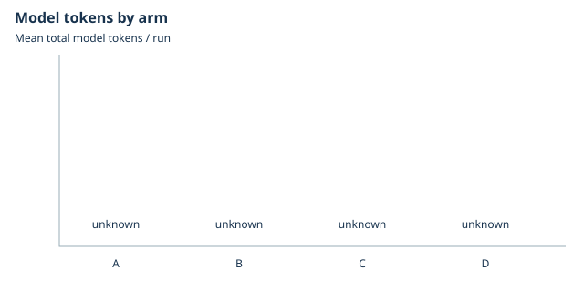
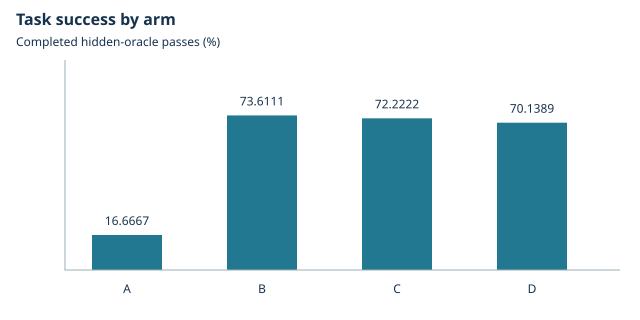
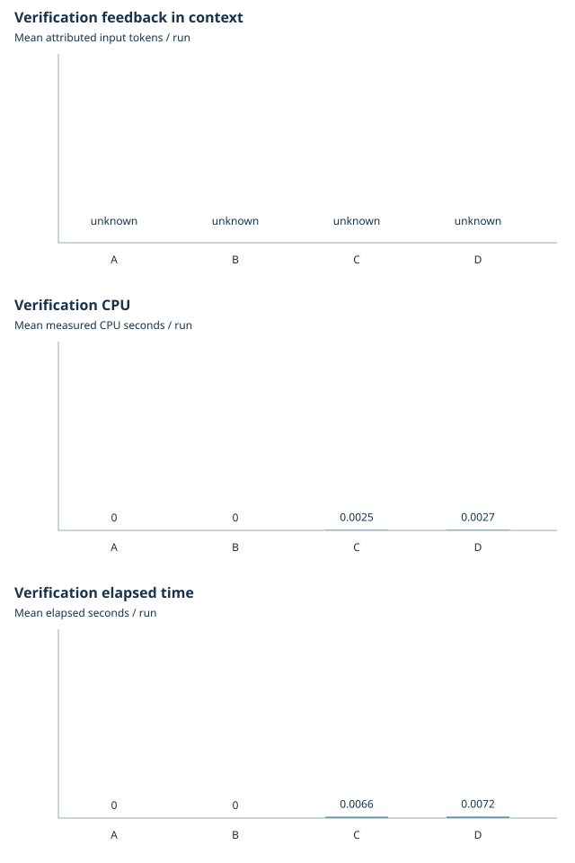
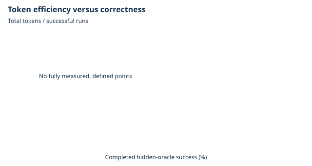
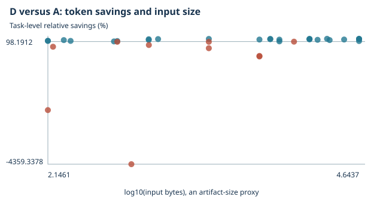
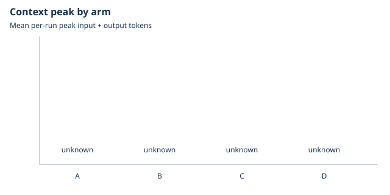
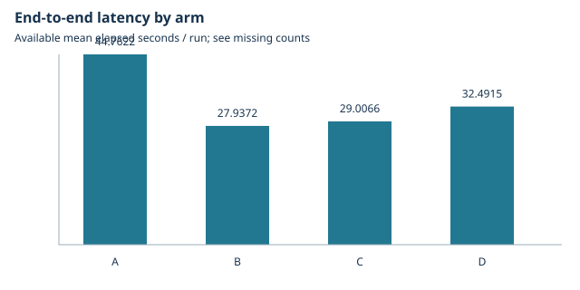

# Verified CLI Delegation Benchmark

**EXPLORATORY OBSERVATIONAL REPORT — NOT CONFIRMATORY**

## 1. Research question and hypotheses

When does CLI delegation with compact verification feedback reduce model tokens without reducing correctness? H1 tests efficiency and correctness separately. H2 tests size dependence and in-range crossover. H3 isolates raw verification and compression effects. H4 examines invocation-complexity limitations independently. No treatment advantage is assumed.

## 2. Experimental methodology

All supplied runs, including failures and incomplete runs, remain in arm summaries. Paired effects weight each task instance equally, retaining paired repetitions within task clusters. Protocol, cohort, and confirmatory status are defined by preregistration; this report does not infer them from the presence of data.

```json
{
  "analysis_config": {
    "allow_synthetic": false,
    "bootstrap_samples": 2000,
    "bootstrap_seed": 2026,
    "expected_repetitions": 3,
    "expected_tasks": 48,
    "margin_justification": "Unchanged: at most one additional failure per 20 runs in a non-safety-critical transformation workflow. Frozen before v3 execution.",
    "minimum_clusters": 48,
    "non_inferiority_margin": 0.05
  },
  "decoding": {
    "max_output_tokens": 4096,
    "reasoning_effort": "none"
  },
  "expected_records": 576,
  "matrix_complete": true,
  "missing_cells": [],
  "model": "gpt-6-luna",
  "protocol_violation_runs": 0,
  "records": 576,
  "unidentified_missing_tasks": 0
}
```

## 3. Dataset description

Inputs and requirements are validated against run manifests. Input byte count is an artifact-size proxy, not final-output size. Expected error tasks are retained; the boundary model controls for expected failure when identifiable. Detailed family, size, complexity and outcome strata are in summary.json.

| Family / arm | Runs | Successes | Exact model tokens |
|---|---:|---:|---:|
| aggregation / A | 36 | 11 | 906922 |
| aggregation / B | 36 | 23 | 664267 |
| aggregation / C | 36 | 23 | 1390798 |
| aggregation / D | 36 | 18 | n/a |
| filesystem / A | 36 | 4 | n/a |
| filesystem / B | 36 | 26 | n/a |
| filesystem / C | 36 | 26 | n/a |
| filesystem / D | 36 | 25 | n/a |
| sorting / A | 36 | 5 | n/a |
| sorting / B | 36 | 25 | n/a |
| sorting / C | 36 | 23 | n/a |
| sorting / D | 36 | 26 | n/a |
| text / A | 36 | 4 | n/a |
| text / B | 36 | 32 | n/a |
| text / C | 36 | 32 | n/a |
| text / D | 36 | 32 | 292075 |

## 4. Implementation architecture

Rust dataset generators, immutable originals, fresh Linux bubblewrap workspaces, single-process tool execution, independent feedback verification, bounded certificates, model adapters, host-only JSONL telemetry and a separate hidden oracle. Provider and protocol validation status is documented in the applicable protocol.

## 5. Token consumption by arm

Unknown usage is not zero; known totals are lower bounds whenever usage is incomplete.

| Arm | Runs | Exact tokens | Known tokens | Unknown-usage runs |
|---|---:|---:|---:|---:|
| A | 144 | n/a | 3759474 | 8 |
| B | 144 | n/a | 1761428 | 7 |
| C | 144 | n/a | 2387111 | 5 |
| D | 144 | n/a | 2569788 | 6 |



## 6. Success rates by arm

Success requires completion and a hidden-oracle pass. Unknown oracle outcomes and resource-limited incomplete runs do not count as successes. Raw oracle pass and completeness remain distinct in raw records.

| Arm | Successes / runs | Success rate | Incomplete runs | Unknown oracle |
|---|---:|---:|---:|---:|
| A | 24 / 144 | 0.1667 | 49 | 0 |
| B | 106 / 144 | 0.7361 | 18 | 0 |
| C | 104 / 144 | 0.7222 | 14 | 0 |
| D | 101 / 144 | 0.7014 | 18 | 0 |



## 7. Token efficiency and verification overhead

Efficiency is aggregate tokens across all runs divided by successful runs, never an average of per-run ratios. Zero successes or missing usage makes it undefined. Verification input tokens, CPU, wall time, memory and observed retries are separate costs; CPU is never converted to LLM tokens. See arm metrics in summary.json for measured/missing counts and attributed-input coverage.

| Arm | Tokens / success | Verifier input tokens | Verifier CPU seconds | Verifier elapsed seconds | Estimated monetary cost |
|---|---:|---:|---:|---:|---:|
| A | n/a | n/a | 0 | 0 | n/a |
| B | n/a | n/a | 0 | 0 | n/a |
| C | n/a | n/a | 0.3569 | 0.9452 | n/a |
| D | n/a | n/a | 0.3907 | 1.0425 | n/a |

Recorded pricing assumptions (null means unavailable):

```json
null
```





## 8. Token savings against artifact size

Paired relative savings are 1 − treatment/reference; positive values mean fewer treatment tokens. The chart uses ratios of task-level mean tokens, whereas the paired relative-effect estimate averages paired ratios within each task. Zero reference tokens produce an undefined ratio. Negative savings are retained. The exploratory SVD fit uses log token ratio with size × family, complexity and expected-failure interactions when identifiable. No crossover is extrapolated beyond its measured stratum.



```json
{
  "status": "not_estimable_incomplete_usage"
}
```

## 9. Context-usage comparison

Peak context is the largest reported input-plus-output call for each run. Complete artifacts are not injected into later model calls; arm A retains only chunk metadata. Input reads and raw feedback remain part of actual context. Missing usage prevents exact context-peak conclusions. Tool I/O volume, calls, attempts and retries are reported separately in summary.json.



## 10. Failure taxonomy and representative traces

Terminations count runs. Taxonomy counts encountered events, not mutually exclusive final failures; retries may recover. Verifier-reported semantic/format errors are marked as such, not treated as oracle truth. Unknown classifications remain unknown, including unclassified execution failures. Trace collection enriches summary-only data; absent trace coverage is not evidence that no errors occurred.

```json
{
  "failed_run_examples": {
    "adapter_error": [
      {
        "arm": "B",
        "oracle_error": null,
        "oracle_pass": false,
        "run_id": "1794901774141446078-1921007",
        "task_id": "text-v2-s2",
        "termination": "adapter_error"
      },
      {
        "arm": "B",
        "oracle_error": null,
        "oracle_pass": false,
        "run_id": "1794902203234463185-1921007",
        "task_id": "sorting-v0-s1",
        "termination": "adapter_error"
      },
      {
        "arm": "D",
        "oracle_error": null,
        "oracle_pass": false,
        "run_id": "1794903304019368870-1921007",
        "task_id": "aggregation-v0-s2",
        "termination": "adapter_error"
      }
    ],
    "call_limit": [
      {
        "arm": "D",
        "oracle_error": null,
        "oracle_pass": false,
        "run_id": "1794901903116677708-1921007",
        "task_id": "sorting-v3-s0",
        "termination": "call_limit"
      },
      {
        "arm": "D",
        "oracle_error": null,
        "oracle_pass": false,
        "run_id": "1794902699296300538-1921008",
        "task_id": "aggregation-v1-s2",
        "termination": "call_limit"
      },
      {
        "arm": "A",
        "oracle_error": null,
        "oracle_pass": false,
        "run_id": "1794901590939609121-1921010",
        "task_id": "aggregation-v0-s1",
        "termination": "call_limit"
      }
    ],
    "finished": [
      {
        "arm": "A",
        "oracle_error": null,
        "oracle_pass": false,
        "run_id": "1794901186178878706-1921007",
        "task_id": "aggregation-v3-s2",
        "termination": "finished"
      },
      {
        "arm": "B",
        "oracle_error": null,
        "oracle_pass": false,
        "run_id": "1794901298751715896-1921007",
        "task_id": "filesystem-v3-s2",
        "termination": "finished"
      },
      {
        "arm": "B",
        "oracle_error": null,
        "oracle_pass": false,
        "run_id": "1794901312620668950-1921007",
        "task_id": "filesystem-v3-s0",
        "termination": "finished"
      }
    ],
    "resource_limit": [
      {
        "arm": "A",
        "oracle_error": null,
        "oracle_pass": false,
        "run_id": "1794901340704919891-1921007",
        "task_id": "filesystem-v0-s2",
        "termination": "resource_limit"
      },
      {
        "arm": "A",
        "oracle_error": null,
        "oracle_pass": false,
        "run_id": "1794901424250299759-1921007",
        "task_id": "sorting-v2-s1",
        "termination": "resource_limit"
      },
      {
        "arm": "D",
        "oracle_error": null,
        "oracle_pass": false,
        "run_id": "1794901570720531688-1921007",
        "task_id": "sorting-v2-s2",
        "termination": "resource_limit"
      }
    ]
  },
  "failure_taxonomy": {
    "adapter_transport_failure": {
      "events": 5,
      "examples": [
        {
          "arm": "D",
          "event": {
            "category": "adapter_transport_failure",
            "detail": "{\"error\":\"adapter failed, timed out, or exceeded response budget; usage unknown\",\"raw_adapter_response_bounded\":\"{\\\"error\\\":\\\"provider returned no action text\\\"}\\n\",\"stdout_bytes\":45,\"truncated\":false}",
            "line": 24
          },
          "run_id": "1794903304019368870-1921007",
          "task_id": "aggregation-v0-s2",
          "trace": "main-v3-1/runs/0062-aggregation-v0-s2-D-r1/trace.jsonl"
        },
        {
          "arm": "C",
          "event": {
            "category": "adapter_transport_failure",
            "detail": "{\"error\":\"adapter failed, timed out, or exceeded response budget; usage unknown\",\"raw_adapter_response_bounded\":\"{\\\"error\\\":\\\"curl failed: exit status: 28 curl: (3) URL rejected: Malformed input to a URL function\\\\ncurl: (28) Operation timed out after 115000 milliseconds with 6897 bytes received\\\"}\\n\",\"stdout_bytes\":182,\"truncated\":false}",
            "line": 15
          },
          "run_id": "1794903283042405657-1921008",
          "task_id": "sorting-v3-s0",
          "trace": "main-v3-2/runs/0039-sorting-v3-s0-C-r0/trace.jsonl"
        },
        {
          "arm": "D",
          "event": {
            "category": "adapter_transport_failure",
            "detail": "{\"error\":\"adapter failed, timed out, or exceeded response budget; usage unknown\",\"raw_adapter_response_bounded\":\"{\\\"error\\\":\\\"curl failed: exit status: 28 curl: (3) URL rejected: Malformed input to a URL function\\\\ncurl: (28) Operation timed out after 115001 milliseconds with 6897 bytes received\\\"}\\n\",\"stdout_bytes\":182,\"truncated\":false}",
            "line": 7
          },
          "run_id": "1794903782520472036-1921010",
          "task_id": "aggregation-v3-s1",
          "trace": "main-v3-3/runs/0075-aggregation-v3-s1-D-r2/trace.jsonl"
        }
      ],
      "known_events": 5,
      "unit": "encountered_events_not_mutually_exclusive_final_run_failures"
    },
    "argument_construction_failure": {
      "events": 0,
      "examples": [],
      "known_events": 0,
      "unit": "encountered_events_not_mutually_exclusive_final_run_failures"
    },
    "incorrect_transformation_semantics": {
      "events": 21,
      "examples": [
        {
          "arm": "D",
          "event": {
            "category": "incorrect_transformation_semantics",
            "detail": "CONTENT_ERROR",
            "line": 52,
            "reported_by_verifier_not_oracle": true
          },
          "run_id": "1794903151422614739-1921007",
          "task_id": "aggregation-v2-s1",
          "trace": "main-v3-1/runs/0058-aggregation-v2-s1-D-r1/trace.jsonl"
        },
        {
          "arm": "C",
          "event": {
            "category": "incorrect_transformation_semantics",
            "detail": "CONTENT_ERROR",
            "line": 18,
            "reported_by_verifier_not_oracle": true
          },
          "run_id": "1794903779393022409-1921007",
          "task_id": "aggregation-v1-s1",
          "trace": "main-v3-1/runs/0076-aggregation-v1-s1-C-r0/trace.jsonl"
        },
        {
          "arm": "C",
          "event": {
            "category": "incorrect_transformation_semantics",
            "detail": "CONTENT_ERROR",
            "line": 9,
            "reported_by_verifier_not_oracle": true
          },
          "run_id": "1794903975058309230-1921007",
          "task_id": "aggregation-v1-s0",
          "trace": "main-v3-1/runs/0089-aggregation-v1-s0-C-r0/trace.jsonl"
        }
      ],
      "known_events": 21,
      "unit": "encountered_events_not_mutually_exclusive_final_run_failures"
    },
    "model_context_or_output_limit_failure": {
      "events": 6,
      "examples": [
        {
          "arm": "D",
          "event": {
            "category": "model_context_or_output_limit_failure",
            "detail": "call_limit"
          },
          "run_id": "1794901903116677708-1921007",
          "task_id": "sorting-v3-s0",
          "trace": "main-v3-1/runs/0021-sorting-v3-s0-D-r1/trace.jsonl"
        },
        {
          "arm": "D",
          "event": {
            "category": "model_context_or_output_limit_failure",
            "detail": "call_limit"
          },
          "run_id": "1794902699296300538-1921008",
          "task_id": "aggregation-v1-s2",
          "trace": "main-v3-2/runs/0028-aggregation-v1-s2-D-r2/trace.jsonl"
        },
        {
          "arm": "A",
          "event": {
            "category": "model_context_or_output_limit_failure",
            "detail": "call_limit"
          },
          "run_id": "1794901590939609121-1921010",
          "task_id": "aggregation-v0-s1",
          "trace": "main-v3-3/runs/0021-aggregation-v0-s1-A-r1/trace.jsonl"
        }
      ],
      "known_events": 6,
      "unit": "encountered_events_not_mutually_exclusive_final_run_failures"
    },
    "permission_or_safety_rejection": {
      "events": 0,
      "examples": [],
      "known_events": 0,
      "unit": "encountered_events_not_mutually_exclusive_final_run_failures"
    },
    "provider_content_rejection": {
      "events": 21,
      "examples": [
        {
          "arm": "B",
          "event": {
            "category": "provider_content_rejection",
            "detail": "{\"error\":\"adapter failed, timed out, or exceeded response budget; usage unknown\",\"raw_adapter_response_bounded\":\"{\\\"error\\\":\\\"provider reported failure: {\\\\\\\"code\\\\\\\":\\\\\\\"invalid_prompt\\\\\\\",\\\\\\\"message\\\\\\\":\\\\\\\"Invalid prompt: your prompt was flagged as potentially violating our usage policy. Please try again with a different prompt: https://platform.openai.com/docs/guides/reasoning#advice-on-prompting\\\\\\\",\\\\\\\"param\\\\\\\":null,\\\\\\\"type\\\\\\\":\\\\\\\"invalid_request_error\\\\\\\"}\\\"}\\n\",\"stdout_bytes\":330,\"tr",
            "line": 3
          },
          "run_id": "1794901774141446078-1921007",
          "task_id": "text-v2-s2",
          "trace": "main-v3-1/runs/0017-text-v2-s2-B-r2/trace.jsonl"
        },
        {
          "arm": "B",
          "event": {
            "category": "provider_content_rejection",
            "detail": "{\"error\":\"adapter failed, timed out, or exceeded response budget; usage unknown\",\"raw_adapter_response_bounded\":\"{\\\"error\\\":\\\"provider reported failure: {\\\\\\\"code\\\\\\\":\\\\\\\"invalid_prompt\\\\\\\",\\\\\\\"message\\\\\\\":\\\\\\\"Invalid prompt: your prompt was flagged as potentially violating our usage policy. Please try again with a different prompt: https://platform.openai.com/docs/guides/reasoning#advice-on-prompting\\\\\\\",\\\\\\\"param\\\\\\\":null,\\\\\\\"type\\\\\\\":\\\\\\\"invalid_request_error\\\\\\\"}\\\"}\\n\",\"stdout_bytes\":330,\"tr",
            "line": 3
          },
          "run_id": "1794902203234463185-1921007",
          "task_id": "sorting-v0-s1",
          "trace": "main-v3-1/runs/0025-sorting-v0-s1-B-r1/trace.jsonl"
        },
        {
          "arm": "A",
          "event": {
            "category": "provider_content_rejection",
            "detail": "{\"error\":\"adapter failed, timed out, or exceeded response budget; usage unknown\",\"raw_adapter_response_bounded\":\"{\\\"error\\\":\\\"provider reported failure: {\\\\\\\"code\\\\\\\":\\\\\\\"invalid_prompt\\\\\\\",\\\\\\\"message\\\\\\\":\\\\\\\"Invalid prompt: your prompt was flagged as potentially violating our usage policy. Please try again with a different prompt: https://platform.openai.com/docs/guides/reasoning#advice-on-prompting\\\\\\\",\\\\\\\"param\\\\\\\":null,\\\\\\\"type\\\\\\\":\\\\\\\"invalid_request_error\\\\\\\"}\\\"}\\n\",\"stdout_bytes\":330,\"tr",
            "line": 14
          },
          "run_id": "1794903395454041689-1921007",
          "task_id": "filesystem-v1-s1",
          "trace": "main-v3-1/runs/0068-filesystem-v1-s1-A-r2/trace.jsonl"
        }
      ],
      "known_events": 21,
      "unit": "encountered_events_not_mutually_exclusive_final_run_failures"
    },
    "resource_limit_failure": {
      "events": 86,
      "examples": [
        {
          "arm": "A",
          "event": {
            "category": "resource_limit_failure",
            "detail": "resource_limit"
          },
          "run_id": "1794901340704919891-1921007",
          "task_id": "filesystem-v0-s2",
          "trace": "main-v3-1/runs/0011-filesystem-v0-s2-A-r1/trace.jsonl"
        },
        {
          "arm": "A",
          "event": {
            "category": "resource_limit_failure",
            "detail": "resource_limit"
          },
          "run_id": "1794901424250299759-1921007",
          "task_id": "sorting-v2-s1",
          "trace": "main-v3-1/runs/0012-sorting-v2-s1-A-r1/trace.jsonl"
        },
        {
          "arm": "D",
          "event": {
            "category": "resource_limit_failure",
            "detail": "resource_limit"
          },
          "run_id": "1794901570720531688-1921007",
          "task_id": "sorting-v2-s2",
          "trace": "main-v3-1/runs/0014-sorting-v2-s2-D-r0/trace.jsonl"
        }
      ],
      "known_events": 86,
      "unit": "encountered_events_not_mutually_exclusive_final_run_failures"
    },
    "syntax_or_parsing_failure": {
      "events": 1951,
      "examples": [
        {
          "arm": "A",
          "event": {
            "category": "syntax_or_parsing_failure",
            "detail": "trailing characters at line 1 column 60",
            "line": 4
          },
          "run_id": "1794901186178878706-1921007",
          "task_id": "aggregation-v3-s2",
          "trace": "main-v3-1/runs/0000-aggregation-v3-s2-A-r1/trace.jsonl"
        },
        {
          "arm": "A",
          "event": {
            "category": "syntax_or_parsing_failure",
            "detail": "trailing characters at line 1 column 98",
            "line": 11
          },
          "run_id": "1794901186178878706-1921007",
          "task_id": "aggregation-v3-s2",
          "trace": "main-v3-1/runs/0000-aggregation-v3-s2-A-r1/trace.jsonl"
        },
        {
          "arm": "B",
          "event": {
            "category": "syntax_or_parsing_failure",
            "detail": "trailing characters at line 1 column 271",
            "line": 4
          },
          "run_id": "1794901199922263240-1921007",
          "task_id": "text-v1-s1",
          "trace": "main-v3-1/runs/0001-text-v1-s1-B-r2/trace.jsonl"
        }
      ],
      "known_events": 1951,
      "unit": "encountered_events_not_mutually_exclusive_final_run_failures"
    },
    "tool_selection_failure": {
      "events": 0,
      "examples": [],
      "known_events": 0,
      "unit": "encountered_events_not_mutually_exclusive_final_run_failures"
    },
    "unclassified_action_failure": {
      "events": 11,
      "examples": [
        {
          "arm": "A",
          "event": {
            "category": "unclassified_action_failure",
            "detail": "No such file or directory (os error 2)",
            "line": 23
          },
          "run_id": "1794902379336083917-1921007",
          "task_id": "filesystem-v2-s0",
          "trace": "main-v3-1/runs/0037-filesystem-v2-s0-A-r1/trace.jsonl"
        },
        {
          "arm": "A",
          "event": {
            "category": "unclassified_action_failure",
            "detail": "No such file or directory (os error 2)",
            "line": 27
          },
          "run_id": "1794902379336083917-1921007",
          "task_id": "filesystem-v2-s0",
          "trace": "main-v3-1/runs/0037-filesystem-v2-s0-A-r1/trace.jsonl"
        },
        {
          "arm": "A",
          "event": {
            "category": "unclassified_action_failure",
            "detail": "No such file or directory (os error 2)",
            "line": 31
          },
          "run_id": "1794902379336083917-1921007",
          "task_id": "filesystem-v2-s0",
          "trace": "main-v3-1/runs/0037-filesystem-v2-s0-A-r1/trace.jsonl"
        }
      ],
      "known_events": 11,
      "unit": "encountered_events_not_mutually_exclusive_final_run_failures"
    },
    "unclassified_execution_failure": {
      "events": 40,
      "examples": [
        {
          "arm": "D",
          "event": {
            "category": "unclassified_execution_failure",
            "detail": "Traceback (most recent call last):\n  File \"<string>\", line 4, in <module>\n    n=sum(1 for r in rows if r.get('group')=='A' and r.get('active')=='true' and int(r['value'])>50)\n  File \"<string>\", line 4, in <genexpr>\n    n=sum(1 for r in rows if r.get('group')=='A' and r.get('active')=='true' and int(r['value'])>50)\n                                                                                 ~~~^^^^^^^^^^^^\nValueError: invalid literal for int() with base 10: ''\n",
            "tool_log": "tool-1.json"
          },
          "run_id": "1794903304019368870-1921007",
          "task_id": "aggregation-v0-s2",
          "trace": "main-v3-1/runs/0062-aggregation-v0-s2-D-r1/trace.jsonl"
        },
        {
          "arm": "D",
          "event": {
            "category": "unclassified_execution_failure",
            "detail": "Traceback (most recent call last):\n  File \"<string>\", line 4, in <module>\n    n=sum(1 for r in rows if r.get('group')=='A' and r.get('active')=='true' and int(r['value'])>50)\n  File \"<string>\", line 4, in <genexpr>\n    n=sum(1 for r in rows if r.get('group')=='A' and r.get('active')=='true' and int(r['value'])>50)\n                                                                                 ~~~^^^^^^^^^^^^\nValueError: invalid literal for int() with base 10: ''\n",
            "tool_log": "tool-2.json"
          },
          "run_id": "1794903304019368870-1921007",
          "task_id": "aggregation-v0-s2",
          "trace": "main-v3-1/runs/0062-aggregation-v0-s2-D-r1/trace.jsonl"
        },
        {
          "arm": "D",
          "event": {
            "category": "unclassified_execution_failure",
            "detail": "  File \"<string>\", line 1\n    from pathlib import Path; import re; [(Path(f).write_bytes(re.sub(b'red',b'blue',Path(f).read_bytes(),flags=re.I)) for f in ('scope/a.txt','scope/b.txt'))\n                                         ^\nSyntaxError: '[' was never closed\n",
            "tool_log": "tool-1.json"
          },
          "run_id": "1794904450359896254-1921007",
          "task_id": "text-v2-s1",
          "trace": "main-v3-1/runs/0099-text-v2-s1-D-r2/trace.jsonl"
        }
      ],
      "known_events": 40,
      "unit": "encountered_events_not_mutually_exclusive_final_run_failures"
    },
    "verifier_false_negative": {
      "evaluated_runs": 260,
      "events": 0,
      "unit": "evaluable_final_verifier_oracle_runs"
    },
    "verifier_false_positive": {
      "evaluated_runs": 260,
      "events": 0,
      "unit": "evaluable_final_verifier_oracle_runs"
    }
  },
  "terminations": {
    "adapter_error": 26,
    "call_limit": 6,
    "finished": 477,
    "resource_limit": 67
  },
  "trace_classified_runs": 576,
  "verifier_disagreement": {
    "evaluated_runs": 260,
    "false_negative": 0,
    "false_negative_rate": 0.0,
    "false_positive": 0,
    "false_positive_rate": 0.0,
    "oracle_negative_runs": 55,
    "oracle_positive_runs": 205,
    "tool_arm_runs_without_evaluable_final_pair": 28
  }
}
```

## 11. Statistical uncertainty

All intervals are exploratory. Percentile bootstrap resamples task instances with replacement and preserves all matched repetitions in each selected cluster; repeated runs are not independent samples. Paired differences are treatment minus reference. Non-inferiority uses a one-sided 95% lower bound and is separate from a two-sided 95% token interval. Too few clusters, missing matrix cells, protocol violations or unknown usage prevent the corresponding support claim. Secondary comparisons are not multiplicity-adjusted and are not confirmatory.

A degenerate bootstrap is not proof of zero failure risk. For all-nonnegative or constant observed task success differences, the success lower bound is also capped by m·0.05^(1/n) − (1−0.05^(1/n)), where m is the minimum observed cluster difference and n is the task count. This conservative unseen-task risk guard shares the task-sampling assumptions; it is not a guarantee outside this dataset. In particular, 48 perfect ties do not establish a five-point margin under this guard.

| Treatment − reference | Task clusters | Mean token difference | Token CI95 | Mean success difference | NI lower bound |
|---|---:|---:|---|---:|---:|
| D − A | 48 | n/a | null | 0.5347 | 0.4097 |
| B − A | 48 | n/a | null | 0.5694 | 0.4514 |
| C − B | 48 | n/a | null | -0.0139 | -0.0764 |
| D − C | 48 | n/a | null | -0.0208 | -0.0903 |
| D − B | 48 | n/a | null | -0.0347 | -0.0972 |

## 12. Threats to validity

- Protocol and margin are not frozen: all inference is exploratory.
- Bootstrap resamples task instances, retaining all paired repetitions within each cluster; repeated runs are not independent dataset instances.
- Equal task weighting is used for paired effects; arm summaries include every supplied run, including failures and incomplete runs.
- Missing usage suppresses exact token comparisons and efficiency. Reported known totals are lower bounds, not imputed zeros.
- Non-inferiority is separate from token reduction; no-worse-observed clusters use a conservative zero-event risk guard.
- Related semantic variants at multiple sizes may remain correlated across task clusters; interpret task-instance bootstrap uncertainty conditionally.
- Input bytes are an artifact-size proxy, not measured final-output bytes.
- Summary-only data cannot distinguish every tool-selection, argument, parsing or permission error. Consult host traces; do not infer absent errors from unclassified counts.
- Synthetic cohorts are fixture validation only and cannot support scientific conclusions.
- The size model includes failed and incomplete paired runs. It estimates token cost, not correctness-adjusted efficiency; per-task success rates accompany its points.

## 13. Boundary conditions and negative findings

These observations do not discard negative results. Point estimates are not declarations of statistical significance. Synthetic observations validate report logic only.

- C versus B: success decreased at the point estimate. Token savings do not compensate for correctness loss.
- D versus C: success decreased at the point estimate. Token savings do not compensate for correctness loss.
- D versus B: success decreased at the point estimate. Token savings do not compensate for correctness loss.
- Incomplete usage prevents exact token-efficiency and paired-token conclusions for affected comparisons.



## 14. Conclusions and reproducibility

Token reduction alone is insufficient to establish an overall improvement. Hypotheses are evaluated independently; the report can show no advantage or no established non-inferiority. Synthetic fixtures support none of the scientific hypotheses.

```json
{
  "H1": "token_reduction_not_established",
  "H2": {
    "boundary_status": "not_estimable_incomplete_usage",
    "status": "exploratory_size_interactions_only",
    "warning": "Size trends and crossovers are stratum-specific; no universal advantage or out-of-range crossover is asserted."
  },
  "H3": {
    "compression_delta": {
      "ci95": null,
      "estimate": null,
      "reason": "incomplete_usage; known lower bounds not substituted for totals"
    },
    "compression_reduces_tokens": false,
    "raw_verification_delta": {
      "ci95": null,
      "estimate": null,
      "reason": "incomplete_usage; known lower bounds not substituted for totals"
    },
    "raw_verification_increases_tokens": false,
    "status": "exploratory_only",
    "verification_input_attribution_complete": false,
    "warning": "Execution CPU and latency are not LLM tokens. Attribution, runtime, resources and observed retries are separate quantities; compression is not assumed beneficial."
  },
  "H4": {
    "invocation_measured_runs": 432,
    "invocation_relationships": {
      "log_argument_bytes_vs_D_A_token_savings": {
        "ci95": [
          0.14648593207404983,
          0.8935036889338434
        ],
        "estimate": 0.6816144738199393,
        "inference_eligible": false,
        "status": "observational_correlation_not_causation",
        "task_clusters": 36,
        "valid_bootstraps": 2000
      },
      "log_argument_bytes_vs_interface_errors": {
        "ci95": [
          0.17432072780470143,
          0.5393119750310067
        ],
        "estimate": 0.369283474227636,
        "inference_eligible": true,
        "status": "observational_correlation_not_causation",
        "task_clusters": 48,
        "valid_bootstraps": 2000
      },
      "log_argument_bytes_vs_success": {
        "ci95": [
          -0.1428379730753714,
          0.32701730481087005
        ],
        "estimate": 0.10226893643916504,
        "inference_eligible": true,
        "status": "observational_correlation_not_causation",
        "task_clusters": 48,
        "valid_bootstraps": 2000
      },
      "observed_tool_task_arm_groups": 144,
      "paired_D_A_points": [
        {
          "arm": "D",
          "family": "aggregation",
          "mean_argument_bytes": 331.3333333333333,
          "mean_interface_errors": 0.0,
          "mean_tool_requests": 1.0,
          "relative_token_savings_D_A": 0.25895292564892214,
          "semantic_complexity": "simple",
          "success_rate": 1.0,
          "task_id": "aggregation-v0-s0"
        },
        {
          "arm": "D",
          "family": "aggregation",
          "mean_argument_bytes": 354.6666666666667,
          "mean_interface_errors": 1.0,
          "mean_tool_requests": 1.3333333333333333,
          "relative_token_savings_D_A": 0.9431504529510922,
          "semantic_complexity": "simple",
          "success_rate": 0.3333333333333333,
          "task_id": "aggregation-v0-s1"
        },
        {
          "arm": "D",
          "family": "aggregation",
          "mean_argument_bytes": 414.3333333333333,
          "mean_interface_errors": 0.0,
          "mean_tool_requests": 1.0,
          "relative_token_savings_D_A": 0.26840995360607334,
          "semantic_complexity": "multi-step",
          "success_rate": 1.0,
          "task_id": "aggregation-v1-s0"
        },
        {
          "arm": "D",
          "family": "aggregation",
          "mean_argument_bytes": 520.6666666666666,
          "mean_interface_errors": 0.3333333333333333,
          "mean_tool_requests": 1.3333333333333333,
          "relative_token_savings_D_A": -0.0752620545073377,
          "semantic_complexity": "multi-step",
          "success_rate": 0.6666666666666666,
          "task_id": "aggregation-v1-s1"
        },
        {
          "arm": "D",
          "family": "aggregation",
          "mean_argument_bytes": 333.3333333333333,
          "mean_interface_errors": 0.3333333333333333,
          "mean_tool_requests": 1.0,
          "relative_token_savings_D_A": -5.101035814606742,
          "semantic_complexity": "multi-step",
          "success_rate": 0.3333333333333333,
          "task_id": "aggregation-v1-s2"
        },
        {
          "arm": "D",
          "family": "aggregation",
          "mean_argument_bytes": 161.33333333333334,
          "mean_interface_errors": 0.0,
          "mean_tool_requests": 0.6666666666666666,
          "relative_token_savings_D_A": -24.36047138565817,
          "semantic_complexity": "multi-step",
          "success_rate": 0.3333333333333333,
          "task_id": "aggregation-v2-s0"
        },
        {
          "arm": "D",
          "family": "aggregation",
          "mean_argument_bytes": 280.6666666666667,
          "mean_interface_errors": 0.0,
          "mean_tool_requests": 1.3333333333333333,
          "relative_token_savings_D_A": -2.362601450836745,
          "semantic_complexity": "multi-step",
          "success_rate": 0.3333333333333333,
          "task_id": "aggregation-v2-s1"
        },
        {
          "arm": "D",
          "family": "aggregation",
          "mean_argument_bytes": 147.33333333333334,
          "mean_interface_errors": 0.0,
          "mean_tool_requests": 0.3333333333333333,
          "relative_token_savings_D_A": 0.71844867714815,
          "semantic_complexity": "multi-step",
          "success_rate": 0.3333333333333333,
          "task_id": "aggregation-v2-s2"
        },
        {
          "arm": "D",
          "family": "aggregation",
          "mean_argument_bytes": 42.666666666666664,
          "mean_interface_errors": 0.0,
          "mean_tool_requests": 1.3333333333333333,
          "relative_token_savings_D_A": -1.8396189819404336,
          "semantic_complexity": "multi-step",
          "success_rate": 0.0,
          "task_id": "aggregation-v3-s0"
        },
        {
          "arm": "D",
          "family": "aggregation",
          "mean_argument_bytes": 128.0,
          "mean_interface_errors": 0.0,
          "mean_tool_requests": 0.3333333333333333,
          "relative_token_savings_D_A": -5.29370148373784,
          "semantic_complexity": "multi-step",
          "success_rate": 0.3333333333333333,
          "task_id": "aggregation-v3-s2"
        },
        {
          "arm": "D",
          "family": "filesystem",
          "mean_argument_bytes": 286.6666666666667,
          "mean_interface_errors": 0.0,
          "mean_tool_requests": 1.0,
          "relative_token_savings_D_A": 0.521233312142403,
          "semantic_complexity": "multi-step",
          "success_rate": 1.0,
          "task_id": "filesystem-v1-s0"
        },
        {
          "arm": "D",
          "family": "filesystem",
          "mean_argument_bytes": 498.3333333333333,
          "mean_interface_errors": 0.0,
          "mean_tool_requests": 1.0,
          "relative_token_savings_D_A": 0.8622726566143324,
          "semantic_complexity": "multi-step",
          "success_rate": 1.0,
          "task_id": "filesystem-v1-s2"
        },
        {
          "arm": "D",
          "family": "filesystem",
          "mean_argument_bytes": 309.3333333333333,
          "mean_interface_errors": 0.0,
          "mean_tool_requests": 2.3333333333333335,
          "relative_token_savings_D_A": 0.8874454780789371,
          "semantic_complexity": "multi-step",
          "success_rate": 1.0,
          "task_id": "filesystem-v2-s0"
        },
        {
          "arm": "D",
          "family": "filesystem",
          "mean_argument_bytes": 351.6666666666667,
          "mean_interface_errors": 0.0,
          "mean_tool_requests": 1.0,
          "relative_token_savings_D_A": 0.6239039350352036,
          "semantic_complexity": "multi-step",
          "success_rate": 1.0,
          "task_id": "filesystem-v2-s1"
        },
        {
          "arm": "D",
          "family": "filesystem",
          "mean_argument_bytes": 528.0,
          "mean_interface_errors": 1.3333333333333333,
          "mean_tool_requests": 2.0,
          "relative_token_savings_D_A": 0.23751429660693857,
          "semantic_complexity": "simple",
          "success_rate": 0.0,
          "task_id": "filesystem-v3-s0"
        },
        {
          "arm": "D",
          "family": "filesystem",
          "mean_argument_bytes": 366.6666666666667,
          "mean_interface_errors": 1.0,
          "mean_tool_requests": 1.6666666666666667,
          "relative_token_savings_D_A": 0.9309039708177449,
          "semantic_complexity": "simple",
          "success_rate": 0.0,
          "task_id": "filesystem-v3-s2"
        },
        {
          "arm": "D",
          "family": "sorting",
          "mean_argument_bytes": 418.0,
          "mean_interface_errors": 0.0,
          "mean_tool_requests": 1.0,
          "relative_token_savings_D_A": 0.05196966894766031,
          "semantic_complexity": "simple",
          "success_rate": 1.0,
          "task_id": "sorting-v0-s0"
        },
        {
          "arm": "D",
          "family": "sorting",
          "mean_argument_bytes": 419.6666666666667,
          "mean_interface_errors": 0.0,
          "mean_tool_requests": 1.0,
          "relative_token_savings_D_A": 0.9819115617950459,
          "semantic_complexity": "simple",
          "success_rate": 1.0,
          "task_id": "sorting-v0-s2"
        },
        {
          "arm": "D",
          "family": "sorting",
          "mean_argument_bytes": 355.6666666666667,
          "mean_interface_errors": 0.0,
          "mean_tool_requests": 1.0,
          "relative_token_savings_D_A": 0.1875315497223624,
          "semantic_complexity": "simple",
          "success_rate": 1.0,
          "task_id": "sorting-v1-s0"
        },
        {
          "arm": "D",
          "family": "sorting",
          "mean_argument_bytes": 359.0,
          "mean_interface_errors": 0.0,
          "mean_tool_requests": 1.0,
          "relative_token_savings_D_A": 0.6904955804945874,
          "semantic_complexity": "simple",
          "success_rate": 1.0,
          "task_id": "sorting-v1-s1"
        },
        {
          "arm": "D",
          "family": "sorting",
          "mean_argument_bytes": 451.3333333333333,
          "mean_interface_errors": 0.3333333333333333,
          "mean_tool_requests": 1.0,
          "relative_token_savings_D_A": -0.07403264016846545,
          "semantic_complexity": "multi-step",
          "success_rate": 0.6666666666666666,
          "task_id": "sorting-v2-s0"
        },
        {
          "arm": "D",
          "family": "sorting",
          "mean_argument_bytes": 668.0,
          "mean_interface_errors": 1.6666666666666667,
          "mean_tool_requests": 1.6666666666666667,
          "relative_token_savings_D_A": 0.07777125334377244,
          "semantic_complexity": "multi-step",
          "success_rate": 0.3333333333333333,
          "task_id": "sorting-v2-s1"
        },
        {
          "arm": "D",
          "family": "sorting",
          "mean_argument_bytes": 550.6666666666666,
          "mean_interface_errors": 0.6666666666666666,
          "mean_tool_requests": 1.0,
          "relative_token_savings_D_A": 0.5291315462562756,
          "semantic_complexity": "multi-step",
          "success_rate": 0.3333333333333333,
          "task_id": "sorting-v2-s2"
        },
        {
          "arm": "D",
          "family": "sorting",
          "mean_argument_bytes": 10.666666666666666,
          "mean_interface_errors": 0.0,
          "mean_tool_requests": 0.3333333333333333,
          "relative_token_savings_D_A": -43.59337813243735,
          "semantic_complexity": "multi-step",
          "success_rate": 0.0,
          "task_id": "sorting-v3-s0"
        },
        {
          "arm": "D",
          "family": "sorting",
          "mean_argument_bytes": 515.0,
          "mean_interface_errors": 0.3333333333333333,
          "mean_tool_requests": 1.3333333333333333,
          "relative_token_savings_D_A": -0.027570331111646418,
          "semantic_complexity": "multi-step",
          "success_rate": 0.6666666666666666,
          "task_id": "sorting-v3-s1"
        },
        {
          "arm": "D",
          "family": "sorting",
          "mean_argument_bytes": 762.6666666666666,
          "mean_interface_errors": 0.0,
          "mean_tool_requests": 1.0,
          "relative_token_savings_D_A": 0.7288140161725067,
          "semantic_complexity": "multi-step",
          "success_rate": 1.0,
          "task_id": "sorting-v3-s2"
        },
        {
          "arm": "D",
          "family": "text",
          "mean_argument_bytes": 134.33333333333334,
          "mean_interface_errors": 0.0,
          "mean_tool_requests": 1.0,
          "relative_token_savings_D_A": 0.5717560073937153,
          "semantic_complexity": "simple",
          "success_rate": 1.0,
          "task_id": "text-v0-s0"
        },
        {
          "arm": "D",
          "family": "text",
          "mean_argument_bytes": 130.0,
          "mean_interface_errors": 0.0,
          "mean_tool_requests": 1.0,
          "relative_token_savings_D_A": 0.8959221700648583,
          "semantic_complexity": "simple",
          "success_rate": 1.0,
          "task_id": "text-v0-s1"
        },
        {
          "arm": "D",
          "family": "text",
          "mean_argument_bytes": 131.0,
          "mean_interface_errors": 0.0,
          "mean_tool_requests": 1.0,
          "relative_token_savings_D_A": 0.9286003658371902,
          "semantic_complexity": "simple",
          "success_rate": 1.0,
          "task_id": "text-v0-s2"
        },
        {
          "arm": "D",
          "family": "text",
          "mean_argument_bytes": 219.66666666666666,
          "mean_interface_errors": 0.0,
          "mean_tool_requests": 1.0,
          "relative_token_savings_D_A": 0.8011952310880206,
          "semantic_complexity": "simple",
          "success_rate": 1.0,
          "task_id": "text-v1-s1"
        },
        {
          "arm": "D",
          "family": "text",
          "mean_argument_bytes": 209.66666666666666,
          "mean_interface_errors": 0.0,
          "mean_tool_requests": 1.0,
          "relative_token_savings_D_A": 0.9066899125398038,
          "semantic_complexity": "simple",
          "success_rate": 1.0,
          "task_id": "text-v1-s2"
        },
        {
          "arm": "D",
          "family": "text",
          "mean_argument_bytes": 254.66666666666666,
          "mean_interface_errors": 0.0,
          "mean_tool_requests": 1.0,
          "relative_token_savings_D_A": 0.8344074249172659,
          "semantic_complexity": "multi-step",
          "success_rate": 1.0,
          "task_id": "text-v2-s0"
        },
        {
          "arm": "D",
          "family": "text",
          "mean_argument_bytes": 312.3333333333333,
          "mean_interface_errors": 0.0,
          "mean_tool_requests": 1.0,
          "relative_token_savings_D_A": 0.9621614310350658,
          "semantic_complexity": "multi-step",
          "success_rate": 1.0,
          "task_id": "text-v2-s2"
        },
        {
          "arm": "D",
          "family": "text",
          "mean_argument_bytes": 192.33333333333334,
          "mean_interface_errors": 0.3333333333333333,
          "mean_tool_requests": 1.3333333333333333,
          "relative_token_savings_D_A": -1.2209751609935604,
          "semantic_complexity": "multi-step",
          "success_rate": 0.3333333333333333,
          "task_id": "text-v3-s0"
        },
        {
          "arm": "D",
          "family": "text",
          "mean_argument_bytes": 381.3333333333333,
          "mean_interface_errors": 0.3333333333333333,
          "mean_tool_requests": 1.0,
          "relative_token_savings_D_A": 0.9487747799791326,
          "semantic_complexity": "multi-step",
          "success_rate": 1.0,
          "task_id": "text-v3-s1"
        },
        {
          "arm": "D",
          "family": "text",
          "mean_argument_bytes": 254.33333333333334,
          "mean_interface_errors": 0.6666666666666666,
          "mean_tool_requests": 1.6666666666666667,
          "relative_token_savings_D_A": 0.19146072129924774,
          "semantic_complexity": "multi-step",
          "success_rate": 0.3333333333333333,
          "task_id": "text-v3-s2"
        }
      ],
      "status": "secondary_observational_only",
      "task_arm_points": [
        {
          "arm": "B",
          "family": "aggregation",
          "mean_argument_bytes": 460.0,
          "mean_interface_errors": 0.3333333333333333,
          "mean_tool_requests": 1.3333333333333333,
          "semantic_complexity": "simple",
          "success_rate": 1.0,
          "task_id": "aggregation-v0-s0"
        },
        {
          "arm": "C",
          "family": "aggregation",
          "mean_argument_bytes": 427.0,
          "mean_interface_errors": 1.0,
          "mean_tool_requests": 1.3333333333333333,
          "semantic_complexity": "simple",
          "success_rate": 0.6666666666666666,
          "task_id": "aggregation-v0-s0"
        },
        {
          "arm": "D",
          "family": "aggregation",
          "mean_argument_bytes": 331.3333333333333,
          "mean_interface_errors": 0.0,
          "mean_tool_requests": 1.0,
          "semantic_complexity": "simple",
          "success_rate": 1.0,
          "task_id": "aggregation-v0-s0"
        },
        {
          "arm": "B",
          "family": "aggregation",
          "mean_argument_bytes": 261.6666666666667,
          "mean_interface_errors": 0.0,
          "mean_tool_requests": 1.0,
          "semantic_complexity": "simple",
          "success_rate": 1.0,
          "task_id": "aggregation-v0-s1"
        },
        {
          "arm": "C",
          "family": "aggregation",
          "mean_argument_bytes": 329.6666666666667,
          "mean_interface_errors": 0.3333333333333333,
          "mean_tool_requests": 1.0,
          "semantic_complexity": "simple",
          "success_rate": 0.6666666666666666,
          "task_id": "aggregation-v0-s1"
        },
        {
          "arm": "D",
          "family": "aggregation",
          "mean_argument_bytes": 354.6666666666667,
          "mean_interface_errors": 1.0,
          "mean_tool_requests": 1.3333333333333333,
          "semantic_complexity": "simple",
          "success_rate": 0.3333333333333333,
          "task_id": "aggregation-v0-s1"
        },
        {
          "arm": "B",
          "family": "aggregation",
          "mean_argument_bytes": 290.3333333333333,
          "mean_interface_errors": 0.3333333333333333,
          "mean_tool_requests": 1.0,
          "semantic_complexity": "simple",
          "success_rate": 0.6666666666666666,
          "task_id": "aggregation-v0-s2"
        },
        {
          "arm": "C",
          "family": "aggregation",
          "mean_argument_bytes": 295.0,
          "mean_interface_errors": 0.6666666666666666,
          "mean_tool_requests": 1.0,
          "semantic_complexity": "simple",
          "success_rate": 0.3333333333333333,
          "task_id": "aggregation-v0-s2"
        },
        {
          "arm": "D",
          "family": "aggregation",
          "mean_argument_bytes": 453.6666666666667,
          "mean_interface_errors": 1.0,
          "mean_tool_requests": 1.3333333333333333,
          "semantic_complexity": "simple",
          "success_rate": 0.6666666666666666,
          "task_id": "aggregation-v0-s2"
        },
        {
          "arm": "B",
          "family": "aggregation",
          "mean_argument_bytes": 245.0,
          "mean_interface_errors": 0.0,
          "mean_tool_requests": 0.6666666666666666,
          "semantic_complexity": "multi-step",
          "success_rate": 0.6666666666666666,
          "task_id": "aggregation-v1-s0"
        },
        {
          "arm": "C",
          "family": "aggregation",
          "mean_argument_bytes": 416.0,
          "mean_interface_errors": 0.0,
          "mean_tool_requests": 1.3333333333333333,
          "semantic_complexity": "multi-step",
          "success_rate": 0.6666666666666666,
          "task_id": "aggregation-v1-s0"
        },
        {
          "arm": "D",
          "family": "aggregation",
          "mean_argument_bytes": 414.3333333333333,
          "mean_interface_errors": 0.0,
          "mean_tool_requests": 1.0,
          "semantic_complexity": "multi-step",
          "success_rate": 1.0,
          "task_id": "aggregation-v1-s0"
        },
        {
          "arm": "B",
          "family": "aggregation",
          "mean_argument_bytes": 420.6666666666667,
          "mean_interface_errors": 0.0,
          "mean_tool_requests": 1.0,
          "semantic_complexity": "multi-step",
          "success_rate": 0.6666666666666666,
          "task_id": "aggregation-v1-s1"
        },
        {
          "arm": "C",
          "family": "aggregation",
          "mean_argument_bytes": 334.3333333333333,
          "mean_interface_errors": 0.0,
          "mean_tool_requests": 1.3333333333333333,
          "semantic_complexity": "multi-step",
          "success_rate": 0.3333333333333333,
          "task_id": "aggregation-v1-s1"
        },
        {
          "arm": "D",
          "family": "aggregation",
          "mean_argument_bytes": 520.6666666666666,
          "mean_interface_errors": 0.3333333333333333,
          "mean_tool_requests": 1.3333333333333333,
          "semantic_complexity": "multi-step",
          "success_rate": 0.6666666666666666,
          "task_id": "aggregation-v1-s1"
        },
        {
          "arm": "B",
          "family": "aggregation",
          "mean_argument_bytes": 419.6666666666667,
          "mean_interface_errors": 0.0,
          "mean_tool_requests": 1.0,
          "semantic_complexity": "multi-step",
          "success_rate": 0.6666666666666666,
          "task_id": "aggregation-v1-s2"
        },
        {
          "arm": "C",
          "family": "aggregation",
          "mean_argument_bytes": 372.6666666666667,
          "mean_interface_errors": 0.0,
          "mean_tool_requests": 1.0,
          "semantic_complexity": "multi-step",
          "success_rate": 0.6666666666666666,
          "task_id": "aggregation-v1-s2"
        },
        {
          "arm": "D",
          "family": "aggregation",
          "mean_argument_bytes": 333.3333333333333,
          "mean_interface_errors": 0.3333333333333333,
          "mean_tool_requests": 1.0,
          "semantic_complexity": "multi-step",
          "success_rate": 0.3333333333333333,
          "task_id": "aggregation-v1-s2"
        },
        {
          "arm": "B",
          "family": "aggregation",
          "mean_argument_bytes": 134.0,
          "mean_interface_errors": 0.0,
          "mean_tool_requests": 0.3333333333333333,
          "semantic_complexity": "multi-step",
          "success_rate": 0.3333333333333333,
          "task_id": "aggregation-v2-s0"
        },
        {
          "arm": "C",
          "family": "aggregation",
          "mean_argument_bytes": 316.6666666666667,
          "mean_interface_errors": 0.0,
          "mean_tool_requests": 0.6666666666666666,
          "semantic_complexity": "multi-step",
          "success_rate": 0.6666666666666666,
          "task_id": "aggregation-v2-s0"
        },
        {
          "arm": "D",
          "family": "aggregation",
          "mean_argument_bytes": 161.33333333333334,
          "mean_interface_errors": 0.0,
          "mean_tool_requests": 0.6666666666666666,
          "semantic_complexity": "multi-step",
          "success_rate": 0.3333333333333333,
          "task_id": "aggregation-v2-s0"
        },
        {
          "arm": "B",
          "family": "aggregation",
          "mean_argument_bytes": 333.0,
          "mean_interface_errors": 0.0,
          "mean_tool_requests": 1.0,
          "semantic_complexity": "multi-step",
          "success_rate": 0.6666666666666666,
          "task_id": "aggregation-v2-s1"
        },
        {
          "arm": "C",
          "family": "aggregation",
          "mean_argument_bytes": 148.0,
          "mean_interface_errors": 0.0,
          "mean_tool_requests": 0.6666666666666666,
          "semantic_complexity": "multi-step",
          "success_rate": 0.3333333333333333,
          "task_id": "aggregation-v2-s1"
        },
        {
          "arm": "D",
          "family": "aggregation",
          "mean_argument_bytes": 280.6666666666667,
          "mean_interface_errors": 0.0,
          "mean_tool_requests": 1.3333333333333333,
          "semantic_complexity": "multi-step",
          "success_rate": 0.3333333333333333,
          "task_id": "aggregation-v2-s1"
        },
        {
          "arm": "B",
          "family": "aggregation",
          "mean_argument_bytes": 109.33333333333333,
          "mean_interface_errors": 0.3333333333333333,
          "mean_tool_requests": 1.3333333333333333,
          "semantic_complexity": "multi-step",
          "success_rate": 0.0,
          "task_id": "aggregation-v2-s2"
        },
        {
          "arm": "C",
          "family": "aggregation",
          "mean_argument_bytes": 301.6666666666667,
          "mean_interface_errors": 0.0,
          "mean_tool_requests": 0.6666666666666666,
          "semantic_complexity": "multi-step",
          "success_rate": 0.6666666666666666,
          "task_id": "aggregation-v2-s2"
        },
        {
          "arm": "D",
          "family": "aggregation",
          "mean_argument_bytes": 147.33333333333334,
          "mean_interface_errors": 0.0,
          "mean_tool_requests": 0.3333333333333333,
          "semantic_complexity": "multi-step",
          "success_rate": 0.3333333333333333,
          "task_id": "aggregation-v2-s2"
        },
        {
          "arm": "B",
          "family": "aggregation",
          "mean_argument_bytes": 607.3333333333334,
          "mean_interface_errors": 0.0,
          "mean_tool_requests": 0.6666666666666666,
          "semantic_complexity": "multi-step",
          "success_rate": 0.3333333333333333,
          "task_id": "aggregation-v3-s0"
        },
        {
          "arm": "C",
          "family": "aggregation",
          "mean_argument_bytes": 584.3333333333334,
          "mean_interface_errors": 0.0,
          "mean_tool_requests": 1.0,
          "semantic_complexity": "multi-step",
          "success_rate": 0.6666666666666666,
          "task_id": "aggregation-v3-s0"
        },
        {
          "arm": "D",
          "family": "aggregation",
          "mean_argument_bytes": 42.666666666666664,
          "mean_interface_errors": 0.0,
          "mean_tool_requests": 1.3333333333333333,
          "semantic_complexity": "multi-step",
          "success_rate": 0.0,
          "task_id": "aggregation-v3-s0"
        },
        {
          "arm": "B",
          "family": "aggregation",
          "mean_argument_bytes": 229.33333333333334,
          "mean_interface_errors": 0.0,
          "mean_tool_requests": 0.6666666666666666,
          "semantic_complexity": "multi-step",
          "success_rate": 0.6666666666666666,
          "task_id": "aggregation-v3-s1"
        },
        {
          "arm": "C",
          "family": "aggregation",
          "mean_argument_bytes": 391.6666666666667,
          "mean_interface_errors": 0.0,
          "mean_tool_requests": 1.0,
          "semantic_complexity": "multi-step",
          "success_rate": 1.0,
          "task_id": "aggregation-v3-s1"
        },
        {
          "arm": "D",
          "family": "aggregation",
          "mean_argument_bytes": 272.3333333333333,
          "mean_interface_errors": 0.0,
          "mean_tool_requests": 0.6666666666666666,
          "semantic_complexity": "multi-step",
          "success_rate": 0.6666666666666666,
          "task_id": "aggregation-v3-s1"
        },
        {
          "arm": "B",
          "family": "aggregation",
          "mean_argument_bytes": 341.0,
          "mean_interface_errors": 0.0,
          "mean_tool_requests": 1.0,
          "semantic_complexity": "multi-step",
          "success_rate": 1.0,
          "task_id": "aggregation-v3-s2"
        },
        {
          "arm": "C",
          "family": "aggregation",
          "mean_argument_bytes": 324.0,
          "mean_interface_errors": 0.0,
          "mean_tool_requests": 1.0,
          "semantic_complexity": "multi-step",
          "success_rate": 1.0,
          "task_id": "aggregation-v3-s2"
        },
        {
          "arm": "D",
          "family": "aggregation",
          "mean_argument_bytes": 128.0,
          "mean_interface_errors": 0.0,
          "mean_tool_requests": 0.3333333333333333,
          "semantic_complexity": "multi-step",
          "success_rate": 0.3333333333333333,
          "task_id": "aggregation-v3-s2"
        },
        {
          "arm": "B",
          "family": "filesystem",
          "mean_argument_bytes": 182.66666666666666,
          "mean_interface_errors": 0.0,
          "mean_tool_requests": 1.0,
          "semantic_complexity": "simple",
          "success_rate": 1.0,
          "task_id": "filesystem-v0-s0"
        },
        {
          "arm": "C",
          "family": "filesystem",
          "mean_argument_bytes": 301.0,
          "mean_interface_errors": 0.0,
          "mean_tool_requests": 1.0,
          "semantic_complexity": "simple",
          "success_rate": 1.0,
          "task_id": "filesystem-v0-s0"
        },
        {
          "arm": "D",
          "family": "filesystem",
          "mean_argument_bytes": 164.33333333333334,
          "mean_interface_errors": 0.0,
          "mean_tool_requests": 1.0,
          "semantic_complexity": "simple",
          "success_rate": 1.0,
          "task_id": "filesystem-v0-s0"
        },
        {
          "arm": "B",
          "family": "filesystem",
          "mean_argument_bytes": 238.33333333333334,
          "mean_interface_errors": 0.0,
          "mean_tool_requests": 1.0,
          "semantic_complexity": "simple",
          "success_rate": 1.0,
          "task_id": "filesystem-v0-s1"
        },
        {
          "arm": "C",
          "family": "filesystem",
          "mean_argument_bytes": 220.66666666666666,
          "mean_interface_errors": 0.0,
          "mean_tool_requests": 1.0,
          "semantic_complexity": "simple",
          "success_rate": 1.0,
          "task_id": "filesystem-v0-s1"
        },
        {
          "arm": "D",
          "family": "filesystem",
          "mean_argument_bytes": 192.66666666666666,
          "mean_interface_errors": 0.0,
          "mean_tool_requests": 1.0,
          "semantic_complexity": "simple",
          "success_rate": 1.0,
          "task_id": "filesystem-v0-s1"
        },
        {
          "arm": "B",
          "family": "filesystem",
          "mean_argument_bytes": 221.33333333333334,
          "mean_interface_errors": 0.0,
          "mean_tool_requests": 1.0,
          "semantic_complexity": "simple",
          "success_rate": 1.0,
          "task_id": "filesystem-v0-s2"
        },
        {
          "arm": "C",
          "family": "filesystem",
          "mean_argument_bytes": 162.0,
          "mean_interface_errors": 0.0,
          "mean_tool_requests": 1.0,
          "semantic_complexity": "simple",
          "success_rate": 1.0,
          "task_id": "filesystem-v0-s2"
        },
        {
          "arm": "D",
          "family": "filesystem",
          "mean_argument_bytes": 157.33333333333334,
          "mean_interface_errors": 0.0,
          "mean_tool_requests": 0.6666666666666666,
          "semantic_complexity": "simple",
          "success_rate": 0.6666666666666666,
          "task_id": "filesystem-v0-s2"
        },
        {
          "arm": "B",
          "family": "filesystem",
          "mean_argument_bytes": 201.33333333333334,
          "mean_interface_errors": 0.0,
          "mean_tool_requests": 0.6666666666666666,
          "semantic_complexity": "multi-step",
          "success_rate": 0.6666666666666666,
          "task_id": "filesystem-v1-s0"
        },
        {
          "arm": "C",
          "family": "filesystem",
          "mean_argument_bytes": 306.6666666666667,
          "mean_interface_errors": 0.0,
          "mean_tool_requests": 0.6666666666666666,
          "semantic_complexity": "multi-step",
          "success_rate": 0.6666666666666666,
          "task_id": "filesystem-v1-s0"
        },
        {
          "arm": "D",
          "family": "filesystem",
          "mean_argument_bytes": 286.6666666666667,
          "mean_interface_errors": 0.0,
          "mean_tool_requests": 1.0,
          "semantic_complexity": "multi-step",
          "success_rate": 1.0,
          "task_id": "filesystem-v1-s0"
        },
        {
          "arm": "B",
          "family": "filesystem",
          "mean_argument_bytes": 351.6666666666667,
          "mean_interface_errors": 0.0,
          "mean_tool_requests": 1.0,
          "semantic_complexity": "multi-step",
          "success_rate": 1.0,
          "task_id": "filesystem-v1-s1"
        },
        {
          "arm": "C",
          "family": "filesystem",
          "mean_argument_bytes": 501.6666666666667,
          "mean_interface_errors": 0.0,
          "mean_tool_requests": 1.0,
          "semantic_complexity": "multi-step",
          "success_rate": 1.0,
          "task_id": "filesystem-v1-s1"
        },
        {
          "arm": "D",
          "family": "filesystem",
          "mean_argument_bytes": 286.6666666666667,
          "mean_interface_errors": 0.0,
          "mean_tool_requests": 1.0,
          "semantic_complexity": "multi-step",
          "success_rate": 1.0,
          "task_id": "filesystem-v1-s1"
        },
        {
          "arm": "B",
          "family": "filesystem",
          "mean_argument_bytes": 503.6666666666667,
          "mean_interface_errors": 0.0,
          "mean_tool_requests": 1.0,
          "semantic_complexity": "multi-step",
          "success_rate": 1.0,
          "task_id": "filesystem-v1-s2"
        },
        {
          "arm": "C",
          "family": "filesystem",
          "mean_argument_bytes": 241.0,
          "mean_interface_errors": 0.3333333333333333,
          "mean_tool_requests": 1.6666666666666667,
          "semantic_complexity": "multi-step",
          "success_rate": 1.0,
          "task_id": "filesystem-v1-s2"
        },
        {
          "arm": "D",
          "family": "filesystem",
          "mean_argument_bytes": 498.3333333333333,
          "mean_interface_errors": 0.0,
          "mean_tool_requests": 1.0,
          "semantic_complexity": "multi-step",
          "success_rate": 1.0,
          "task_id": "filesystem-v1-s2"
        },
        {
          "arm": "B",
          "family": "filesystem",
          "mean_argument_bytes": 405.0,
          "mean_interface_errors": 0.0,
          "mean_tool_requests": 1.3333333333333333,
          "semantic_complexity": "multi-step",
          "success_rate": 1.0,
          "task_id": "filesystem-v2-s0"
        },
        {
          "arm": "C",
          "family": "filesystem",
          "mean_argument_bytes": 305.6666666666667,
          "mean_interface_errors": 0.0,
          "mean_tool_requests": 1.0,
          "semantic_complexity": "multi-step",
          "success_rate": 1.0,
          "task_id": "filesystem-v2-s0"
        },
        {
          "arm": "D",
          "family": "filesystem",
          "mean_argument_bytes": 309.3333333333333,
          "mean_interface_errors": 0.0,
          "mean_tool_requests": 2.3333333333333335,
          "semantic_complexity": "multi-step",
          "success_rate": 1.0,
          "task_id": "filesystem-v2-s0"
        },
        {
          "arm": "B",
          "family": "filesystem",
          "mean_argument_bytes": 306.6666666666667,
          "mean_interface_errors": 0.0,
          "mean_tool_requests": 2.3333333333333335,
          "semantic_complexity": "multi-step",
          "success_rate": 1.0,
          "task_id": "filesystem-v2-s1"
        },
        {
          "arm": "C",
          "family": "filesystem",
          "mean_argument_bytes": 382.0,
          "mean_interface_errors": 0.0,
          "mean_tool_requests": 1.0,
          "semantic_complexity": "multi-step",
          "success_rate": 1.0,
          "task_id": "filesystem-v2-s1"
        },
        {
          "arm": "D",
          "family": "filesystem",
          "mean_argument_bytes": 351.6666666666667,
          "mean_interface_errors": 0.0,
          "mean_tool_requests": 1.0,
          "semantic_complexity": "multi-step",
          "success_rate": 1.0,
          "task_id": "filesystem-v2-s1"
        },
        {
          "arm": "B",
          "family": "filesystem",
          "mean_argument_bytes": 272.0,
          "mean_interface_errors": 0.0,
          "mean_tool_requests": 1.0,
          "semantic_complexity": "multi-step",
          "success_rate": 1.0,
          "task_id": "filesystem-v2-s2"
        },
        {
          "arm": "C",
          "family": "filesystem",
          "mean_argument_bytes": 337.6666666666667,
          "mean_interface_errors": 0.0,
          "mean_tool_requests": 1.0,
          "semantic_complexity": "multi-step",
          "success_rate": 1.0,
          "task_id": "filesystem-v2-s2"
        },
        {
          "arm": "D",
          "family": "filesystem",
          "mean_argument_bytes": 306.6666666666667,
          "mean_interface_errors": 0.0,
          "mean_tool_requests": 2.3333333333333335,
          "semantic_complexity": "multi-step",
          "success_rate": 0.6666666666666666,
          "task_id": "filesystem-v2-s2"
        },
        {
          "arm": "B",
          "family": "filesystem",
          "mean_argument_bytes": 167.0,
          "mean_interface_errors": 0.0,
          "mean_tool_requests": 0.6666666666666666,
          "semantic_complexity": "simple",
          "success_rate": 0.0,
          "task_id": "filesystem-v3-s0"
        },
        {
          "arm": "C",
          "family": "filesystem",
          "mean_argument_bytes": 395.3333333333333,
          "mean_interface_errors": 0.3333333333333333,
          "mean_tool_requests": 1.3333333333333333,
          "semantic_complexity": "simple",
          "success_rate": 0.0,
          "task_id": "filesystem-v3-s0"
        },
        {
          "arm": "D",
          "family": "filesystem",
          "mean_argument_bytes": 528.0,
          "mean_interface_errors": 1.3333333333333333,
          "mean_tool_requests": 2.0,
          "semantic_complexity": "simple",
          "success_rate": 0.0,
          "task_id": "filesystem-v3-s0"
        },
        {
          "arm": "B",
          "family": "filesystem",
          "mean_argument_bytes": 330.6666666666667,
          "mean_interface_errors": 0.0,
          "mean_tool_requests": 1.0,
          "semantic_complexity": "simple",
          "success_rate": 0.0,
          "task_id": "filesystem-v3-s1"
        },
        {
          "arm": "C",
          "family": "filesystem",
          "mean_argument_bytes": 285.6666666666667,
          "mean_interface_errors": 0.0,
          "mean_tool_requests": 1.0,
          "semantic_complexity": "simple",
          "success_rate": 0.0,
          "task_id": "filesystem-v3-s1"
        },
        {
          "arm": "D",
          "family": "filesystem",
          "mean_argument_bytes": 484.3333333333333,
          "mean_interface_errors": 0.0,
          "mean_tool_requests": 1.6666666666666667,
          "semantic_complexity": "simple",
          "success_rate": 0.0,
          "task_id": "filesystem-v3-s1"
        },
        {
          "arm": "B",
          "family": "filesystem",
          "mean_argument_bytes": 233.66666666666666,
          "mean_interface_errors": 0.0,
          "mean_tool_requests": 1.3333333333333333,
          "semantic_complexity": "simple",
          "success_rate": 0.0,
          "task_id": "filesystem-v3-s2"
        },
        {
          "arm": "C",
          "family": "filesystem",
          "mean_argument_bytes": 352.3333333333333,
          "mean_interface_errors": 0.3333333333333333,
          "mean_tool_requests": 1.3333333333333333,
          "semantic_complexity": "simple",
          "success_rate": 0.0,
          "task_id": "filesystem-v3-s2"
        },
        {
          "arm": "D",
          "family": "filesystem",
          "mean_argument_bytes": 366.6666666666667,
          "mean_interface_errors": 1.0,
          "mean_tool_requests": 1.6666666666666667,
          "semantic_complexity": "simple",
          "success_rate": 0.0,
          "task_id": "filesystem-v3-s2"
        },
        {
          "arm": "B",
          "family": "sorting",
          "mean_argument_bytes": 270.6666666666667,
          "mean_interface_errors": 0.0,
          "mean_tool_requests": 0.6666666666666666,
          "semantic_complexity": "simple",
          "success_rate": 0.6666666666666666,
          "task_id": "sorting-v0-s0"
        },
        {
          "arm": "C",
          "family": "sorting",
          "mean_argument_bytes": 242.66666666666666,
          "mean_interface_errors": 0.0,
          "mean_tool_requests": 0.6666666666666666,
          "semantic_complexity": "simple",
          "success_rate": 0.6666666666666666,
          "task_id": "sorting-v0-s0"
        },
        {
          "arm": "D",
          "family": "sorting",
          "mean_argument_bytes": 418.0,
          "mean_interface_errors": 0.0,
          "mean_tool_requests": 1.0,
          "semantic_complexity": "simple",
          "success_rate": 1.0,
          "task_id": "sorting-v0-s0"
        },
        {
          "arm": "B",
          "family": "sorting",
          "mean_argument_bytes": 145.33333333333334,
          "mean_interface_errors": 0.0,
          "mean_tool_requests": 0.3333333333333333,
          "semantic_complexity": "simple",
          "success_rate": 0.3333333333333333,
          "task_id": "sorting-v0-s1"
        },
        {
          "arm": "C",
          "family": "sorting",
          "mean_argument_bytes": 513.3333333333334,
          "mean_interface_errors": 0.0,
          "mean_tool_requests": 1.3333333333333333,
          "semantic_complexity": "simple",
          "success_rate": 1.0,
          "task_id": "sorting-v0-s1"
        },
        {
          "arm": "D",
          "family": "sorting",
          "mean_argument_bytes": 360.6666666666667,
          "mean_interface_errors": 0.0,
          "mean_tool_requests": 0.6666666666666666,
          "semantic_complexity": "simple",
          "success_rate": 0.6666666666666666,
          "task_id": "sorting-v0-s1"
        },
        {
          "arm": "B",
          "family": "sorting",
          "mean_argument_bytes": 447.0,
          "mean_interface_errors": 0.0,
          "mean_tool_requests": 1.0,
          "semantic_complexity": "simple",
          "success_rate": 1.0,
          "task_id": "sorting-v0-s2"
        },
        {
          "arm": "C",
          "family": "sorting",
          "mean_argument_bytes": 264.0,
          "mean_interface_errors": 0.0,
          "mean_tool_requests": 0.6666666666666666,
          "semantic_complexity": "simple",
          "success_rate": 0.6666666666666666,
          "task_id": "sorting-v0-s2"
        },
        {
          "arm": "D",
          "family": "sorting",
          "mean_argument_bytes": 419.6666666666667,
          "mean_interface_errors": 0.0,
          "mean_tool_requests": 1.0,
          "semantic_complexity": "simple",
          "success_rate": 1.0,
          "task_id": "sorting-v0-s2"
        },
        {
          "arm": "B",
          "family": "sorting",
          "mean_argument_bytes": 485.6666666666667,
          "mean_interface_errors": 0.0,
          "mean_tool_requests": 1.0,
          "semantic_complexity": "simple",
          "success_rate": 1.0,
          "task_id": "sorting-v1-s0"
        },
        {
          "arm": "C",
          "family": "sorting",
          "mean_argument_bytes": 385.6666666666667,
          "mean_interface_errors": 0.0,
          "mean_tool_requests": 1.0,
          "semantic_complexity": "simple",
          "success_rate": 1.0,
          "task_id": "sorting-v1-s0"
        },
        {
          "arm": "D",
          "family": "sorting",
          "mean_argument_bytes": 355.6666666666667,
          "mean_interface_errors": 0.0,
          "mean_tool_requests": 1.0,
          "semantic_complexity": "simple",
          "success_rate": 1.0,
          "task_id": "sorting-v1-s0"
        },
        {
          "arm": "B",
          "family": "sorting",
          "mean_argument_bytes": 236.66666666666666,
          "mean_interface_errors": 0.0,
          "mean_tool_requests": 0.6666666666666666,
          "semantic_complexity": "simple",
          "success_rate": 0.6666666666666666,
          "task_id": "sorting-v1-s1"
        },
        {
          "arm": "C",
          "family": "sorting",
          "mean_argument_bytes": 371.6666666666667,
          "mean_interface_errors": 0.0,
          "mean_tool_requests": 1.0,
          "semantic_complexity": "simple",
          "success_rate": 1.0,
          "task_id": "sorting-v1-s1"
        },
        {
          "arm": "D",
          "family": "sorting",
          "mean_argument_bytes": 359.0,
          "mean_interface_errors": 0.0,
          "mean_tool_requests": 1.0,
          "semantic_complexity": "simple",
          "success_rate": 1.0,
          "task_id": "sorting-v1-s1"
        },
        {
          "arm": "B",
          "family": "sorting",
          "mean_argument_bytes": 398.0,
          "mean_interface_errors": 0.0,
          "mean_tool_requests": 1.0,
          "semantic_complexity": "simple",
          "success_rate": 1.0,
          "task_id": "sorting-v1-s2"
        },
        {
          "arm": "C",
          "family": "sorting",
          "mean_argument_bytes": 264.0,
          "mean_interface_errors": 0.0,
          "mean_tool_requests": 0.6666666666666666,
          "semantic_complexity": "simple",
          "success_rate": 0.6666666666666666,
          "task_id": "sorting-v1-s2"
        },
        {
          "arm": "D",
          "family": "sorting",
          "mean_argument_bytes": 320.6666666666667,
          "mean_interface_errors": 0.0,
          "mean_tool_requests": 1.0,
          "semantic_complexity": "simple",
          "success_rate": 1.0,
          "task_id": "sorting-v1-s2"
        },
        {
          "arm": "B",
          "family": "sorting",
          "mean_argument_bytes": 626.0,
          "mean_interface_errors": 1.0,
          "mean_tool_requests": 1.3333333333333333,
          "semantic_complexity": "multi-step",
          "success_rate": 0.6666666666666666,
          "task_id": "sorting-v2-s0"
        },
        {
          "arm": "C",
          "family": "sorting",
          "mean_argument_bytes": 84.66666666666667,
          "mean_interface_errors": 0.0,
          "mean_tool_requests": 0.3333333333333333,
          "semantic_complexity": "multi-step",
          "success_rate": 0.3333333333333333,
          "task_id": "sorting-v2-s0"
        },
        {
          "arm": "D",
          "family": "sorting",
          "mean_argument_bytes": 451.3333333333333,
          "mean_interface_errors": 0.3333333333333333,
          "mean_tool_requests": 1.0,
          "semantic_complexity": "multi-step",
          "success_rate": 0.6666666666666666,
          "task_id": "sorting-v2-s0"
        },
        {
          "arm": "B",
          "family": "sorting",
          "mean_argument_bytes": 1119.3333333333333,
          "mean_interface_errors": 1.3333333333333333,
          "mean_tool_requests": 1.3333333333333333,
          "semantic_complexity": "multi-step",
          "success_rate": 0.3333333333333333,
          "task_id": "sorting-v2-s1"
        },
        {
          "arm": "C",
          "family": "sorting",
          "mean_argument_bytes": 457.3333333333333,
          "mean_interface_errors": 1.0,
          "mean_tool_requests": 1.0,
          "semantic_complexity": "multi-step",
          "success_rate": 0.3333333333333333,
          "task_id": "sorting-v2-s1"
        },
        {
          "arm": "D",
          "family": "sorting",
          "mean_argument_bytes": 668.0,
          "mean_interface_errors": 1.6666666666666667,
          "mean_tool_requests": 1.6666666666666667,
          "semantic_complexity": "multi-step",
          "success_rate": 0.3333333333333333,
          "task_id": "sorting-v2-s1"
        },
        {
          "arm": "B",
          "family": "sorting",
          "mean_argument_bytes": 815.6666666666666,
          "mean_interface_errors": 1.3333333333333333,
          "mean_tool_requests": 1.6666666666666667,
          "semantic_complexity": "multi-step",
          "success_rate": 0.6666666666666666,
          "task_id": "sorting-v2-s2"
        },
        {
          "arm": "C",
          "family": "sorting",
          "mean_argument_bytes": 373.6666666666667,
          "mean_interface_errors": 0.6666666666666666,
          "mean_tool_requests": 1.3333333333333333,
          "semantic_complexity": "multi-step",
          "success_rate": 0.3333333333333333,
          "task_id": "sorting-v2-s2"
        },
        {
          "arm": "D",
          "family": "sorting",
          "mean_argument_bytes": 550.6666666666666,
          "mean_interface_errors": 0.6666666666666666,
          "mean_tool_requests": 1.0,
          "semantic_complexity": "multi-step",
          "success_rate": 0.3333333333333333,
          "task_id": "sorting-v2-s2"
        },
        {
          "arm": "B",
          "family": "sorting",
          "mean_argument_bytes": 410.6666666666667,
          "mean_interface_errors": 0.0,
          "mean_tool_requests": 0.6666666666666666,
          "semantic_complexity": "multi-step",
          "success_rate": 0.6666666666666666,
          "task_id": "sorting-v3-s0"
        },
        {
          "arm": "C",
          "family": "sorting",
          "mean_argument_bytes": 831.6666666666666,
          "mean_interface_errors": 0.0,
          "mean_tool_requests": 0.6666666666666666,
          "semantic_complexity": "multi-step",
          "success_rate": 0.6666666666666666,
          "task_id": "sorting-v3-s0"
        },
        {
          "arm": "D",
          "family": "sorting",
          "mean_argument_bytes": 10.666666666666666,
          "mean_interface_errors": 0.0,
          "mean_tool_requests": 0.3333333333333333,
          "semantic_complexity": "multi-step",
          "success_rate": 0.0,
          "task_id": "sorting-v3-s0"
        },
        {
          "arm": "B",
          "family": "sorting",
          "mean_argument_bytes": 262.0,
          "mean_interface_errors": 0.0,
          "mean_tool_requests": 0.6666666666666666,
          "semantic_complexity": "multi-step",
          "success_rate": 0.3333333333333333,
          "task_id": "sorting-v3-s1"
        },
        {
          "arm": "C",
          "family": "sorting",
          "mean_argument_bytes": 378.0,
          "mean_interface_errors": 0.0,
          "mean_tool_requests": 1.0,
          "semantic_complexity": "multi-step",
          "success_rate": 0.3333333333333333,
          "task_id": "sorting-v3-s1"
        },
        {
          "arm": "D",
          "family": "sorting",
          "mean_argument_bytes": 515.0,
          "mean_interface_errors": 0.3333333333333333,
          "mean_tool_requests": 1.3333333333333333,
          "semantic_complexity": "multi-step",
          "success_rate": 0.6666666666666666,
          "task_id": "sorting-v3-s1"
        },
        {
          "arm": "B",
          "family": "sorting",
          "mean_argument_bytes": 687.6666666666666,
          "mean_interface_errors": 0.0,
          "mean_tool_requests": 1.0,
          "semantic_complexity": "multi-step",
          "success_rate": 1.0,
          "task_id": "sorting-v3-s2"
        },
        {
          "arm": "C",
          "family": "sorting",
          "mean_argument_bytes": 593.3333333333334,
          "mean_interface_errors": 0.0,
          "mean_tool_requests": 1.0,
          "semantic_complexity": "multi-step",
          "success_rate": 0.6666666666666666,
          "task_id": "sorting-v3-s2"
        },
        {
          "arm": "D",
          "family": "sorting",
          "mean_argument_bytes": 762.6666666666666,
          "mean_interface_errors": 0.0,
          "mean_tool_requests": 1.0,
          "semantic_complexity": "multi-step",
          "success_rate": 1.0,
          "task_id": "sorting-v3-s2"
        },
        {
          "arm": "B",
          "family": "text",
          "mean_argument_bytes": 131.33333333333334,
          "mean_interface_errors": 0.0,
          "mean_tool_requests": 1.0,
          "semantic_complexity": "simple",
          "success_rate": 1.0,
          "task_id": "text-v0-s0"
        },
        {
          "arm": "C",
          "family": "text",
          "mean_argument_bytes": 147.0,
          "mean_interface_errors": 0.0,
          "mean_tool_requests": 1.0,
          "semantic_complexity": "simple",
          "success_rate": 1.0,
          "task_id": "text-v0-s0"
        },
        {
          "arm": "D",
          "family": "text",
          "mean_argument_bytes": 134.33333333333334,
          "mean_interface_errors": 0.0,
          "mean_tool_requests": 1.0,
          "semantic_complexity": "simple",
          "success_rate": 1.0,
          "task_id": "text-v0-s0"
        },
        {
          "arm": "B",
          "family": "text",
          "mean_argument_bytes": 129.66666666666666,
          "mean_interface_errors": 0.0,
          "mean_tool_requests": 1.0,
          "semantic_complexity": "simple",
          "success_rate": 1.0,
          "task_id": "text-v0-s1"
        },
        {
          "arm": "C",
          "family": "text",
          "mean_argument_bytes": 133.33333333333334,
          "mean_interface_errors": 0.0,
          "mean_tool_requests": 1.0,
          "semantic_complexity": "simple",
          "success_rate": 1.0,
          "task_id": "text-v0-s1"
        },
        {
          "arm": "D",
          "family": "text",
          "mean_argument_bytes": 130.0,
          "mean_interface_errors": 0.0,
          "mean_tool_requests": 1.0,
          "semantic_complexity": "simple",
          "success_rate": 1.0,
          "task_id": "text-v0-s1"
        },
        {
          "arm": "B",
          "family": "text",
          "mean_argument_bytes": 138.66666666666666,
          "mean_interface_errors": 0.0,
          "mean_tool_requests": 1.0,
          "semantic_complexity": "simple",
          "success_rate": 1.0,
          "task_id": "text-v0-s2"
        },
        {
          "arm": "C",
          "family": "text",
          "mean_argument_bytes": 137.33333333333334,
          "mean_interface_errors": 0.0,
          "mean_tool_requests": 1.0,
          "semantic_complexity": "simple",
          "success_rate": 1.0,
          "task_id": "text-v0-s2"
        },
        {
          "arm": "D",
          "family": "text",
          "mean_argument_bytes": 131.0,
          "mean_interface_errors": 0.0,
          "mean_tool_requests": 1.0,
          "semantic_complexity": "simple",
          "success_rate": 1.0,
          "task_id": "text-v0-s2"
        },
        {
          "arm": "B",
          "family": "text",
          "mean_argument_bytes": 251.0,
          "mean_interface_errors": 0.0,
          "mean_tool_requests": 1.0,
          "semantic_complexity": "simple",
          "success_rate": 1.0,
          "task_id": "text-v1-s0"
        },
        {
          "arm": "C",
          "family": "text",
          "mean_argument_bytes": 210.33333333333334,
          "mean_interface_errors": 0.0,
          "mean_tool_requests": 1.0,
          "semantic_complexity": "simple",
          "success_rate": 1.0,
          "task_id": "text-v1-s0"
        },
        {
          "arm": "D",
          "family": "text",
          "mean_argument_bytes": 205.0,
          "mean_interface_errors": 0.0,
          "mean_tool_requests": 1.0,
          "semantic_complexity": "simple",
          "success_rate": 1.0,
          "task_id": "text-v1-s0"
        },
        {
          "arm": "B",
          "family": "text",
          "mean_argument_bytes": 146.0,
          "mean_interface_errors": 0.0,
          "mean_tool_requests": 0.6666666666666666,
          "semantic_complexity": "simple",
          "success_rate": 0.6666666666666666,
          "task_id": "text-v1-s1"
        },
        {
          "arm": "C",
          "family": "text",
          "mean_argument_bytes": 218.33333333333334,
          "mean_interface_errors": 0.0,
          "mean_tool_requests": 1.0,
          "semantic_complexity": "simple",
          "success_rate": 1.0,
          "task_id": "text-v1-s1"
        },
        {
          "arm": "D",
          "family": "text",
          "mean_argument_bytes": 219.66666666666666,
          "mean_interface_errors": 0.0,
          "mean_tool_requests": 1.0,
          "semantic_complexity": "simple",
          "success_rate": 1.0,
          "task_id": "text-v1-s1"
        },
        {
          "arm": "B",
          "family": "text",
          "mean_argument_bytes": 264.0,
          "mean_interface_errors": 0.0,
          "mean_tool_requests": 1.0,
          "semantic_complexity": "simple",
          "success_rate": 1.0,
          "task_id": "text-v1-s2"
        },
        {
          "arm": "C",
          "family": "text",
          "mean_argument_bytes": 210.66666666666666,
          "mean_interface_errors": 0.0,
          "mean_tool_requests": 1.0,
          "semantic_complexity": "simple",
          "success_rate": 1.0,
          "task_id": "text-v1-s2"
        },
        {
          "arm": "D",
          "family": "text",
          "mean_argument_bytes": 209.66666666666666,
          "mean_interface_errors": 0.0,
          "mean_tool_requests": 1.0,
          "semantic_complexity": "simple",
          "success_rate": 1.0,
          "task_id": "text-v1-s2"
        },
        {
          "arm": "B",
          "family": "text",
          "mean_argument_bytes": 194.0,
          "mean_interface_errors": 0.0,
          "mean_tool_requests": 1.0,
          "semantic_complexity": "multi-step",
          "success_rate": 1.0,
          "task_id": "text-v2-s0"
        },
        {
          "arm": "C",
          "family": "text",
          "mean_argument_bytes": 202.0,
          "mean_interface_errors": 0.0,
          "mean_tool_requests": 1.0,
          "semantic_complexity": "multi-step",
          "success_rate": 1.0,
          "task_id": "text-v2-s0"
        },
        {
          "arm": "D",
          "family": "text",
          "mean_argument_bytes": 254.66666666666666,
          "mean_interface_errors": 0.0,
          "mean_tool_requests": 1.0,
          "semantic_complexity": "multi-step",
          "success_rate": 1.0,
          "task_id": "text-v2-s0"
        },
        {
          "arm": "B",
          "family": "text",
          "mean_argument_bytes": 212.33333333333334,
          "mean_interface_errors": 0.0,
          "mean_tool_requests": 1.0,
          "semantic_complexity": "multi-step",
          "success_rate": 1.0,
          "task_id": "text-v2-s1"
        },
        {
          "arm": "C",
          "family": "text",
          "mean_argument_bytes": 192.33333333333334,
          "mean_interface_errors": 0.0,
          "mean_tool_requests": 1.0,
          "semantic_complexity": "multi-step",
          "success_rate": 1.0,
          "task_id": "text-v2-s1"
        },
        {
          "arm": "D",
          "family": "text",
          "mean_argument_bytes": 259.3333333333333,
          "mean_interface_errors": 0.3333333333333333,
          "mean_tool_requests": 1.3333333333333333,
          "semantic_complexity": "multi-step",
          "success_rate": 1.0,
          "task_id": "text-v2-s1"
        },
        {
          "arm": "B",
          "family": "text",
          "mean_argument_bytes": 135.66666666666666,
          "mean_interface_errors": 0.0,
          "mean_tool_requests": 0.6666666666666666,
          "semantic_complexity": "multi-step",
          "success_rate": 0.6666666666666666,
          "task_id": "text-v2-s2"
        },
        {
          "arm": "C",
          "family": "text",
          "mean_argument_bytes": 212.0,
          "mean_interface_errors": 0.0,
          "mean_tool_requests": 1.0,
          "semantic_complexity": "multi-step",
          "success_rate": 1.0,
          "task_id": "text-v2-s2"
        },
        {
          "arm": "D",
          "family": "text",
          "mean_argument_bytes": 312.3333333333333,
          "mean_interface_errors": 0.0,
          "mean_tool_requests": 1.0,
          "semantic_complexity": "multi-step",
          "success_rate": 1.0,
          "task_id": "text-v2-s2"
        },
        {
          "arm": "B",
          "family": "text",
          "mean_argument_bytes": 164.33333333333334,
          "mean_interface_errors": 0.0,
          "mean_tool_requests": 1.0,
          "semantic_complexity": "multi-step",
          "success_rate": 0.3333333333333333,
          "task_id": "text-v3-s0"
        },
        {
          "arm": "C",
          "family": "text",
          "mean_argument_bytes": 340.0,
          "mean_interface_errors": 0.0,
          "mean_tool_requests": 0.6666666666666666,
          "semantic_complexity": "multi-step",
          "success_rate": 0.6666666666666666,
          "task_id": "text-v3-s0"
        },
        {
          "arm": "D",
          "family": "text",
          "mean_argument_bytes": 192.33333333333334,
          "mean_interface_errors": 0.3333333333333333,
          "mean_tool_requests": 1.3333333333333333,
          "semantic_complexity": "multi-step",
          "success_rate": 0.3333333333333333,
          "task_id": "text-v3-s0"
        },
        {
          "arm": "B",
          "family": "text",
          "mean_argument_bytes": 320.3333333333333,
          "mean_interface_errors": 0.0,
          "mean_tool_requests": 1.0,
          "semantic_complexity": "multi-step",
          "success_rate": 1.0,
          "task_id": "text-v3-s1"
        },
        {
          "arm": "C",
          "family": "text",
          "mean_argument_bytes": 437.0,
          "mean_interface_errors": 1.0,
          "mean_tool_requests": 1.6666666666666667,
          "semantic_complexity": "multi-step",
          "success_rate": 0.3333333333333333,
          "task_id": "text-v3-s1"
        },
        {
          "arm": "D",
          "family": "text",
          "mean_argument_bytes": 381.3333333333333,
          "mean_interface_errors": 0.3333333333333333,
          "mean_tool_requests": 1.0,
          "semantic_complexity": "multi-step",
          "success_rate": 1.0,
          "task_id": "text-v3-s1"
        },
        {
          "arm": "B",
          "family": "text",
          "mean_argument_bytes": 353.3333333333333,
          "mean_interface_errors": 0.0,
          "mean_tool_requests": 1.0,
          "semantic_complexity": "multi-step",
          "success_rate": 1.0,
          "task_id": "text-v3-s2"
        },
        {
          "arm": "C",
          "family": "text",
          "mean_argument_bytes": 244.33333333333334,
          "mean_interface_errors": 0.0,
          "mean_tool_requests": 0.6666666666666666,
          "semantic_complexity": "multi-step",
          "success_rate": 0.6666666666666666,
          "task_id": "text-v3-s2"
        },
        {
          "arm": "D",
          "family": "text",
          "mean_argument_bytes": 254.33333333333334,
          "mean_interface_errors": 0.6666666666666666,
          "mean_tool_requests": 1.6666666666666667,
          "semantic_complexity": "multi-step",
          "success_rate": 0.3333333333333333,
          "task_id": "text-v3-s2"
        }
      ],
      "unmeasured_tool_task_arm_groups": 0,
      "warning": "Correlations use log1p serialized argv JSON bytes and bootstrap whole tasks, retaining their arms and repetitions. Missing matrix or trace data limit the available-data summaries. Invocation choices are model-dependent and confounded by difficulty and repairs. No causal complexity penalty is established."
    },
    "semantic_complexity_strata": {
      "multi-step / A": {
        "incomplete_runs": 25,
        "known_total_tokens": 1730267.0,
        "mean_tokens": null,
        "metrics": {
          "attempts": {
            "known_sum": 56.0,
            "measured_runs": 81,
            "missing_runs": 0,
            "sum": 56.0
          },
          "cached_input_tokens": {
            "known_sum": 109824.0,
            "measured_runs": 81,
            "missing_runs": 0,
            "sum": null
          },
          "context_peak": {
            "known_maximum": 21914.0,
            "maximum": null,
            "mean": null,
            "measured_runs": 81,
            "missing_runs": 0
          },
          "end_to_end_seconds": {
            "known_maximum": 161.038847671,
            "maximum": 161.038847671,
            "mean": 42.03363313280247,
            "measured_runs": 81,
            "missing_runs": 0
          },
          "feedback_input_tokens": {
            "known_sum": -0.0,
            "measured_runs": 0,
            "missing_runs": 81,
            "sum": null
          },
          "input_tokens": {
            "known_sum": 1611809.0,
            "measured_runs": 81,
            "missing_runs": 0,
            "sum": null
          },
          "invocation_argument_bytes": {
            "known_sum": 0.0,
            "measured_runs": 81,
            "missing_runs": 0,
            "sum": 0.0
          },
          "monetary_cost": {
            "known_sum": -0.0,
            "measured_runs": 0,
            "missing_runs": 81,
            "sum": null
          },
          "output_tokens": {
            "known_sum": 118458.0,
            "measured_runs": 81,
            "missing_runs": 0,
            "sum": null
          },
          "retries": {
            "known_sum": 0.0,
            "measured_runs": 81,
            "missing_runs": 0,
            "sum": 0.0
          },
          "retries_after_negative_verification": {
            "known_sum": 0.0,
            "measured_runs": 81,
            "missing_runs": 0,
            "sum": 0.0
          },
          "returned_feedback_bytes": {
            "known_sum": 894044.0,
            "measured_runs": 81,
            "missing_runs": 0,
            "sum": 894044.0
          },
          "schema_input_tokens": {
            "known_sum": -0.0,
            "measured_runs": 0,
            "missing_runs": 81,
            "sum": null
          },
          "tool_errors": {
            "known_sum": 9.0,
            "measured_runs": 81,
            "missing_runs": 0,
            "sum": 9.0
          },
          "tool_invocations": {
            "known_sum": 0.0,
            "measured_runs": 81,
            "missing_runs": 0,
            "sum": 0.0
          },
          "tool_output_bytes": {
            "known_sum": 0.0,
            "measured_runs": 81,
            "missing_runs": 0,
            "sum": 0.0
          },
          "verification_input_tokens": {
            "known_sum": -0.0,
            "measured_runs": 0,
            "missing_runs": 81,
            "sum": null
          },
          "verifier_cpu_seconds": {
            "known_sum": 0.0,
            "measured_runs": 81,
            "missing_runs": 0,
            "sum": 0.0
          },
          "verifier_elapsed_seconds": {
            "known_sum": 0.0,
            "measured_runs": 81,
            "missing_runs": 0,
            "sum": 0.0
          },
          "verifier_peak_rss_bytes_max": {
            "known_maximum": null,
            "maximum": null,
            "mean": null,
            "measured_runs": 0,
            "missing_runs": 81
          }
        },
        "oracle_unknown_runs": 0,
        "runs": 81,
        "success_rate": 0.19753086419753085,
        "successes": 16,
        "token_efficiency": null,
        "token_efficiency_reason": "incomplete_usage",
        "total_tokens": null,
        "usage_incomplete_runs": 4
      },
      "multi-step / B": {
        "incomplete_runs": 11,
        "known_total_tokens": 1545764.0,
        "mean_tokens": null,
        "metrics": {
          "attempts": {
            "known_sum": 77.0,
            "measured_runs": 81,
            "missing_runs": 0,
            "sum": 77.0
          },
          "cached_input_tokens": {
            "known_sum": 217088.0,
            "measured_runs": 81,
            "missing_runs": 0,
            "sum": null
          },
          "context_peak": {
            "known_maximum": 12972.0,
            "maximum": null,
            "mean": null,
            "measured_runs": 81,
            "missing_runs": 0
          },
          "end_to_end_seconds": {
            "known_maximum": 232.020437266,
            "maximum": 232.020437266,
            "mean": 35.543987613987646,
            "measured_runs": 81,
            "missing_runs": 0
          },
          "feedback_input_tokens": {
            "known_sum": 0.0,
            "measured_runs": 3,
            "missing_runs": 78,
            "sum": null
          },
          "input_tokens": {
            "known_sum": 1455240.0,
            "measured_runs": 81,
            "missing_runs": 0,
            "sum": null
          },
          "invocation_argument_bytes": {
            "known_sum": 30543.0,
            "measured_runs": 81,
            "missing_runs": 0,
            "sum": 30543.0
          },
          "monetary_cost": {
            "known_sum": -0.0,
            "measured_runs": 0,
            "missing_runs": 81,
            "sum": null
          },
          "output_tokens": {
            "known_sum": 90524.0,
            "measured_runs": 81,
            "missing_runs": 0,
            "sum": null
          },
          "retries": {
            "known_sum": 6.0,
            "measured_runs": 81,
            "missing_runs": 0,
            "sum": 6.0
          },
          "retries_after_negative_verification": {
            "known_sum": 0.0,
            "measured_runs": 81,
            "missing_runs": 0,
            "sum": 0.0
          },
          "returned_feedback_bytes": {
            "known_sum": 122912.0,
            "measured_runs": 81,
            "missing_runs": 0,
            "sum": 122912.0
          },
          "schema_input_tokens": {
            "known_sum": 0.0,
            "measured_runs": 3,
            "missing_runs": 78,
            "sum": null
          },
          "tool_errors": {
            "known_sum": 12.0,
            "measured_runs": 81,
            "missing_runs": 0,
            "sum": 12.0
          },
          "tool_invocations": {
            "known_sum": 82.0,
            "measured_runs": 81,
            "missing_runs": 0,
            "sum": 82.0
          },
          "tool_output_bytes": {
            "known_sum": 3913.0,
            "measured_runs": 81,
            "missing_runs": 0,
            "sum": 3913.0
          },
          "verification_input_tokens": {
            "known_sum": 0.0,
            "measured_runs": 3,
            "missing_runs": 78,
            "sum": null
          },
          "verifier_cpu_seconds": {
            "known_sum": 0.0,
            "measured_runs": 81,
            "missing_runs": 0,
            "sum": 0.0
          },
          "verifier_elapsed_seconds": {
            "known_sum": 0.0,
            "measured_runs": 81,
            "missing_runs": 0,
            "sum": 0.0
          },
          "verifier_peak_rss_bytes_max": {
            "known_maximum": null,
            "maximum": null,
            "mean": null,
            "measured_runs": 0,
            "missing_runs": 81
          }
        },
        "oracle_unknown_runs": 0,
        "runs": 81,
        "success_rate": 0.7160493827160493,
        "successes": 58,
        "token_efficiency": null,
        "token_efficiency_reason": "incomplete_usage",
        "total_tokens": null,
        "usage_incomplete_runs": 4
      },
      "multi-step / C": {
        "incomplete_runs": 11,
        "known_total_tokens": 2205877.0,
        "mean_tokens": null,
        "metrics": {
          "attempts": {
            "known_sum": 78.0,
            "measured_runs": 81,
            "missing_runs": 0,
            "sum": 78.0
          },
          "cached_input_tokens": {
            "known_sum": 384512.0,
            "measured_runs": 81,
            "missing_runs": 0,
            "sum": null
          },
          "context_peak": {
            "known_maximum": 13365.0,
            "maximum": null,
            "mean": null,
            "measured_runs": 81,
            "missing_runs": 0
          },
          "end_to_end_seconds": {
            "known_maximum": 282.838040182,
            "maximum": 282.838040182,
            "mean": 41.83726939856791,
            "measured_runs": 81,
            "missing_runs": 0
          },
          "feedback_input_tokens": {
            "known_sum": -0.0,
            "measured_runs": 0,
            "missing_runs": 81,
            "sum": null
          },
          "input_tokens": {
            "known_sum": 2103985.0,
            "measured_runs": 81,
            "missing_runs": 0,
            "sum": null
          },
          "invocation_argument_bytes": {
            "known_sum": 28831.0,
            "measured_runs": 81,
            "missing_runs": 0,
            "sum": 28831.0
          },
          "monetary_cost": {
            "known_sum": -0.0,
            "measured_runs": 0,
            "missing_runs": 81,
            "sum": null
          },
          "output_tokens": {
            "known_sum": 101892.0,
            "measured_runs": 81,
            "missing_runs": 0,
            "sum": null
          },
          "retries": {
            "known_sum": 7.0,
            "measured_runs": 81,
            "missing_runs": 0,
            "sum": 7.0
          },
          "retries_after_negative_verification": {
            "known_sum": 7.0,
            "measured_runs": 81,
            "missing_runs": 0,
            "sum": 7.0
          },
          "returned_feedback_bytes": {
            "known_sum": 142841.0,
            "measured_runs": 81,
            "missing_runs": 0,
            "sum": 142841.0
          },
          "schema_input_tokens": {
            "known_sum": -0.0,
            "measured_runs": 0,
            "missing_runs": 81,
            "sum": null
          },
          "tool_errors": {
            "known_sum": 9.0,
            "measured_runs": 81,
            "missing_runs": 0,
            "sum": 9.0
          },
          "tool_invocations": {
            "known_sum": 79.0,
            "measured_runs": 81,
            "missing_runs": 0,
            "sum": 79.0
          },
          "tool_output_bytes": {
            "known_sum": 14731.0,
            "measured_runs": 81,
            "missing_runs": 0,
            "sum": 14731.0
          },
          "verification_input_tokens": {
            "known_sum": -0.0,
            "measured_runs": 0,
            "missing_runs": 81,
            "sum": null
          },
          "verifier_cpu_seconds": {
            "known_sum": 0.21437378500000004,
            "measured_runs": 81,
            "missing_runs": 0,
            "sum": 0.21437378500000004
          },
          "verifier_elapsed_seconds": {
            "known_sum": 0.5497474680000001,
            "measured_runs": 81,
            "missing_runs": 0,
            "sum": 0.5497474680000001
          },
          "verifier_peak_rss_bytes_max": {
            "known_maximum": 53006336.0,
            "maximum": 53006336.0,
            "mean": 51962836.73239437,
            "measured_runs": 71,
            "missing_runs": 10
          }
        },
        "oracle_unknown_runs": 0,
        "runs": 81,
        "success_rate": 0.7037037037037037,
        "successes": 57,
        "token_efficiency": null,
        "token_efficiency_reason": "incomplete_usage",
        "total_tokens": null,
        "usage_incomplete_runs": 3
      },
      "multi-step / D": {
        "incomplete_runs": 13,
        "known_total_tokens": 2323869.0,
        "mean_tokens": null,
        "metrics": {
          "attempts": {
            "known_sum": 83.0,
            "measured_runs": 81,
            "missing_runs": 0,
            "sum": 83.0
          },
          "cached_input_tokens": {
            "known_sum": 416512.0,
            "measured_runs": 81,
            "missing_runs": 0,
            "sum": null
          },
          "context_peak": {
            "known_maximum": 18824.0,
            "maximum": null,
            "mean": null,
            "measured_runs": 81,
            "missing_runs": 0
          },
          "end_to_end_seconds": {
            "known_maximum": 278.331332697,
            "maximum": 278.331332697,
            "mean": 45.93380628419753,
            "measured_runs": 81,
            "missing_runs": 0
          },
          "feedback_input_tokens": {
            "known_sum": -0.0,
            "measured_runs": 0,
            "missing_runs": 81,
            "sum": null
          },
          "input_tokens": {
            "known_sum": 2218160.0,
            "measured_runs": 81,
            "missing_runs": 0,
            "sum": null
          },
          "invocation_argument_bytes": {
            "known_sum": 26858.0,
            "measured_runs": 81,
            "missing_runs": 0,
            "sum": 26858.0
          },
          "monetary_cost": {
            "known_sum": -0.0,
            "measured_runs": 0,
            "missing_runs": 81,
            "sum": null
          },
          "output_tokens": {
            "known_sum": 105709.0,
            "measured_runs": 81,
            "missing_runs": 0,
            "sum": null
          },
          "retries": {
            "known_sum": 15.0,
            "measured_runs": 81,
            "missing_runs": 0,
            "sum": 15.0
          },
          "retries_after_negative_verification": {
            "known_sum": 15.0,
            "measured_runs": 81,
            "missing_runs": 0,
            "sum": 15.0
          },
          "returned_feedback_bytes": {
            "known_sum": 142778.0,
            "measured_runs": 81,
            "missing_runs": 0,
            "sum": 142778.0
          },
          "schema_input_tokens": {
            "known_sum": -0.0,
            "measured_runs": 0,
            "missing_runs": 81,
            "sum": null
          },
          "tool_errors": {
            "known_sum": 16.0,
            "measured_runs": 81,
            "missing_runs": 0,
            "sum": 16.0
          },
          "tool_invocations": {
            "known_sum": 91.0,
            "measured_runs": 81,
            "missing_runs": 0,
            "sum": 91.0
          },
          "tool_output_bytes": {
            "known_sum": 4735.0,
            "measured_runs": 81,
            "missing_runs": 0,
            "sum": 4735.0
          },
          "verification_input_tokens": {
            "known_sum": -0.0,
            "measured_runs": 0,
            "missing_runs": 81,
            "sum": null
          },
          "verifier_cpu_seconds": {
            "known_sum": 0.23029647400000014,
            "measured_runs": 81,
            "missing_runs": 0,
            "sum": 0.23029647400000014
          },
          "verifier_elapsed_seconds": {
            "known_sum": 0.586380859,
            "measured_runs": 81,
            "missing_runs": 0,
            "sum": 0.586380859
          },
          "verifier_peak_rss_bytes_max": {
            "known_maximum": 53006336.0,
            "maximum": 53006336.0,
            "mean": 52030102.5882353,
            "measured_runs": 68,
            "missing_runs": 13
          }
        },
        "oracle_unknown_runs": 0,
        "runs": 81,
        "success_rate": 0.6419753086419753,
        "successes": 52,
        "token_efficiency": null,
        "token_efficiency_reason": "incomplete_usage",
        "total_tokens": null,
        "usage_incomplete_runs": 2
      },
      "simple / A": {
        "incomplete_runs": 24,
        "known_total_tokens": 2029207.0,
        "mean_tokens": null,
        "metrics": {
          "attempts": {
            "known_sum": 39.0,
            "measured_runs": 63,
            "missing_runs": 0,
            "sum": 39.0
          },
          "cached_input_tokens": {
            "known_sum": 318464.0,
            "measured_runs": 63,
            "missing_runs": 0,
            "sum": null
          },
          "context_peak": {
            "known_maximum": 29824.0,
            "maximum": null,
            "mean": null,
            "measured_runs": 63,
            "missing_runs": 0
          },
          "end_to_end_seconds": {
            "known_maximum": 213.430419742,
            "maximum": 213.430419742,
            "mean": 48.27025773649205,
            "measured_runs": 63,
            "missing_runs": 0
          },
          "feedback_input_tokens": {
            "known_sum": -0.0,
            "measured_runs": 0,
            "missing_runs": 63,
            "sum": null
          },
          "input_tokens": {
            "known_sum": 1925278.0,
            "measured_runs": 63,
            "missing_runs": 0,
            "sum": null
          },
          "invocation_argument_bytes": {
            "known_sum": 0.0,
            "measured_runs": 63,
            "missing_runs": 0,
            "sum": 0.0
          },
          "monetary_cost": {
            "known_sum": -0.0,
            "measured_runs": 0,
            "missing_runs": 63,
            "sum": null
          },
          "output_tokens": {
            "known_sum": 103929.0,
            "measured_runs": 63,
            "missing_runs": 0,
            "sum": null
          },
          "retries": {
            "known_sum": 0.0,
            "measured_runs": 63,
            "missing_runs": 0,
            "sum": 0.0
          },
          "retries_after_negative_verification": {
            "known_sum": 0.0,
            "measured_runs": 63,
            "missing_runs": 0,
            "sum": 0.0
          },
          "returned_feedback_bytes": {
            "known_sum": 839797.0,
            "measured_runs": 63,
            "missing_runs": 0,
            "sum": 839797.0
          },
          "schema_input_tokens": {
            "known_sum": -0.0,
            "measured_runs": 0,
            "missing_runs": 63,
            "sum": null
          },
          "tool_errors": {
            "known_sum": 1.0,
            "measured_runs": 63,
            "missing_runs": 0,
            "sum": 1.0
          },
          "tool_invocations": {
            "known_sum": 0.0,
            "measured_runs": 63,
            "missing_runs": 0,
            "sum": 0.0
          },
          "tool_output_bytes": {
            "known_sum": 0.0,
            "measured_runs": 63,
            "missing_runs": 0,
            "sum": 0.0
          },
          "verification_input_tokens": {
            "known_sum": -0.0,
            "measured_runs": 0,
            "missing_runs": 63,
            "sum": null
          },
          "verifier_cpu_seconds": {
            "known_sum": 0.0,
            "measured_runs": 63,
            "missing_runs": 0,
            "sum": 0.0
          },
          "verifier_elapsed_seconds": {
            "known_sum": 0.0,
            "measured_runs": 63,
            "missing_runs": 0,
            "sum": 0.0
          },
          "verifier_peak_rss_bytes_max": {
            "known_maximum": null,
            "maximum": null,
            "mean": null,
            "measured_runs": 0,
            "missing_runs": 63
          }
        },
        "oracle_unknown_runs": 0,
        "runs": 63,
        "success_rate": 0.12698412698412698,
        "successes": 8,
        "token_efficiency": null,
        "token_efficiency_reason": "incomplete_usage",
        "total_tokens": null,
        "usage_incomplete_runs": 4
      },
      "simple / B": {
        "incomplete_runs": 7,
        "known_total_tokens": 215664.0,
        "mean_tokens": null,
        "metrics": {
          "attempts": {
            "known_sum": 59.0,
            "measured_runs": 63,
            "missing_runs": 0,
            "sum": 59.0
          },
          "cached_input_tokens": {
            "known_sum": 0.0,
            "measured_runs": 63,
            "missing_runs": 0,
            "sum": null
          },
          "context_peak": {
            "known_maximum": 12264.0,
            "maximum": null,
            "mean": null,
            "measured_runs": 63,
            "missing_runs": 0
          },
          "end_to_end_seconds": {
            "known_maximum": 87.619165945,
            "maximum": 87.619165945,
            "mean": 18.156954988111114,
            "measured_runs": 63,
            "missing_runs": 0
          },
          "feedback_input_tokens": {
            "known_sum": 0.0,
            "measured_runs": 2,
            "missing_runs": 61,
            "sum": null
          },
          "input_tokens": {
            "known_sum": 181753.0,
            "measured_runs": 63,
            "missing_runs": 0,
            "sum": null
          },
          "invocation_argument_bytes": {
            "known_sum": 16289.0,
            "measured_runs": 63,
            "missing_runs": 0,
            "sum": 16289.0
          },
          "monetary_cost": {
            "known_sum": -0.0,
            "measured_runs": 0,
            "missing_runs": 63,
            "sum": null
          },
          "output_tokens": {
            "known_sum": 33911.0,
            "measured_runs": 63,
            "missing_runs": 0,
            "sum": null
          },
          "retries": {
            "known_sum": 3.0,
            "measured_runs": 63,
            "missing_runs": 0,
            "sum": 3.0
          },
          "retries_after_negative_verification": {
            "known_sum": 0.0,
            "measured_runs": 63,
            "missing_runs": 0,
            "sum": 0.0
          },
          "returned_feedback_bytes": {
            "known_sum": 59749.0,
            "measured_runs": 63,
            "missing_runs": 0,
            "sum": 59749.0
          },
          "schema_input_tokens": {
            "known_sum": 0.0,
            "measured_runs": 2,
            "missing_runs": 61,
            "sum": null
          },
          "tool_errors": {
            "known_sum": 2.0,
            "measured_runs": 63,
            "missing_runs": 0,
            "sum": 2.0
          },
          "tool_invocations": {
            "known_sum": 59.0,
            "measured_runs": 63,
            "missing_runs": 0,
            "sum": 59.0
          },
          "tool_output_bytes": {
            "known_sum": 1467.0,
            "measured_runs": 63,
            "missing_runs": 0,
            "sum": 1467.0
          },
          "verification_input_tokens": {
            "known_sum": 0.0,
            "measured_runs": 2,
            "missing_runs": 61,
            "sum": null
          },
          "verifier_cpu_seconds": {
            "known_sum": 0.0,
            "measured_runs": 63,
            "missing_runs": 0,
            "sum": 0.0
          },
          "verifier_elapsed_seconds": {
            "known_sum": 0.0,
            "measured_runs": 63,
            "missing_runs": 0,
            "sum": 0.0
          },
          "verifier_peak_rss_bytes_max": {
            "known_maximum": null,
            "maximum": null,
            "mean": null,
            "measured_runs": 0,
            "missing_runs": 63
          }
        },
        "oracle_unknown_runs": 0,
        "runs": 63,
        "success_rate": 0.7619047619047619,
        "successes": 48,
        "token_efficiency": null,
        "token_efficiency_reason": "incomplete_usage",
        "total_tokens": null,
        "usage_incomplete_runs": 3
      },
      "simple / C": {
        "incomplete_runs": 3,
        "known_total_tokens": 181234.0,
        "mean_tokens": null,
        "metrics": {
          "attempts": {
            "known_sum": 64.0,
            "measured_runs": 63,
            "missing_runs": 0,
            "sum": 64.0
          },
          "cached_input_tokens": {
            "known_sum": 0.0,
            "measured_runs": 63,
            "missing_runs": 0,
            "sum": null
          },
          "context_peak": {
            "known_maximum": 5798.0,
            "maximum": null,
            "mean": null,
            "measured_runs": 63,
            "missing_runs": 0
          },
          "end_to_end_seconds": {
            "known_maximum": 82.756742114,
            "maximum": 82.756742114,
            "mean": 12.50997175969841,
            "measured_runs": 63,
            "missing_runs": 0
          },
          "feedback_input_tokens": {
            "known_sum": 0.0,
            "measured_runs": 2,
            "missing_runs": 61,
            "sum": null
          },
          "input_tokens": {
            "known_sum": 160755.0,
            "measured_runs": 63,
            "missing_runs": 0,
            "sum": null
          },
          "invocation_argument_bytes": {
            "known_sum": 17601.0,
            "measured_runs": 63,
            "missing_runs": 0,
            "sum": 17601.0
          },
          "monetary_cost": {
            "known_sum": -0.0,
            "measured_runs": 0,
            "missing_runs": 63,
            "sum": null
          },
          "output_tokens": {
            "known_sum": 20479.0,
            "measured_runs": 63,
            "missing_runs": 0,
            "sum": null
          },
          "retries": {
            "known_sum": 4.0,
            "measured_runs": 63,
            "missing_runs": 0,
            "sum": 4.0
          },
          "retries_after_negative_verification": {
            "known_sum": 4.0,
            "measured_runs": 63,
            "missing_runs": 0,
            "sum": 4.0
          },
          "returned_feedback_bytes": {
            "known_sum": 38160.0,
            "measured_runs": 63,
            "missing_runs": 0,
            "sum": 38160.0
          },
          "schema_input_tokens": {
            "known_sum": 0.0,
            "measured_runs": 2,
            "missing_runs": 61,
            "sum": null
          },
          "tool_errors": {
            "known_sum": 8.0,
            "measured_runs": 63,
            "missing_runs": 0,
            "sum": 8.0
          },
          "tool_invocations": {
            "known_sum": 64.0,
            "measured_runs": 63,
            "missing_runs": 0,
            "sum": 64.0
          },
          "tool_output_bytes": {
            "known_sum": 5694.0,
            "measured_runs": 63,
            "missing_runs": 0,
            "sum": 5694.0
          },
          "verification_input_tokens": {
            "known_sum": 0.0,
            "measured_runs": 2,
            "missing_runs": 61,
            "sum": null
          },
          "verifier_cpu_seconds": {
            "known_sum": 0.142497334,
            "measured_runs": 63,
            "missing_runs": 0,
            "sum": 0.142497334
          },
          "verifier_elapsed_seconds": {
            "known_sum": 0.39545362400000017,
            "measured_runs": 63,
            "missing_runs": 0,
            "sum": 0.39545362400000017
          },
          "verifier_peak_rss_bytes_max": {
            "known_maximum": 52957184.0,
            "maximum": 52957184.0,
            "mean": 51845870.93333333,
            "measured_runs": 60,
            "missing_runs": 3
          }
        },
        "oracle_unknown_runs": 0,
        "runs": 63,
        "success_rate": 0.746031746031746,
        "successes": 47,
        "token_efficiency": null,
        "token_efficiency_reason": "incomplete_usage",
        "total_tokens": null,
        "usage_incomplete_runs": 2
      },
      "simple / D": {
        "incomplete_runs": 5,
        "known_total_tokens": 245919.0,
        "mean_tokens": null,
        "metrics": {
          "attempts": {
            "known_sum": 70.0,
            "measured_runs": 63,
            "missing_runs": 0,
            "sum": 70.0
          },
          "cached_input_tokens": {
            "known_sum": 1536.0,
            "measured_runs": 63,
            "missing_runs": 0,
            "sum": null
          },
          "context_peak": {
            "known_maximum": 5831.0,
            "maximum": null,
            "mean": null,
            "measured_runs": 63,
            "missing_runs": 0
          },
          "end_to_end_seconds": {
            "known_maximum": 84.559527168,
            "maximum": 84.559527168,
            "mean": 15.20850882149206,
            "measured_runs": 63,
            "missing_runs": 0
          },
          "feedback_input_tokens": {
            "known_sum": 0.0,
            "measured_runs": 2,
            "missing_runs": 61,
            "sum": null
          },
          "input_tokens": {
            "known_sum": 221074.0,
            "measured_runs": 63,
            "missing_runs": 0,
            "sum": null
          },
          "invocation_argument_bytes": {
            "known_sum": 18889.0,
            "measured_runs": 63,
            "missing_runs": 0,
            "sum": 18889.0
          },
          "monetary_cost": {
            "known_sum": -0.0,
            "measured_runs": 0,
            "missing_runs": 63,
            "sum": null
          },
          "output_tokens": {
            "known_sum": 24845.0,
            "measured_runs": 63,
            "missing_runs": 0,
            "sum": null
          },
          "retries": {
            "known_sum": 9.0,
            "measured_runs": 63,
            "missing_runs": 0,
            "sum": 9.0
          },
          "retries_after_negative_verification": {
            "known_sum": 9.0,
            "measured_runs": 63,
            "missing_runs": 0,
            "sum": 9.0
          },
          "returned_feedback_bytes": {
            "known_sum": 34888.0,
            "measured_runs": 63,
            "missing_runs": 0,
            "sum": 34888.0
          },
          "schema_input_tokens": {
            "known_sum": 0.0,
            "measured_runs": 2,
            "missing_runs": 61,
            "sum": null
          },
          "tool_errors": {
            "known_sum": 13.0,
            "measured_runs": 63,
            "missing_runs": 0,
            "sum": 13.0
          },
          "tool_invocations": {
            "known_sum": 70.0,
            "measured_runs": 63,
            "missing_runs": 0,
            "sum": 70.0
          },
          "tool_output_bytes": {
            "known_sum": 5341.0,
            "measured_runs": 63,
            "missing_runs": 0,
            "sum": 5341.0
          },
          "verification_input_tokens": {
            "known_sum": 0.0,
            "measured_runs": 2,
            "missing_runs": 61,
            "sum": null
          },
          "verifier_cpu_seconds": {
            "known_sum": 0.16044009400000003,
            "measured_runs": 63,
            "missing_runs": 0,
            "sum": 0.16044009400000003
          },
          "verifier_elapsed_seconds": {
            "known_sum": 0.456107022,
            "measured_runs": 63,
            "missing_runs": 0,
            "sum": 0.456107022
          },
          "verifier_peak_rss_bytes_max": {
            "known_maximum": 52957184.0,
            "maximum": 52957184.0,
            "mean": 52148324.72131147,
            "measured_runs": 61,
            "missing_runs": 2
          }
        },
        "oracle_unknown_runs": 0,
        "runs": 63,
        "success_rate": 0.7777777777777778,
        "successes": 49,
        "token_efficiency": null,
        "token_efficiency_reason": "incomplete_usage",
        "total_tokens": null,
        "usage_incomplete_runs": 4
      }
    },
    "status": "secondary_exploratory_only",
    "warning": "Task semantic complexity is not measured CLI invocation complexity. Collect host traces to obtain invocation count/argument volume; no causal claim follows from these observational strata."
  }
}
```

Regenerate from the repository root, preserving Cargo.lock:

```sh
cargo run --locked -- analyze REPORT_DIRECTORY/records.jsonl NEW_OUTPUT REPORT_DIRECTORY/config.json
```

The report bundles source records, normalized analysis settings, summary.json and seven SVGs. Source hashes are in summary.json. Keep original run directories for full prompts, provider payloads, tool output and environment evidence. Consult the preregistration for cohort and confirmatory status; the generated report does not infer these from its record count.
