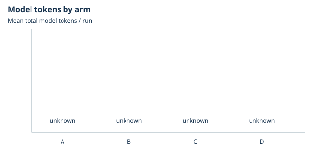
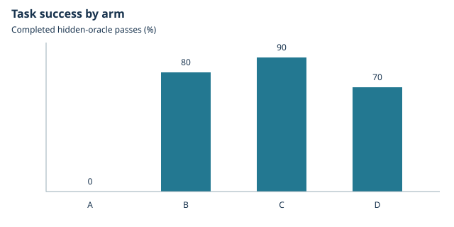
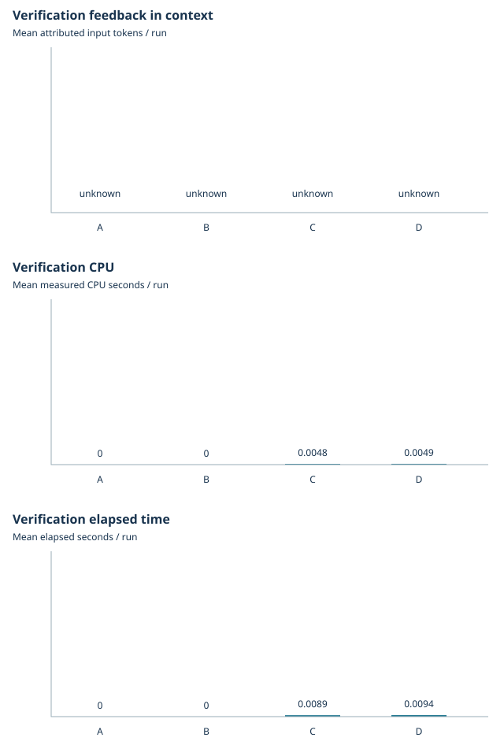
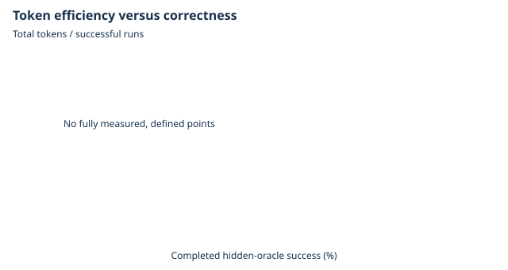
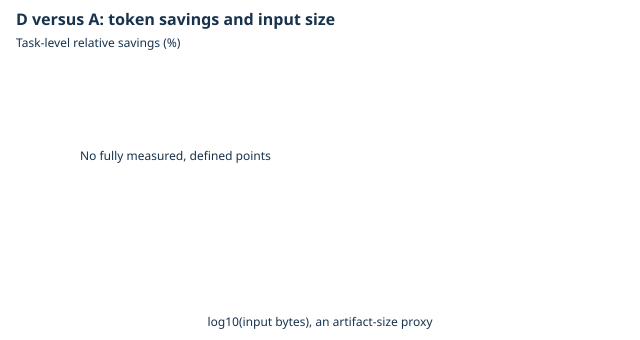
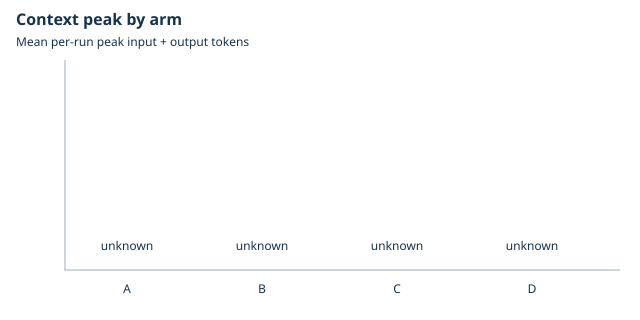
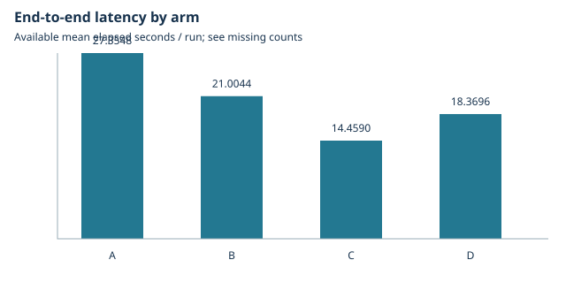

# Verified CLI Delegation Benchmark

**EXPLORATORY OBSERVATIONAL REPORT — NOT CONFIRMATORY**

## 1. Research question and hypotheses

When does CLI delegation with compact verification feedback reduce model tokens without reducing correctness? H1 tests efficiency and correctness separately. H2 tests size dependence and in-range crossover. H3 isolates raw verification and compression effects. H4 examines invocation-complexity limitations independently. No treatment advantage is assumed.

## 2. Experimental methodology

All supplied runs, including failures and incomplete runs, remain in arm summaries. Paired effects weight each task instance equally, retaining paired repetitions within task clusters. Main and pilot experiments are not inferred from the presence of data. The protocol and margin remain unfrozen.

```json
{
  "analysis_config": {
    "allow_synthetic": false,
    "bootstrap_samples": 2000,
    "bootstrap_seed": 2026,
    "expected_repetitions": 5,
    "expected_tasks": 2,
    "margin_justification": "Draft margin: at most one additional failure per 20 runs in a non-safety-critical workflow. This pilot does not test it; the main protocol must justify and freeze it.",
    "minimum_clusters": 2,
    "non_inferiority_margin": 0.05
  },
  "decoding": {
    "max_output_tokens": 8192,
    "reasoning_effort": "none"
  },
  "expected_records": 40,
  "matrix_complete": true,
  "missing_cells": [],
  "model": "gpt-6-luna",
  "protocol_violation_runs": 0,
  "records": 40,
  "unidentified_missing_tasks": 0
}
```

## 3. Dataset description

Inputs and requirements are validated against run manifests. Input byte count is an artifact-size proxy, not final-output size. Expected error tasks are retained; the boundary model controls for expected failure when identifiable. Detailed family, size, complexity and outcome strata are in summary.json.

| Family / arm | Runs | Successes | Exact model tokens |
|---|---:|---:|---:|
| sorting / A | 10 | 0 | n/a |
| sorting / B | 10 | 8 | n/a |
| sorting / C | 10 | 9 | n/a |
| sorting / D | 10 | 7 | n/a |

## 4. Implementation architecture

Rust dataset generators, immutable originals, fresh Linux bubblewrap workspaces, single-process tool execution, independent feedback verification, bounded certificates, model adapters, host-only JSONL telemetry and a separate hidden oracle. Provider/tokenizer validation and protocol freeze remain prerequisites to a real study.

## 5. Token consumption by arm

Unknown usage is not zero; known totals are lower bounds whenever usage is incomplete.

| Arm | Runs | Exact tokens | Known tokens | Unknown-usage runs |
|---|---:|---:|---:|---:|
| A | 10 | n/a | 1192730 | 1 |
| B | 10 | n/a | 36496 | 1 |
| C | 10 | n/a | 37701 | 1 |
| D | 10 | n/a | 91106 | 2 |



## 6. Success rates by arm

Success requires completion and a hidden-oracle pass. Unknown oracle outcomes and resource-limited incomplete runs do not count as successes. Raw oracle pass and completeness remain distinct in raw records.

| Arm | Successes / runs | Success rate | Incomplete runs | Unknown oracle |
|---|---:|---:|---:|---:|
| A | 0 / 10 | 0 | 5 | 0 |
| B | 8 / 10 | 0.8000 | 1 | 0 |
| C | 9 / 10 | 0.9000 | 1 | 0 |
| D | 7 / 10 | 0.7000 | 2 | 0 |



## 7. Token efficiency and verification overhead

Efficiency is aggregate tokens across all runs divided by successful runs, never an average of per-run ratios. Zero successes or missing usage makes it undefined. Verification input tokens, CPU, wall time, memory and observed retries are separate costs; CPU is never converted to LLM tokens. See arm metrics in summary.json for measured/missing counts and attributed-input coverage.

| Arm | Tokens / success | Verifier input tokens | Verifier CPU seconds | Verifier elapsed seconds | Estimated monetary cost |
|---|---:|---:|---:|---:|---:|
| A | n/a | n/a | 0 | 0 | n/a |
| B | n/a | n/a | 0 | 0 | n/a |
| C | n/a | n/a | 0.0476 | 0.0888 | n/a |
| D | n/a | n/a | 0.0493 | 0.0938 | n/a |

Recorded pricing assumptions (null means unavailable):

```json
null
```





## 8. Token savings against artifact size

Paired relative savings are 1 − treatment/reference; positive values mean fewer treatment tokens. The chart uses ratios of task-level mean tokens, whereas the paired relative-effect estimate averages paired ratios within each task. Zero reference tokens produce an undefined ratio. Negative savings are retained. The exploratory SVD fit uses log token ratio with size × family, complexity and expected-failure interactions when identifiable. No crossover is extrapolated beyond its measured stratum.



```json
{
  "status": "not_estimable_incomplete_usage"
}
```

## 9. Context-usage comparison

Peak context is the largest reported input-plus-output call for each run. Complete artifacts are not injected into later model calls; arm A retains only chunk metadata. Input reads and raw feedback remain part of actual context. Missing usage prevents exact context-peak conclusions. Tool I/O volume, calls, attempts and retries are reported separately in summary.json.



## 10. Failure taxonomy and representative traces

Terminations count runs. Taxonomy counts encountered events, not mutually exclusive final failures; retries may recover. Verifier-reported semantic/format errors are marked as such, not treated as oracle truth. Unknown classifications remain unknown, including unclassified execution failures. Trace collection enriches summary-only data; absent trace coverage is not evidence that no errors occurred.

```json
{
  "failed_run_examples": {
    "adapter_error": [
      {
        "arm": "B",
        "oracle_error": null,
        "oracle_pass": false,
        "run_id": "1794870880260747250-736724",
        "task_id": "sorting-v0-s1",
        "termination": "adapter_error"
      },
      {
        "arm": "C",
        "oracle_error": null,
        "oracle_pass": false,
        "run_id": "1794871094598609345-736724",
        "task_id": "sorting-v0-s1",
        "termination": "adapter_error"
      },
      {
        "arm": "D",
        "oracle_error": null,
        "oracle_pass": false,
        "run_id": "1794871174304452799-736724",
        "task_id": "sorting-v0-s0",
        "termination": "adapter_error"
      }
    ],
    "finished": [
      {
        "arm": "B",
        "oracle_error": null,
        "oracle_pass": false,
        "run_id": "1794870568103556067-736724",
        "task_id": "sorting-v0-s1",
        "termination": "finished"
      },
      {
        "arm": "A",
        "oracle_error": null,
        "oracle_pass": false,
        "run_id": "1794870584372459199-736724",
        "task_id": "sorting-v0-s0",
        "termination": "finished"
      },
      {
        "arm": "A",
        "oracle_error": null,
        "oracle_pass": false,
        "run_id": "1794870976289132378-736724",
        "task_id": "sorting-v0-s0",
        "termination": "finished"
      }
    ],
    "resource_limit": [
      {
        "arm": "A",
        "oracle_error": null,
        "oracle_pass": false,
        "run_id": "1794870657868287597-736724",
        "task_id": "sorting-v0-s1",
        "termination": "resource_limit"
      },
      {
        "arm": "A",
        "oracle_error": null,
        "oracle_pass": false,
        "run_id": "1794870835815794203-736724",
        "task_id": "sorting-v0-s1",
        "termination": "resource_limit"
      },
      {
        "arm": "A",
        "oracle_error": null,
        "oracle_pass": false,
        "run_id": "1794871020529565611-736724",
        "task_id": "sorting-v0-s1",
        "termination": "resource_limit"
      }
    ]
  },
  "failure_taxonomy": {
    "argument_construction_failure": {
      "events": 0,
      "examples": [],
      "known_events": 0,
      "unit": "encountered_events_not_mutually_exclusive_final_run_failures"
    },
    "incorrect_transformation_semantics": {
      "events": 2,
      "examples": [
        {
          "arm": "D",
          "event": {
            "category": "incorrect_transformation_semantics",
            "detail": "ORDER_ERROR",
            "line": 13,
            "reported_by_verifier_not_oracle": true
          },
          "run_id": "1794871076049734037-736724",
          "task_id": "sorting-v0-s0",
          "trace": "pilot/runs/0021-sorting-v0-s0-D-r3/trace.jsonl"
        },
        {
          "arm": "D",
          "event": {
            "category": "incorrect_transformation_semantics",
            "detail": "ORDER_ERROR",
            "line": 18,
            "reported_by_verifier_not_oracle": true
          },
          "run_id": "1794871076049734037-736724",
          "task_id": "sorting-v0-s0",
          "trace": "pilot/runs/0021-sorting-v0-s0-D-r3/trace.jsonl"
        }
      ],
      "known_events": 2,
      "unit": "encountered_events_not_mutually_exclusive_final_run_failures"
    },
    "model_context_or_output_limit_failure": {
      "events": 0,
      "examples": [],
      "known_events": 0,
      "unit": "encountered_events_not_mutually_exclusive_final_run_failures"
    },
    "permission_or_safety_rejection": {
      "events": 0,
      "examples": [],
      "known_events": 0,
      "unit": "encountered_events_not_mutually_exclusive_final_run_failures"
    },
    "resource_limit_failure": {
      "events": 5,
      "examples": [
        {
          "arm": "A",
          "event": {
            "category": "resource_limit_failure",
            "detail": "resource_limit"
          },
          "run_id": "1794870657868287597-736724",
          "task_id": "sorting-v0-s1",
          "trace": "pilot/runs/0006-sorting-v0-s1-A-r2/trace.jsonl"
        },
        {
          "arm": "A",
          "event": {
            "category": "resource_limit_failure",
            "detail": "resource_limit"
          },
          "run_id": "1794870835815794203-736724",
          "task_id": "sorting-v0-s1",
          "trace": "pilot/runs/0012-sorting-v0-s1-A-r4/trace.jsonl"
        },
        {
          "arm": "A",
          "event": {
            "category": "resource_limit_failure",
            "detail": "resource_limit"
          },
          "run_id": "1794871020529565611-736724",
          "task_id": "sorting-v0-s1",
          "trace": "pilot/runs/0018-sorting-v0-s1-A-r0/trace.jsonl"
        }
      ],
      "known_events": 5,
      "unit": "encountered_events_not_mutually_exclusive_final_run_failures"
    },
    "syntax_or_parsing_failure": {
      "events": 87,
      "examples": [
        {
          "arm": "B",
          "event": {
            "category": "syntax_or_parsing_failure",
            "detail": "trailing characters at line 1 column 59",
            "line": 4
          },
          "run_id": "1794870568103556067-736724",
          "task_id": "sorting-v0-s1",
          "trace": "pilot/runs/0000-sorting-v0-s1-B-r1/trace.jsonl"
        },
        {
          "arm": "B",
          "event": {
            "category": "syntax_or_parsing_failure",
            "detail": "trailing characters at line 1 column 59",
            "line": 8
          },
          "run_id": "1794870568103556067-736724",
          "task_id": "sorting-v0-s1",
          "trace": "pilot/runs/0000-sorting-v0-s1-B-r1/trace.jsonl"
        },
        {
          "arm": "A",
          "event": {
            "category": "syntax_or_parsing_failure",
            "detail": "trailing characters at line 1 column 59",
            "line": 4
          },
          "run_id": "1794870584372459199-736724",
          "task_id": "sorting-v0-s0",
          "trace": "pilot/runs/0001-sorting-v0-s0-A-r4/trace.jsonl"
        }
      ],
      "known_events": 87,
      "unit": "encountered_events_not_mutually_exclusive_final_run_failures"
    },
    "tool_selection_failure": {
      "events": 0,
      "examples": [],
      "known_events": 0,
      "unit": "encountered_events_not_mutually_exclusive_final_run_failures"
    },
    "verifier_false_negative": {
      "evaluated_runs": 17,
      "events": 0,
      "unit": "evaluable_final_verifier_oracle_runs"
    },
    "verifier_false_positive": {
      "evaluated_runs": 17,
      "events": 0,
      "unit": "evaluable_final_verifier_oracle_runs"
    }
  },
  "terminations": {
    "adapter_error": 5,
    "finished": 31,
    "resource_limit": 4
  },
  "trace_classified_runs": 40,
  "verifier_disagreement": {
    "evaluated_runs": 17,
    "false_negative": 0,
    "false_negative_rate": 0.0,
    "false_positive": 0,
    "false_positive_rate": 0.0,
    "oracle_negative_runs": 1,
    "oracle_positive_runs": 16,
    "tool_arm_runs_without_evaluable_final_pair": 3
  }
}
```

## 11. Statistical uncertainty

All intervals are exploratory. Percentile bootstrap resamples task instances with replacement and preserves all matched repetitions in each selected cluster; repeated runs are not independent samples. Paired differences are treatment minus reference. Non-inferiority uses a one-sided 95% lower bound and is separate from a two-sided 95% token interval. Too few clusters, missing matrix cells, protocol violations or unknown usage prevent the corresponding support claim. Secondary comparisons are not multiplicity-adjusted and are not confirmatory.

A degenerate bootstrap is not proof of zero failure risk. For all-nonnegative or constant observed task success differences, the success lower bound is also capped by m·0.05^(1/n) − (1−0.05^(1/n)), where m is the minimum observed cluster difference and n is the task count. This conservative unseen-task risk guard shares the task-sampling assumptions; it is not a guarantee outside this dataset. In particular, 48 perfect ties do not establish a five-point margin under this guard.

| Treatment − reference | Task clusters | Mean token difference | Token CI95 | Mean success difference | NI lower bound |
|---|---:|---:|---|---:|---:|
| D − A | 2 | n/a | null | 0.7000 | -0.6422 |
| B − A | 2 | n/a | null | 0.8000 | -0.6422 |
| C − B | 2 | n/a | null | 0.1000 | -0.7764 |
| D − C | 2 | n/a | null | -0.2000 | -0.4000 |
| D − B | 2 | n/a | null | -0.1000 | -0.4000 |

## 12. Threats to validity

- Protocol and margin are not frozen: all inference is exploratory.
- Bootstrap resamples task instances, retaining all paired repetitions within each cluster; repeated runs are not independent dataset instances.
- Equal task weighting is used for paired effects; arm summaries include every supplied run, including failures and incomplete runs.
- Missing usage suppresses exact token comparisons and efficiency. Reported known totals are lower bounds, not imputed zeros.
- Non-inferiority is separate from token reduction; no-worse-observed clusters use a conservative zero-event risk guard.
- Related semantic variants at multiple sizes may remain correlated across task clusters; interpret task-instance bootstrap uncertainty conditionally.
- Input bytes are an artifact-size proxy, not measured final-output bytes.
- Summary-only data cannot distinguish every tool-selection, argument, parsing or permission error. Consult host traces; do not infer absent errors from unclassified counts.
- Synthetic cohorts are fixture validation only and cannot support scientific conclusions.
- The size model includes failed and incomplete paired runs. It estimates token cost, not correctness-adjusted efficiency; per-task success rates accompany its points.

## 13. Boundary conditions and negative findings

These observations do not discard negative results. Point estimates are not declarations of statistical significance. Synthetic observations validate report logic only.

- D versus C: success decreased at the point estimate. Token savings do not compensate for correctness loss.
- D versus B: success decreased at the point estimate. Token savings do not compensate for correctness loss.
- Success non-inferiority is not established; lower token consumption alone cannot establish H1.
- Incomplete usage prevents exact token-efficiency and paired-token conclusions for affected comparisons.
- Arm A: zero successful runs; token efficiency is undefined.



## 14. Conclusions and reproducibility

Token reduction alone is insufficient to establish an overall improvement. Hypotheses are evaluated independently; the report can show no advantage or no established non-inferiority. Synthetic fixtures support none of the scientific hypotheses.

```json
{
  "H1": "non_inferiority_not_established",
  "H2": {
    "boundary_status": "not_estimable_incomplete_usage",
    "status": "exploratory_size_interactions_only",
    "warning": "Size trends and crossovers are stratum-specific; no universal advantage or out-of-range crossover is asserted."
  },
  "H3": {
    "compression_delta": {
      "ci95": null,
      "estimate": null,
      "reason": "incomplete_usage; known lower bounds not substituted for totals"
    },
    "compression_reduces_tokens": false,
    "raw_verification_delta": {
      "ci95": null,
      "estimate": null,
      "reason": "incomplete_usage; known lower bounds not substituted for totals"
    },
    "raw_verification_increases_tokens": false,
    "status": "exploratory_only",
    "verification_input_attribution_complete": false,
    "warning": "Execution CPU and latency are not LLM tokens. Attribution, runtime, resources and observed retries are separate quantities; compression is not assumed beneficial."
  },
  "H4": {
    "invocation_measured_runs": 30,
    "invocation_relationships": {
      "log_argument_bytes_vs_D_A_token_savings": {
        "ci95": null,
        "estimate": null,
        "inference_eligible": false,
        "status": "not_estimable_insufficient_points_or_variation",
        "task_clusters": 0,
        "valid_bootstraps": 0
      },
      "log_argument_bytes_vs_interface_errors": {
        "ci95": null,
        "estimate": -0.14981457934145045,
        "inference_eligible": true,
        "status": "observational_correlation_not_causation",
        "task_clusters": 2,
        "valid_bootstraps": 1515
      },
      "log_argument_bytes_vs_success": {
        "ci95": [
          0.09383486349562263,
          0.9972145035047423
        ],
        "estimate": 0.6991326451132069,
        "inference_eligible": true,
        "status": "observational_correlation_not_causation",
        "task_clusters": 2,
        "valid_bootstraps": 2000
      },
      "observed_tool_task_arm_groups": 6,
      "paired_D_A_points": [],
      "status": "secondary_observational_only",
      "task_arm_points": [
        {
          "arm": "B",
          "family": "sorting",
          "mean_argument_bytes": 380.4,
          "mean_interface_errors": 0.0,
          "mean_tool_requests": 1.0,
          "semantic_complexity": "simple",
          "success_rate": 1.0,
          "task_id": "sorting-v0-s0"
        },
        {
          "arm": "C",
          "family": "sorting",
          "mean_argument_bytes": 387.4,
          "mean_interface_errors": 0.0,
          "mean_tool_requests": 1.0,
          "semantic_complexity": "simple",
          "success_rate": 1.0,
          "task_id": "sorting-v0-s0"
        },
        {
          "arm": "D",
          "family": "sorting",
          "mean_argument_bytes": 310.8,
          "mean_interface_errors": 0.2,
          "mean_tool_requests": 1.0,
          "semantic_complexity": "simple",
          "success_rate": 0.6,
          "task_id": "sorting-v0-s0"
        },
        {
          "arm": "B",
          "family": "sorting",
          "mean_argument_bytes": 292.4,
          "mean_interface_errors": 0.0,
          "mean_tool_requests": 0.8,
          "semantic_complexity": "simple",
          "success_rate": 0.6,
          "task_id": "sorting-v0-s1"
        },
        {
          "arm": "C",
          "family": "sorting",
          "mean_argument_bytes": 342.4,
          "mean_interface_errors": 0.0,
          "mean_tool_requests": 0.8,
          "semantic_complexity": "simple",
          "success_rate": 0.8,
          "task_id": "sorting-v0-s1"
        },
        {
          "arm": "D",
          "family": "sorting",
          "mean_argument_bytes": 261.0,
          "mean_interface_errors": 0.0,
          "mean_tool_requests": 0.8,
          "semantic_complexity": "simple",
          "success_rate": 0.8,
          "task_id": "sorting-v0-s1"
        }
      ],
      "unmeasured_tool_task_arm_groups": 0,
      "warning": "Correlations use log1p serialized argv JSON bytes and bootstrap whole tasks, retaining their arms and repetitions. Missing matrix or trace data limit the available-data summaries. Invocation choices are model-dependent and confounded by difficulty and repairs. No causal complexity penalty is established."
    },
    "semantic_complexity_strata": {
      "simple / A": {
        "incomplete_runs": 5,
        "known_total_tokens": 1192730.0,
        "mean_tokens": null,
        "metrics": {
          "attempts": {
            "known_sum": 5.0,
            "measured_runs": 10,
            "missing_runs": 0,
            "sum": 5.0
          },
          "cached_input_tokens": {
            "known_sum": 168960.0,
            "measured_runs": 10,
            "missing_runs": 0,
            "sum": null
          },
          "context_peak": {
            "known_maximum": 33334.0,
            "maximum": null,
            "mean": null,
            "measured_runs": 10,
            "missing_runs": 0
          },
          "end_to_end_seconds": {
            "known_maximum": 92.048615411,
            "maximum": 92.048615411,
            "mean": 27.354757163399995,
            "measured_runs": 10,
            "missing_runs": 0
          },
          "feedback_input_tokens": {
            "known_sum": -0.0,
            "measured_runs": 0,
            "missing_runs": 10,
            "sum": null
          },
          "input_tokens": {
            "known_sum": 1188481.0,
            "measured_runs": 10,
            "missing_runs": 0,
            "sum": null
          },
          "invocation_argument_bytes": {
            "known_sum": 0.0,
            "measured_runs": 10,
            "missing_runs": 0,
            "sum": 0.0
          },
          "monetary_cost": {
            "known_sum": -0.0,
            "measured_runs": 0,
            "missing_runs": 10,
            "sum": null
          },
          "output_tokens": {
            "known_sum": 4249.0,
            "measured_runs": 10,
            "missing_runs": 0,
            "sum": null
          },
          "retries": {
            "known_sum": 0.0,
            "measured_runs": 10,
            "missing_runs": 0,
            "sum": 0.0
          },
          "retries_after_negative_verification": {
            "known_sum": 0.0,
            "measured_runs": 10,
            "missing_runs": 0,
            "sum": 0.0
          },
          "returned_feedback_bytes": {
            "known_sum": 227955.0,
            "measured_runs": 10,
            "missing_runs": 0,
            "sum": 227955.0
          },
          "schema_input_tokens": {
            "known_sum": -0.0,
            "measured_runs": 0,
            "missing_runs": 10,
            "sum": null
          },
          "tool_errors": {
            "known_sum": 0.0,
            "measured_runs": 10,
            "missing_runs": 0,
            "sum": 0.0
          },
          "tool_invocations": {
            "known_sum": 0.0,
            "measured_runs": 10,
            "missing_runs": 0,
            "sum": 0.0
          },
          "tool_output_bytes": {
            "known_sum": 0.0,
            "measured_runs": 10,
            "missing_runs": 0,
            "sum": 0.0
          },
          "verification_input_tokens": {
            "known_sum": -0.0,
            "measured_runs": 0,
            "missing_runs": 10,
            "sum": null
          },
          "verifier_cpu_seconds": {
            "known_sum": 0.0,
            "measured_runs": 10,
            "missing_runs": 0,
            "sum": 0.0
          },
          "verifier_elapsed_seconds": {
            "known_sum": 0.0,
            "measured_runs": 10,
            "missing_runs": 0,
            "sum": 0.0
          },
          "verifier_peak_rss_bytes_max": {
            "known_maximum": null,
            "maximum": null,
            "mean": null,
            "measured_runs": 0,
            "missing_runs": 10
          }
        },
        "oracle_unknown_runs": 0,
        "runs": 10,
        "success_rate": 0.0,
        "successes": 0,
        "token_efficiency": null,
        "token_efficiency_reason": "zero_successful_runs",
        "total_tokens": null,
        "usage_incomplete_runs": 1
      },
      "simple / B": {
        "incomplete_runs": 1,
        "known_total_tokens": 36496.0,
        "mean_tokens": null,
        "metrics": {
          "attempts": {
            "known_sum": 9.0,
            "measured_runs": 10,
            "missing_runs": 0,
            "sum": 9.0
          },
          "cached_input_tokens": {
            "known_sum": 0.0,
            "measured_runs": 10,
            "missing_runs": 0,
            "sum": null
          },
          "context_peak": {
            "known_maximum": 3015.0,
            "maximum": null,
            "mean": null,
            "measured_runs": 10,
            "missing_runs": 0
          },
          "end_to_end_seconds": {
            "known_maximum": 96.024519101,
            "maximum": 96.024519101,
            "mean": 21.0043633913,
            "measured_runs": 10,
            "missing_runs": 0
          },
          "feedback_input_tokens": {
            "known_sum": -0.0,
            "measured_runs": 0,
            "missing_runs": 10,
            "sum": null
          },
          "input_tokens": {
            "known_sum": 32819.0,
            "measured_runs": 10,
            "missing_runs": 0,
            "sum": null
          },
          "invocation_argument_bytes": {
            "known_sum": 3364.0,
            "measured_runs": 10,
            "missing_runs": 0,
            "sum": 3364.0
          },
          "monetary_cost": {
            "known_sum": -0.0,
            "measured_runs": 0,
            "missing_runs": 10,
            "sum": null
          },
          "output_tokens": {
            "known_sum": 3677.0,
            "measured_runs": 10,
            "missing_runs": 0,
            "sum": null
          },
          "retries": {
            "known_sum": 0.0,
            "measured_runs": 10,
            "missing_runs": 0,
            "sum": 0.0
          },
          "retries_after_negative_verification": {
            "known_sum": 0.0,
            "measured_runs": 10,
            "missing_runs": 0,
            "sum": 0.0
          },
          "returned_feedback_bytes": {
            "known_sum": 7168.0,
            "measured_runs": 10,
            "missing_runs": 0,
            "sum": 7168.0
          },
          "schema_input_tokens": {
            "known_sum": -0.0,
            "measured_runs": 0,
            "missing_runs": 10,
            "sum": null
          },
          "tool_errors": {
            "known_sum": 0.0,
            "measured_runs": 10,
            "missing_runs": 0,
            "sum": 0.0
          },
          "tool_invocations": {
            "known_sum": 9.0,
            "measured_runs": 10,
            "missing_runs": 0,
            "sum": 9.0
          },
          "tool_output_bytes": {
            "known_sum": 0.0,
            "measured_runs": 10,
            "missing_runs": 0,
            "sum": 0.0
          },
          "verification_input_tokens": {
            "known_sum": -0.0,
            "measured_runs": 0,
            "missing_runs": 10,
            "sum": null
          },
          "verifier_cpu_seconds": {
            "known_sum": 0.0,
            "measured_runs": 10,
            "missing_runs": 0,
            "sum": 0.0
          },
          "verifier_elapsed_seconds": {
            "known_sum": 0.0,
            "measured_runs": 10,
            "missing_runs": 0,
            "sum": 0.0
          },
          "verifier_peak_rss_bytes_max": {
            "known_maximum": null,
            "maximum": null,
            "mean": null,
            "measured_runs": 0,
            "missing_runs": 10
          }
        },
        "oracle_unknown_runs": 0,
        "runs": 10,
        "success_rate": 0.8,
        "successes": 8,
        "token_efficiency": null,
        "token_efficiency_reason": "incomplete_usage",
        "total_tokens": null,
        "usage_incomplete_runs": 1
      },
      "simple / C": {
        "incomplete_runs": 1,
        "known_total_tokens": 37701.0,
        "mean_tokens": null,
        "metrics": {
          "attempts": {
            "known_sum": 9.0,
            "measured_runs": 10,
            "missing_runs": 0,
            "sum": 9.0
          },
          "cached_input_tokens": {
            "known_sum": 1920.0,
            "measured_runs": 10,
            "missing_runs": 0,
            "sum": null
          },
          "context_peak": {
            "known_maximum": 2272.0,
            "maximum": null,
            "mean": null,
            "measured_runs": 10,
            "missing_runs": 0
          },
          "end_to_end_seconds": {
            "known_maximum": 27.724848402,
            "maximum": 27.724848402,
            "mean": 14.459025115099996,
            "measured_runs": 10,
            "missing_runs": 0
          },
          "feedback_input_tokens": {
            "known_sum": -0.0,
            "measured_runs": 0,
            "missing_runs": 10,
            "sum": null
          },
          "input_tokens": {
            "known_sum": 33290.0,
            "measured_runs": 10,
            "missing_runs": 0,
            "sum": null
          },
          "invocation_argument_bytes": {
            "known_sum": 3649.0,
            "measured_runs": 10,
            "missing_runs": 0,
            "sum": 3649.0
          },
          "monetary_cost": {
            "known_sum": -0.0,
            "measured_runs": 0,
            "missing_runs": 10,
            "sum": null
          },
          "output_tokens": {
            "known_sum": 4411.0,
            "measured_runs": 10,
            "missing_runs": 0,
            "sum": null
          },
          "retries": {
            "known_sum": 0.0,
            "measured_runs": 10,
            "missing_runs": 0,
            "sum": 0.0
          },
          "retries_after_negative_verification": {
            "known_sum": 0.0,
            "measured_runs": 10,
            "missing_runs": 0,
            "sum": 0.0
          },
          "returned_feedback_bytes": {
            "known_sum": 4765.0,
            "measured_runs": 10,
            "missing_runs": 0,
            "sum": 4765.0
          },
          "schema_input_tokens": {
            "known_sum": -0.0,
            "measured_runs": 0,
            "missing_runs": 10,
            "sum": null
          },
          "tool_errors": {
            "known_sum": 0.0,
            "measured_runs": 10,
            "missing_runs": 0,
            "sum": 0.0
          },
          "tool_invocations": {
            "known_sum": 9.0,
            "measured_runs": 10,
            "missing_runs": 0,
            "sum": 9.0
          },
          "tool_output_bytes": {
            "known_sum": 0.0,
            "measured_runs": 10,
            "missing_runs": 0,
            "sum": 0.0
          },
          "verification_input_tokens": {
            "known_sum": -0.0,
            "measured_runs": 0,
            "missing_runs": 10,
            "sum": null
          },
          "verifier_cpu_seconds": {
            "known_sum": 0.047623171,
            "measured_runs": 10,
            "missing_runs": 0,
            "sum": 0.047623171
          },
          "verifier_elapsed_seconds": {
            "known_sum": 0.08882484799999998,
            "measured_runs": 10,
            "missing_runs": 0,
            "sum": 0.08882484799999998
          },
          "verifier_peak_rss_bytes_max": {
            "known_maximum": 49377280.0,
            "maximum": 49377280.0,
            "mean": 48963584.0,
            "measured_runs": 9,
            "missing_runs": 1
          }
        },
        "oracle_unknown_runs": 0,
        "runs": 10,
        "success_rate": 0.9,
        "successes": 9,
        "token_efficiency": null,
        "token_efficiency_reason": "incomplete_usage",
        "total_tokens": null,
        "usage_incomplete_runs": 1
      },
      "simple / D": {
        "incomplete_runs": 2,
        "known_total_tokens": 91106.0,
        "mean_tokens": null,
        "metrics": {
          "attempts": {
            "known_sum": 9.0,
            "measured_runs": 10,
            "missing_runs": 0,
            "sum": 9.0
          },
          "cached_input_tokens": {
            "known_sum": 6784.0,
            "measured_runs": 10,
            "missing_runs": 0,
            "sum": null
          },
          "context_peak": {
            "known_maximum": 3522.0,
            "maximum": null,
            "mean": null,
            "measured_runs": 10,
            "missing_runs": 0
          },
          "end_to_end_seconds": {
            "known_maximum": 51.536194279,
            "maximum": 51.536194279,
            "mean": 18.3696231421,
            "measured_runs": 10,
            "missing_runs": 0
          },
          "feedback_input_tokens": {
            "known_sum": 0.0,
            "measured_runs": 1,
            "missing_runs": 9,
            "sum": null
          },
          "input_tokens": {
            "known_sum": 85482.0,
            "measured_runs": 10,
            "missing_runs": 0,
            "sum": null
          },
          "invocation_argument_bytes": {
            "known_sum": 2859.0,
            "measured_runs": 10,
            "missing_runs": 0,
            "sum": 2859.0
          },
          "monetary_cost": {
            "known_sum": -0.0,
            "measured_runs": 0,
            "missing_runs": 10,
            "sum": null
          },
          "output_tokens": {
            "known_sum": 5624.0,
            "measured_runs": 10,
            "missing_runs": 0,
            "sum": null
          },
          "retries": {
            "known_sum": 1.0,
            "measured_runs": 10,
            "missing_runs": 0,
            "sum": 1.0
          },
          "retries_after_negative_verification": {
            "known_sum": 1.0,
            "measured_runs": 10,
            "missing_runs": 0,
            "sum": 1.0
          },
          "returned_feedback_bytes": {
            "known_sum": 13613.0,
            "measured_runs": 10,
            "missing_runs": 0,
            "sum": 13613.0
          },
          "schema_input_tokens": {
            "known_sum": 0.0,
            "measured_runs": 1,
            "missing_runs": 9,
            "sum": null
          },
          "tool_errors": {
            "known_sum": 1.0,
            "measured_runs": 10,
            "missing_runs": 0,
            "sum": 1.0
          },
          "tool_invocations": {
            "known_sum": 9.0,
            "measured_runs": 10,
            "missing_runs": 0,
            "sum": 9.0
          },
          "tool_output_bytes": {
            "known_sum": 0.0,
            "measured_runs": 10,
            "missing_runs": 0,
            "sum": 0.0
          },
          "verification_input_tokens": {
            "known_sum": 0.0,
            "measured_runs": 1,
            "missing_runs": 9,
            "sum": null
          },
          "verifier_cpu_seconds": {
            "known_sum": 0.04933569300000001,
            "measured_runs": 10,
            "missing_runs": 0,
            "sum": 0.04933569300000001
          },
          "verifier_elapsed_seconds": {
            "known_sum": 0.09375297600000002,
            "measured_runs": 10,
            "missing_runs": 0,
            "sum": 0.09375297600000002
          },
          "verifier_peak_rss_bytes_max": {
            "known_maximum": 49377280.0,
            "maximum": 49377280.0,
            "mean": 48335872.0,
            "measured_runs": 8,
            "missing_runs": 2
          }
        },
        "oracle_unknown_runs": 0,
        "runs": 10,
        "success_rate": 0.7,
        "successes": 7,
        "token_efficiency": null,
        "token_efficiency_reason": "incomplete_usage",
        "total_tokens": null,
        "usage_incomplete_runs": 2
      }
    },
    "status": "secondary_exploratory_only",
    "warning": "Task semantic complexity is not measured CLI invocation complexity. Collect host traces to obtain invocation count/argument volume; no causal claim follows from these observational strata."
  }
}
```

Regenerate from the repository root, preserving Cargo.lock:

```sh
cargo run --locked -- analyze REPORT_DIRECTORY/records.jsonl NEW_OUTPUT REPORT_DIRECTORY/config.json
```

The report bundles source records, normalized analysis settings, summary.json and seven SVGs. Source hashes are in summary.json. Keep original run directories for full prompts, provider payloads, tool output and environment evidence. This report contains no invented missing values and no claim that the main experiment has been run.
